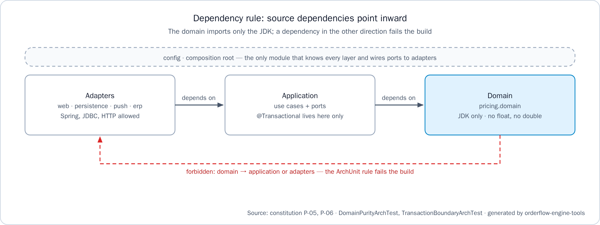
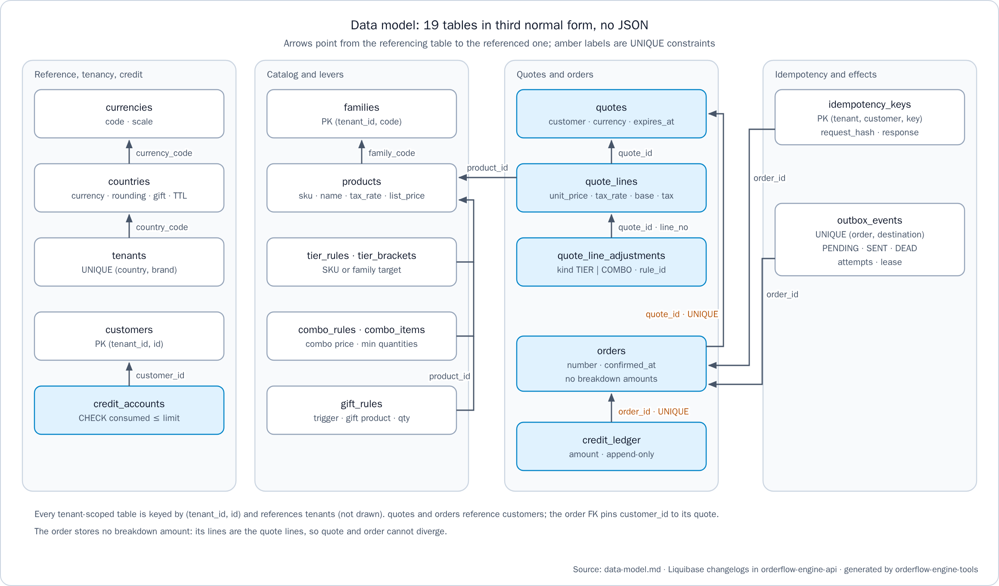

# Orderflow Engine: Architecture of a Multi-Country Order Pricing and Confirmation Service

> **Question this document answers:** which artifacts make up Orderflow Engine, and what does each one do and why?

Orderflow Engine — Tech Lead technical assessment

# Abstract

Orderflow Engine prices and confirms the orders that shopkeepers place with beverage distributors on a multi-tenant, multi-country business-to-business marketplace. This report describes its architecture and inventories every artifact of the six repositories that deliver it: a Java 21 and Spring Boot 4.1.1 service, an Angular 22 web client, a Docker Compose infrastructure, a governed documentation set, a repository of generators and checks, and a folder reserved for a future mobile app. The service is a hexagonal modular monolith. Its pure pricing domain applies gifts, combos, marginal tier discounts and per-line taxes in a fixed, justified order, with `BigDecimal` money rounded only per line at a scale read from country data. Quotes are sealed and insert-only, and an order references its quote without storing any amount, so the confirmed total equals the quoted total by construction. Confirmation runs in one PostgreSQL 17 transaction that locks the idempotency key, the quote and the credit account in that order, and it answers 201 only after the commit. Push and ERP effects leave through a transactional outbox with a leased relay, and consumers deduplicate them by event id. The report also covers the data model, internationalization, delivery and the verified evidence: 333 unit and 308 integration tests, full line and branch coverage of the pricing domain, 185 of 185 mutations detected, 209 web specs and an end-to-end flow in Spanish and English. It closes with the risks, their mitigations and what was consciously left out.

**Keywords:** pricing engine, idempotency, transactional outbox, hexagonal architecture, exact money arithmetic, multi-tenancy, PostgreSQL, Spring Boot, Angular

# Context and Quality Goals

## The Assignment

The assignment, kept unchanged in `orderflow-engine-docs/assignment/`, describes a business-to-business marketplace where shopkeepers buy from beverage distributors. The platform runs in several countries (Colombia, Ecuador, Guatemala and Peru, among others) and for several commercial brands, on one multi-tenant platform. An order moves through catalog, cart, checkout (the quote), confirmation and history. Five commercial levers act on the price and may coexist in one order: a tier discount by SKU or family, a combo, a gift, a tax rate per SKU and a customer credit limit.

The take-home has three parts. A1 asks for the pricing engine: a breakdown per line and totals, a defined and justified lever order, and a credit check. A2 asks for an order confirmation in which a defect seen in three releases becomes impossible: an order number was returned to the shopkeeper, and the order was later missing from the history, sometimes never recorded. A3 asks for one architecture decision record of at most one page. The delivery is a Git repository with a single test command, a README that explains how to run the service, the lever order, the rounding policy and the consistency model, the ADR, and a readable commit history. An optional front, time-boxed to one hour, is one order-summary screen judged on three past defects: truncated text, controls hidden by the system bar or the keyboard, and grid images scaled inconsistently.

## Quality Goals

The assignment names its non-functional requirements as the core of the exercise. The specification (`orderflow-engine-docs/spec/SPEC.md` §0) turns them into four guarantees, and the constitution (`spec/constitution.md`) adds fifteen principles, P-01 to P-15, each with the test or check that verifies it. Table 1 lists the quality goals, the mechanism that delivers each one and the evidence that proves it.

**Table 1.** Quality goals, mechanisms and evidence

| Goal | Mechanism | Verified by |
|------|-----------|-------------|
| G-1: the quoted total is the confirmed total, even if prices or levers change in between | A sealed, insert-only quote. The order references it and stores no amount | `QuoteConfirmRegressionIT` (golden test 6) |
| G-2: no floating point for money; scale, rounding rule and rounding points are explicit | A `Money` value object over `BigDecimal`, scale and mode from country data, rounding per line | `DomainPurityArchTest`, `MoneyTest`, `RoundingPolicyTest` |
| G-3: a 201 means the order exists and can be read; retries never duplicate orders or consume credit twice | One ACID transaction for order, credit, idempotency key and outbox; the reply after the commit | `ConfirmOrderCommitOrderingIT`, `OrderReadYourWritesIT`, `ConfirmOrderConcurrencyIT` |
| G-4: push and ERP effects are never lost and never applied twice | Transactional outbox, leased relay with retries, deduplication by `event_id` | `OutboxWriteIT`, `OutboxRelayIT` |
| Multi-country: no currency, scale or rate in the code | Country, tenant, price and lever data in tables | `GoldenPricingTest` (multi-country case), the Liquibase seeds |
| Front: no truncated text, no hidden control, consistent images | One component owns each defect | `order-summary.spec.ts`, `screen-rules.spec.ts` |

## Scope Boundary

SPEC §1 fixes the boundary. In scope are the quote, order, history and product-list operations, the pricing engine with its credit check, the outbox relay and retention housekeeping, internationalization in Spanish (default) and English, the Angular client, and a local run with Docker. Out of scope, each with its reason, are authentication (tenant and customer come from headers), catalog and lever administration (stores, products and levers are seeded by Liquibase changesets), real push and ERP integrations (fakes sit behind ports), a server-side cart, payment capture, cancellation and credit release, quote revocation, deployment, cloud infrastructure and an OpenAPI file.

The front carries one recorded deviation. On 2026-10-15 the product owner extended the one-hour order-summary screen to the full flow: cart, quote, confirmation, order and My orders, with a store picker. The API deliverable neither depends on nor waits for it, and the measured time is recorded in three parts in the API README under "Not included": the assignment's screen took 68 minutes; its container, the full stack and the web step of the workspace test command took 55 minutes; and the extension took 3 hours 1 minute.

## Sources and Conventions of This Report

Every statement about the system was verified by reading the repositories: source code, changelogs, Docker and Compose files, scripts, READMEs, the specification set and the handoff. Project artifacts are cited by workspace-relative path and by section or code (for example, SPEC §7.1, DEC-05 or AC-26), because they are the subject of the report rather than literature. External works are cited in the author-date style of the American Psychological Association (2020). Figures are the generated diagrams of `orderflow-engine-docs/diagrams/`, numbered by first appearance, so Figure 1 is `01-runtime-topology` and Figure 9 is `09-outbox-lifecycle`. The verified numbers come from the state table of `orderflow-engine-docs/handoff/HANDOFF.md` §3, the only place where the verified state lives.

# System Overview

## Runtime Topology

At run time the system has one deployable service, one database and one web client. As Figure 1 shows, the browser talks only to the web container, whose nginx serves the built Angular client and forwards `/api/` to the service. The service holds the web adapter, the use cases, the pure pricing engine, the persistence adapter and the outbox relay. PostgreSQL is the single source of truth. Push and the ERP are reached only by the relay, after the order is committed (principles P-04 and P-05).


Table 2 lists the runtime elements of the full stack started by `orderflow-engine-infra/compose.yaml`.

**Table 2.** Runtime elements of the full stack

| Element | Technology | Port | Responsibility |
|---------|------------|------|----------------|
| Web client | Angular 22.2.3, served by nginx-unprivileged 1.30.6 | 8081 on the host, 8080 inside the container | Serves the client and forwards `/api/` to the service |
| Service | Java 21, Spring Boot 4.1.1 | 8080 | Prices carts, seals quotes, confirms orders, serves history and the product list, relays outbox events, runs housekeeping |
| Database | PostgreSQL 17 | Not published to the host | Catalog, levers, credit, quotes, orders, idempotency keys and outbox |
| Push and ERP gateways | Fake adapters inside the service | — | Receive the confirmed order, deduplicate by `event_id`, and can be told to fail |

## Workspace Repositories

The workspace is six sibling folders, each a GitHub repository, private during the work and public at delivery, with its own README in English and Spanish and an MIT license. As Figure 2 shows, the specification in `orderflow-engine-docs` governs all of them, `orderflow-engine-tools` generates the figures and deliverables kept in the documentation repository, and `orderflow-engine-infra` builds and tests the service and the web client. Decision DEC-15 chose separate repositories over a monorepo because the service, the screen, the infrastructure and the documentation are released, owned and evolved independently, while `orderflow-engine-api` still stands alone as the deliverable.


Table 3 summarizes the role of each repository and its long-lived branches.

**Table 3.** Repositories of the workspace

| Repository | Role | Long-lived branches |
|------------|------|---------------------|
| `orderflow-engine-api` | The deliverable: service, tests, single command, README and ADR | `main`, `dev` |
| `orderflow-engine-web` | The Angular client: the order summary and the flow around it | `main`, `dev` |
| `orderflow-engine-infra` | Full-stack Compose file, workspace test command, end-to-end suite | `main`, `dev` |
| `orderflow-engine-docs` | Specification, governance, handoff, figures, rendered deliverables | `main` only |
| `orderflow-engine-tools` | Generators and checks for documents and repositories | `main`, `dev` |
| `orderflow-engine-app` | Reserved for a future mobile app; nothing is built | `main`, `dev` |

# Artifact Inventory

This section inventories the artifacts of each repository. The tables name each artifact by its location and state what it contains and why it exists.

## The Service Repository

`orderflow-engine-api` holds all the code and tests that the assignment evaluates. Its Java sources live under `src/main/java/com/orderflow/engine`, and Table 4 lists them with the build, resources, tests and container files.

**Table 4.** Artifacts of `orderflow-engine-api`

| Location | Contents and purpose |
|----------|----------------------|
| `pom.xml`, `mvnw`, `mvnw.cmd`, `.mvn/` | Maven Wrapper build on the Spring Boot 4.1.1 parent for Java 21. `./mvnw verify` runs every test and the JaCoCo 0.8.15 coverage gate; the optional `mutation` profile runs PIT 1.30.1 |
| `pricing/domain` | `Money`, `CurrencyPolicy`, `Cart`, `CartLine`, `CartNormalizer`, `PricingSnapshot`, `PricingEngine`, `Breakdown`, `LineBreakdown`, `Totals`, `Discount`, `ComboAllocation`, `Gift` |
| `pricing/domain/lever` | The lever steps and rules: `GiftStep`, `GiftRule`, `GiftTaxPolicy`, `ComboStep`, `ComboRule`, `LargestRemainderAllocator`, `TierDiscountStep`, `TierRule` |
| `quoting` | `CreateQuoteUseCase`, `GetQuoteUseCase`, `ListProductsUseCase`, the derived `QuoteStatus`, and the ports `SnapshotProvider`, `QuoteRepository`, `CreditAdvisor`, `ProductCatalog` |
| `ordering` | `ConfirmOrderUseCase`, `GetOrderUseCase`, `ListOrdersUseCase`, and the ports `OrderRepository`, `CreditLedger`, `IdempotencyStore`, `OutboxWriter` |
| `outbox` | `OutboxRelay`, `BackoffPolicy`, `HousekeepingJob`, and the ports `PushNotificationPort`, `ErpPublisherPort`, `OutboxRepository`, `HousekeepingStore` |
| `adapters/in/web` | `QuoteController`, `OrderController`, `ProductController`, request and response records, `ProblemDetailsAdvice`, `ErrorCode`, `CorrelationIdFilter`, `LocaleConfig`, `RequestHash` |
| `adapters/out/persistence` | `JdbcClient` repositories with explicit SQL and locks, `LockWaits`, `MoneyColumns`, `UuidV7Generator` |
| `adapters/out/push`, `adapters/out/erp` | `FakePushGateway` and `FakeErpGateway`, which deduplicate by `event_id` and can be told to fail |
| `config` | The composition root: `QuotingConfig`, `OrderingConfig`, `OutboxConfig` (relay and gauges), `HousekeepingConfig`, `TimeConfig` (the injected `Clock`) and typed properties |
| `application.yml`, `.env.example` | Defaults of every `app.*` key. The database connection comes only from environment variables, with no secret default |
| `db/changelog` | A master changelog that includes eight changelogs (33 changesets) in order: five create the schema, one seeds Colombia and Ecuador, one renames the seeds in Spanish, and one adds Guatemala and Peru |
| `i18n` | `messages.properties` (Spanish base), `messages_es.properties` and `messages_en.properties` |
| `src/test` | Unit, golden, contract, integration and architecture tests, and eleven golden fixture folders under `golden/` |
| `Dockerfile`, `compose.yaml` | A two-stage image (JDK 21 build with the wrapper, JRE 21 runtime as a non-root user, one layer per Spring Boot layer) and the service with its own PostgreSQL 17 |
| `README.md`, `README.es.md`, `docs/adr/` | How to run, lever order, rounding policy, consistency model, golden tests, ADR, not included, operations and repositories; ADR-0001 in English and Spanish |

## The Web Client Repository

`orderflow-engine-web` is a standalone Angular application (DEC-16) that consumes the API over relative `/api/` paths. Table 5 lists its artifacts.

**Table 5.** Artifacts of `orderflow-engine-web`

| Location | Contents and purpose |
|----------|----------------------|
| `package.json`, `angular.json` | Angular 22.2.3, ngx-translate 18.0.0, Vitest 5.0.5 with its Playwright browser provider, and Playwright 1.64.1. The unit-test builder runs the specs in headless Chromium |
| `src/app/app.routes.ts` | The four screens: `/cart` (also `/`), `/quotes/:quoteId`, `/orders/:orderId` and `/orders`. Any other path opens the cart |
| `src/app/pages` | The screens `cart`, `order-summary`, `order` and `history` |
| `src/app/breakdown` | Breakdown lines and totals, shared by the order summary and the order |
| `src/app/ui` | `ui-text`, `ui-action-bar`, `ui-product-image`, `ui-problem-notice` and `ui-notice` |
| `src/app/shell` | The header: navigation, the ES/EN switch and the store picker |
| `src/app/core` | API clients for quotes, orders and products, the header interceptor, the `money` pipe, the cart store, idempotency keys, store context, language, problem handling and browser storage |
| `src/testing` | Fixtures with very long names, the order-summary fixture with the shape of E-02, screen checks and a test harness |
| `public/i18n` | The `es.json` and `en.json` dictionaries |
| `public/config/stores.json` | The eight seeded stores of the store picker, two per tenant |
| `public/products` | One SVG image per seeded SKU and a placeholder |
| `scripts/no-literal-text.mjs` | Runs first in `npm test` and fails when a template holds literal text |
| `nginx/default.conf.template` | The nginx server: `/api/` forwarded to `API_UPSTREAM`, every other path falls back to `index.html` |
| `Dockerfile`, `compose.yaml`, `.env.example`, `proxy.conf.mjs` | A three-stage image (specs on the Playwright image, build on Node 24.21.0, serve on nginx-unprivileged 1.30.6), the client alone against an API on the host, and the development-server proxy |
| `README.md`, `README.es.md` | Scope, how to run, prevention at component level and what each spec proves |

## The Infrastructure Repository

`orderflow-engine-infra` is the only repository that references its siblings, because it builds and runs them together. Table 6 lists its artifacts.

**Table 6.** Artifacts of `orderflow-engine-infra`

| Location | Contents and purpose |
|----------|----------------------|
| `compose.yaml` | The full stack: `db` (postgres:17 with a health check and a named volume), `api` (built from `../orderflow-engine-api`) and `web` (built from `../orderflow-engine-web`, with `API_UPSTREAM`). Every service has `restart: unless-stopped` |
| `.env.example` | Every key with a comment and its default value: database, API port and locale, outbox, retention and web port |
| `scripts/test-all.sh`, `scripts/test-all.ps1` | The workspace test command in five steps, for bash and PowerShell |
| `scripts/e2e.sh`, `scripts/e2e.ps1` | The end-to-end step: version check, runner image, a stack on its own ports, the suite, and an unconditional teardown |
| `e2e/` | The Playwright suite (`tests/full-flow.spec.ts`), its configuration, its runner `Dockerfile` on the Playwright 1.64.1 image, and `check-playwright-version.mjs` |
| `README.md`, `README.es.md` | Clone layout, how to run, the test command and the end-to-end flow |

## The Tools Repository

`orderflow-engine-tools` keeps generators and checks apart from the documents they produce (DEC-18). Table 7 lists them.

**Table 7.** Artifacts of `orderflow-engine-tools`

| Location | Contents and purpose |
|----------|----------------------|
| `docs-check/check-docs.mjs` | The documentation gate: allowed locations, document map, language pairs with equal heading counts, links, front matter, required headings, ADR length, i18n key parity, progress chart, commit lines and deliverable sources |
| `integrity/check-integrity.mjs` | Ignore files, `.gitattributes`, `.env.example` where a repository runs with Docker, Docker files that stay inside their repository, and no secrets |
| `progress/progress.mjs` | The task progress chart, generated from the task table of the handoff |
| `diagrams/generate_diagrams.py` | The nine SVG figures, checked for overflowing text, overlapping labels, crossing edges and edges through boxes |
| `render/render_document.py`, `render/build_deliverables.py` | Markdown to Word with the print template (A4, Arial 12, black text, 2 cm margins), then PDF through LibreOffice, with the SHA-256 of each source in `manifest.json` |
| `consistency/` | Cross-reference, stated-count, language-leak and English-Spanish parity checks |
| `Dockerfile`, `requirements.txt` | An image with Python 3.11, Node and the Python packages; the tools run from the mounted workspace |

## The Documentation Repository

`orderflow-engine-docs` owns the specification and every generated result. Its root holds only the READMEs and the license, and a document that is not in its document map does not exist (documentation rule DR-2). Table 8 lists its folders.

**Table 8.** Artifacts of `orderflow-engine-docs`

| Location | Contents and purpose |
|----------|----------------------|
| `assignment/` | The original assignment, never edited |
| `spec/` | Constitution, SPEC, technical plan, TASKS, API contract, data model and architecture |
| `governance/` | Golden rule, branches and environments, pull request rules, commit conventions, documentation rules, repository integrity, the check configuration `docs-governance.json`, and the ADR and document templates |
| `handoff/` | `HANDOFF.md`, with the verified state, the commands to resume, open decisions and traps, and `progress.svg` |
| `diagrams/` | The nine generated SVG figures |
| `deliverables/` | ADR-0001 in Word and PDF, in English and Spanish, and `manifest.json` |
| `delivery/` | The delivery documents in English and Spanish, this report among them, with the screenshots and the figure images |
| `README.md`, `README.es.md` | The folder glossary, the document map and the codes cited across documents |

## The Reserved App Repository

`orderflow-engine-app` holds only its READMEs and its license. It is reserved for a future mobile client, so a mobile app has a home without anything being built for it in this delivery.

# Service Architecture

## Hexagonal Structure

The service is a hexagonal modular monolith (DEC-03), in the sense of ports and adapters described by Cockburn (2005): the application core is surrounded by ports, and technology lives in adapters on either side. As Figure 3 shows, the driving side holds the REST controllers and the scheduled jobs, the core holds the use cases of `quoting`, `ordering` and `outbox` around the pure `pricing.domain`, and the driven side holds the JDBC adapter and the fake push and ERP gateways. Microservices were rejected because one transaction must span the order, the credit, the idempotency key and the outbox, and splitting them would buy a saga for no benefit.


Table 9 lists the modules under the base package `com.orderflow.engine` and what each may depend on. The `config` package is the composition root: swapping the fake push gateway for a real one changes one binding and no use case or domain class.

**Table 9.** Modules of the service

| Module | Kind | Depends on |
|--------|------|------------|
| `pricing.domain` | Domain, pure | The JDK only |
| `quoting` | Application | `pricing.domain` |
| `ordering` | Application | `quoting` ports, `pricing.domain` |
| `outbox` | Application | Its own ports |
| `adapters.in.web` | Driving adapter | Application ports |
| `adapters.out.persistence` | Driven adapter | Application ports |
| `adapters.out.push`, `adapters.out.erp` | Driven adapters | Outbox ports |
| `config` | Composition root | Every module |

The domain follows the separation that Evans (2003) recommends between a domain model and the infrastructure around it: `Money` and `CurrencyPolicy` are immutable value objects, and the engine is a pure function `price(cart, snapshot)` that reads no clock, keeps no state and performs no input or output. Time is an injected `Clock`, which the tests fix, so the golden tests and quote expiry are deterministic.

## The Dependency Rule and Its Enforcement

Source dependencies point inward. As Figure 4 shows, adapters depend on the application, the application depends on the domain, the domain imports only the JDK, and `config` is the only module that knows every layer. A dependency in the other direction fails the build, because ArchUnit rules (TNG Technology Consulting, n.d.) run with the other tests in `./mvnw verify`.



Table 10 lists the ten rules and the reason each one exists. The first four belong to `DomainPurityArchTest` and the other six to `TransactionBoundaryArchTest`.

**Table 10.** Architecture rules enforced by ArchUnit

| Scope | Rule | Reason |
|-------|------|--------|
| Domain | The pricing domain depends only on the JDK and on itself | The engine is pure and deterministic (P-06) |
| Domain | The pricing domain uses no `java.sql` or `javax.sql` type | The domain never reaches the database |
| Domain | No field, parameter, return type, call or dependency of the domain uses `float`, `double`, `Float` or `Double` | Money is never binary floating point (AC-08) |
| Domain | The domain never uses `java.util.Currency` | Scale comes from country data; the JDK reports COP with scale 2 |
| Transactions | `@Transactional` methods are declared only in application classes named `*UseCase` | A controller would answer before the commit, and an adapter would split one confirmation |
| Transactions | A class annotated as a whole with `@Transactional` is a use case | The transaction boundary is the use case |
| Transactions | A transactional method is called only from other classes | A call from its own class bypasses the proxy and runs with no transaction |
| Transactions | A class with a transactional method never depends on an HTTP client or on the push or ERP gateways | No remote call inside a database transaction (P-04, P-05) |
| Transactions | Application packages never depend on adapters or on `config` | Use cases see ports, never adapters |
| Transactions | `ordering` never uses `PricingEngine` or `CartNormalizer`, and never loads a pricing snapshot | The confirmation never prices again, so the confirmed total is the quoted total |

The proxy rule exists because Spring applies `@Transactional` through a proxy, so a call from inside the same class silently runs without a transaction (Spring, n.d.). SPEC §7.6 lists that bypass as one plausible root cause of the reported defect.

## API Surface and Error Model

The service exposes seven operations, specified as operation cards E-01 to E-07 in `spec/api-contract.md`. Every business operation needs the `X-Tenant-Id` and `X-Customer-Id` headers, `Accept-Language` is optional, and money is a JSON string at the currency's scale, never a JSON number. Table 11 lists the operations.

**Table 11.** Operations of the API

| Id | Operation | Purpose | Success |
|----|-----------|---------|---------|
| E-01 | `POST /api/v1/quotes` | Prices the cart and seals the quote | 201 with `Location` |
| E-02 | `GET /api/v1/quotes/{quoteId}` | Reads the quote and its derived status | 200 |
| E-03 | `POST /api/v1/orders` | Confirms a quote; requires `Idempotency-Key` | 201 with `Location` |
| E-04 | `GET /api/v1/orders/{orderId}` | Reads an order, rendered from its quote | 200 |
| E-05 | `GET /api/v1/orders?customerId=` | The customer's orders, newest first, 20 per page by default and at most 100 | 200 |
| E-06 | `GET /actuator/health` | Health, with no tenant headers | 200 |
| E-07 | `GET /api/v1/products` | The tenant's products in SKU order, read-only, with no lever, customer or credit data | 200 |

Errors use the problem details format of RFC 9457 (Nottingham et al., 2023): `application/problem+json` with `type`, a localized `title` and `detail`, `status`, `instance`, a stable `code` and a `correlationId` that also appears in every log line of the request. Status codes keep their HTTP meaning (Fielding et al., 2022), as Table 12 shows. Only `ProblemDetailsAdvice` maps typed domain and application errors to statuses, and no body exposes a stack trace or SQL.

**Table 12.** Error statuses and codes

| Status | Meaning | Codes |
|--------|---------|-------|
| 400 | Malformed request | `VALIDATION_FAILED`, `INVALID_QUANTITY`, `CART_EMPTY`, `TENANT_NOT_FOUND`, `IDEMPOTENCY_KEY_MISSING`, `IDEMPOTENCY_KEY_INVALID` |
| 404 | Not found, or not visible to the caller | `QUOTE_NOT_FOUND`, `ORDER_NOT_FOUND`, `CUSTOMER_NOT_FOUND` |
| 404, 405, 406, 415 | Route, method or media type rejected by the framework | `REQUEST_NOT_SUPPORTED` |
| 409 | Conflict with the current state | `QUOTE_EXPIRED`, `QUOTE_ALREADY_CONFIRMED`, `CREDIT_LIMIT_EXCEEDED`, `IDEMPOTENCY_KEY_IN_PROGRESS` |
| 422 | Valid request that breaks a business rule | `UNKNOWN_SKU`, `CREDIT_NOT_ENABLED`, `IDEMPOTENCY_KEY_REUSED` |
| 500 | Unexpected, logged with the correlation id | `INTERNAL_ERROR` |

A foreign quote, order or history answers 404, not 403, so the existence of another customer's resource is never revealed (behavior decision BD-01).

# Pricing

## Pricing Pipeline and Lever Order

The engine first normalizes the cart: duplicate SKUs are merged, lines are sorted by SKU code, and quantities must be whole numbers from 1 to 1,000,000 (rule BR-00), so the result never depends on the order the client sent. As Figure 5 shows, it then applies the levers in a fixed order, and only two steps round.


Table 13 gives the order and the reason for each position, as SPEC BR-01 and the API README state it.

**Table 13.** Lever order and its rationale

| Step | Lever | Why this position |
|------|-------|-------------------|
| 1 | Gift eligibility, on paid quantities or the gross subtotal before discounts | A gift is triggered by what is bought and never reduces what is paid for product |
| 2 | Combos | A negotiated bundle price consumes its units first, so they never get a tier discount too |
| 3 | Tier discounts, marginal brackets, on units no combo consumed | The generic volume incentive applies only to what the bundle did not price |
| 4 | Line net = gross − discounts | Commercial discounts are settled before tax |
| 5 | Taxable base: the net, plus the gift reference value where the country taxes gifts | The assignment requires tax on the base after commercial discounts |
| 6 | Tax per line, at each SKU's rate | Rates are per SKU |
| 7 | Total = Σ net + taxes | It needs every previous step |
| 8 | Credit check, in the application layer | It needs the final total; advisory at quote, enforced at confirmation |

Three readings complete the order. The assignment says tiers are "acumulativas por tramos" (cumulative by brackets); assumption A-01 reads this as marginal brackets, where each percentage applies only to the units inside its bracket, and the line discount is rounded once per line, never per bracket segment. A SKU rule takes precedence over a family rule for that SKU (A-02). A combo appears as exactly one `COMBO:<id>` discount entry, its products never show loose `TIER` discounts, and each participating line carries `comboAllocations` that only derive its taxable base (A-07); a combo that would not lower the price consumes nothing. A gift is a separate line with its quantity and its `GIFT:<id>` origin, priced at zero, and the country's gift tax policy decides whether its reference value is taxed.

Golden test 1 shows the marginal reading on the Colombian seed. Twenty-five colas at 2,500 give a gross of 62,500. The 10 units of the 10–19 bracket earn 5% (1,250) and the 6 units from 20 earn 10% (1,500), a discount of 2,750. The net 59,750 is the taxable base, the 19% tax of 11,352.50 rounds half up to 11,353, and the total is 71,103.

## Money and Rounding

Money is never a binary floating-point number (P-01), following the long-standing advice to avoid `float` and `double` where exact answers are required (Bloch, 2018). `Money` is an immutable record that holds a `BigDecimal` (Oracle, n.d.) and a `CurrencyPolicy`. The policy carries the ISO currency code, the scale and the rounding mode, read from the `currencies` and `countries` tables and never from `java.util.Currency`, which reports COP with scale 2 (trap TR-01). An amount with more decimals than its scale is rejected, amounts are compared with `compareTo`, and the only rounding call is `CurrencyPolicy.round`. In the database, money is `numeric(19,4)` and rates are `numeric(7,6)`; in the API, money is a string.

Rounding happens per line only. Table 14 lists the five rounding points of SPEC §4; only RP-2 and RP-4 round.

**Table 14.** Rounding points

| Point | Where | Rule |
|-------|-------|------|
| RP-1 | Unit price × quantity | Exact, because prices are already at currency scale |
| RP-2 | Each discount component of a line (tier, combo allocation) | Rounded to currency scale; a combo is split by largest remainder so its parts add up exactly; a component that rounds to zero is not emitted |
| RP-3 | Net = gross − components | Exact |
| RP-4 | Tax per line | Rounded to currency scale |
| RP-5 | Order totals | Sums of rounded line values, never re-rounded |

Per-line rounding was chosen because an electronic invoice carries tax per line, so the order always matches the invoice it produces. Rounding per tax-rate group was rejected because line values would disagree with the totals, and rounding only the total was rejected because it hides cent drift and cannot be audited line by line. Golden test 4 shows the effect: a combo discount of 3,600 is split into 2,647 and 953, the taxes are 1,397 at 19% and 132 at 5%, and the total is 11,529.

# Quotes and Confirmation

## Sealed Quotes: Quote Equals Confirmation

As Figure 6 shows, `POST /api/v1/quotes` normalizes the cart, loads a snapshot of prices, active levers, tax rates and country policy at time T through `SnapshotProvider`, runs the pure engine, adds the advisory credit result when the payment is `CREDIT`, and inserts the quote with its lines and discount components. Each line captures `unit_price` and `tax_rate` as they were at T and stores the rounded `taxable_base` and `tax`. These rows are insert-only: no UPDATE statement exists for quotes (data-model note DM-02).


The confirmation writes no amount. The order row holds its number and a reference to the quote, and its breakdown is rendered from the quote lines, so every figure exists exactly once and the confirmed total equals the quoted total by construction (P-02). The engine is never run again at confirmation, which an ArchUnit rule enforces; otherwise a deployment that changed the engine would alter every open quote. Golden test 6 proves the mechanism against PostgreSQL: between quote and confirmation a price changes and a lever is deactivated, the confirmed total still equals the quoted one, and a fresh quote differs, which shows the test can fail.

The quote state is derived, never stored, so a quote row is never updated:

```text
OPEN ──confirm──▶ CONFIRMED   (an order exists for the quote)
  └ ──ttl──────▶ EXPIRED     (now > expiresAt, and no order)
```

`expiresAt` is the creation time plus the country's quote time to live, 15 minutes in every seeded country. The trade-off is explicit: a price change applies only to new quotes, so a wrong price is honored for at most one time to live. This is the risk recorded in the ADR.

## The Confirmation Transaction

`ConfirmOrderUseCase` runs SPEC §7.1 in one ACID transaction at READ COMMITTED with explicit row locks (PostgreSQL Global Development Group, n.d.). As Figure 7 shows, the 201 is serialized only after the commit returns, and nothing in the transaction calls a remote system. Explicit SQL through Spring's `JdbcClient` was chosen over JPA because JPA hides the locks and the flush order that these invariants depend on (DEC-05).


Table 15 lists the steps and the guarantee each one provides.

**Table 15.** Steps of the confirmation transaction

| Step | Action | Guarantee |
|------|--------|-----------|
| 1 | Insert the idempotency key with `ON CONFLICT DO NOTHING`, then read it back | One owner per key; a concurrent duplicate waits on the uncommitted entry |
| 2 | Lock the quote with `SELECT … FOR UPDATE`; check its owner, that it has no order and that it has not expired | One confirmation per quote |
| 3 | When paying on credit, run the conditional credit update | Credit is never consumed over the limit |
| 4 | Insert the order (number from the country sequence, `confirmed_at`), then the ledger row on credit | No order without its quote; `orders.quote_id` is unique |
| 5 | Insert one outbox event per destination, `PUSH` and `ERP` | Effects are recorded atomically with the order |
| 6 | Store the order id and the 201 body on the idempotency key | Replays return the same answer |
| 7 | Commit, then send the 201 | The 201 invariant |

### Idempotency

The key is scoped to the tenant and the customer and must match `^[A-Za-z0-9_-]{8,64}$`. The request is identified by `request_hash`, the SHA-256 of the method, the path, the customer and the canonical JSON body. Keeping the keys in the order transaction, not in a cache, makes them atomic with the order (DEC-08); idempotent retries of this kind are what make at-least-once requests safe (Kleppmann, 2017). Table 16 lists the outcomes.

**Table 16.** Retries and replays

| Situation | Response |
|-----------|----------|
| Same key, same request, already completed | The stored response, byte-identical, with `Idempotent-Replayed: true` |
| Same key, different request | 422 `IDEMPOTENCY_KEY_REUSED` |
| Same key while the first request is still running | Waits, then replays; 409 `IDEMPOTENCY_KEY_IN_PROGRESS` if the lock timeout passes first |
| Missing or malformed key | 400 `IDEMPOTENCY_KEY_MISSING` or `IDEMPOTENCY_KEY_INVALID` |
| A failed request (validation, expired quote, credit exceeded) | Not cached: the transaction rolls back and releases the key, so the client can fix the cause and retry |
| A new key on an already confirmed quote | 409 `QUOTE_ALREADY_CONFIRMED`, carrying the existing order number |

Keys are kept for 24 hours. After that, a retry still receives `QUOTE_ALREADY_CONFIRMED` with the order number, because orders are never purged.

### Locking Order and the Credit Ledger

Locks are always taken in the same order, idempotency key, then quote, then credit account, so concurrent confirmations cannot deadlock. Every lock wait is bounded by a transaction-local `lock_timeout` of two seconds (`ConfirmOrderUseCase.LOCK_TIMEOUT`), so a stuck request yields a 409 the client can retry instead of hanging.

Credit is consumed with one conditional statement: `UPDATE credit_accounts SET consumed = consumed + :total … WHERE … AND consumed + :total <= credit_limit`. If it updates no row, the answer is 409 `CREDIT_LIMIT_EXCEEDED` and the rollback leaves no order and no ledger row. Otherwise a `credit_ledger` row is appended right after the order row. A `CHECK (consumed >= 0 AND consumed <= credit_limit)` makes the limit hold even if application code were wrong, and `consumed` always equals the sum of the ledger, which `CreditLimitIT` asserts. At quote time the credit result (`fits`, `available`, `shortfall`) is advisory and reserves nothing (A-08).

### The 201 Invariant

Invariant I-201 states that the 201 body is serialized only after the commit of the transaction that inserted the order row and drew its number, and that the order detail and the history read the same primary tables under READ COMMITTED. Therefore no order number is ever returned without a committed, readable row. SPEC §7.6 maps each plausible root cause of the reported defect to a design answer and a test, as Table 17 shows.

**Table 17.** How "confirmed but missing" is made impossible

| Plausible root cause | Design answer | Verified by |
|----------------------|---------------|-------------|
| Response sent before the commit | The reply is serialized after the commit | `ConfirmOrderCommitOrderingIT` |
| Transaction bypassed by a call from the same class | The transaction boundary is a separate use-case bean, enforced by ArchUnit | `TransactionBoundaryArchTest`, `ConfirmOrderFailureInjectionIT` |
| History read from a replica or from the ERP | History reads the primary tables in the request | `OrderReadYourWritesIT` |
| Order written in the background after replying | The order row is written in the request transaction; only the effects are deferred | `ConfirmOrderFailureInjectionIT` |
| Lost update or duplicate on a double tap | Unique idempotency key, unique `quote_id`, conditional credit update | `ConfirmOrderConcurrencyIT` |

# Data Model

The model is relational, in third normal form and without JSON columns, so every fact is a column that can be constrained and queried (DEC-19). Tenant-scoped tables use the composite key `(tenant_id, id)`, and every foreign key between them includes `tenant_id`, so no row can reference another tenant's data and tables can later be partitioned by tenant without re-keying. Identifiers are UUIDv7 values generated by the application, so inserts stay local in the index. As Figure 8 shows, the 19 tables fall into four groups, and the order stores no breakdown amount.



Table 18 lists the tables by group with the invariant each group holds.

**Table 18.** Main tables of the data model

| Group | Tables | Invariant |
|-------|--------|-----------|
| Reference | `currencies`, `countries`, `tenants` | Scale belongs to the currency; rounding mode, gift tax policy and quote time to live belong to the country; a tenant is a unique (country, brand) pair |
| Catalog and levers | `customers`, `families`, `products`, `tier_rules`, `tier_brackets`, `combo_rules`, `combo_items`, `gift_rules` | Each product carries its tax rate and list price; one active tier rule per target; each gift rule has exactly one trigger |
| Credit | `credit_accounts`, `credit_ledger` | `consumed` never exceeds `credit_limit`; the ledger is append-only, one row per order, and `consumed` equals its sum |
| Quotes | `quotes`, `quote_lines`, `quote_line_adjustments` | Insert-only; lines capture `unit_price` and `tax_rate` and store the rounded `taxable_base` and `tax`; each adjustment is one rounded component, of kind TIER or COMBO |
| Orders | `orders` | No breakdown amount; one order per quote; a unique number per tenant; the customer is pinned to the quote by a composite foreign key |
| Idempotency and effects | `idempotency_keys`, `outbox_events` | One owner per key, with the raw SHA-256 hash and the stored response; one event per destination per order, in status `PENDING`, `SENT` or `DEAD` |

The few columns that look derived are deliberate. Captured facts (`unit_price`, `tax_rate`, `currency_code`, `expires_at`) record what was in force at time T. Stored results (`taxable_base`, `tax`) record what the country policy and rounding produced, because recomputing them later is unsafe. `consumed` is a materialized sum guarded by its `CHECK`, and `response_body` exists because a replay must be byte-identical.

The schema is managed by Liquibase (Liquibase, n.d.). Changelogs live in `db/changelog/YYYY/YYYY-MM-DD-NNN-verb-object.yaml`, each changeset has a rollback that `LiquibaseRollbackIT` proves, and each file sets a `logicalFilePath`, so the files can move without being applied again. The changelogs live with the service, their only owner, and run when it starts (DEC-20).

# Outbox Relay and Its Lifecycle

Every external effect goes through the outbox, written in the same transaction as the order (P-04). Publishing after the commit was rejected because a crash would lose the event, and a two-phase commit was rejected because push and the ERP cannot join it (DEC-09). This is the transactional outbox pattern (Richardson, n.d.).

As Figure 9 shows, an event is written as `PENDING`. Each poll of `OutboxRelay` claims up to 20 due events with `FOR UPDATE SKIP LOCKED` in a short transaction that commits at once, and sets a lease (`locked_until`), so several relay instances can run together. The relay then calls `PushNotificationPort` or `ErpPublisherPort` outside any transaction, passing the `event_id` as the downstream idempotency key. Success marks the event `SENT`. A retryable failure increases `attempts` and schedules `next_attempt_at` with exponential backoff and full jitter; after the last attempt, or at once on an error that retrying cannot fix, such as an ERP 4xx, the event becomes `DEAD`, an ERROR log line asks for an operator, and the `outbox_dead` gauge counts it. Only the lease holder marks the outcome.


Delivery is at least once. If the process stops between send and mark, the lease expires and the event is sent again, and consumers deduplicate on `event_id`: push uses it as the collapse id and the ERP upserts by order number, so the effect happens once (Kleppmann, 2017). When an external system is down, the order stays confirmed, the effect waits in the outbox, the `outbox_pending` gauge shows the backlog, and delivery resumes when the system recovers. The API README documents the safe, repeatable statement that requeues a `DEAD` event after its cause is fixed.

A housekeeping job runs every hour for every tenant. It purges idempotency keys after 24 hours, unconfirmed quotes 7 days after they expire, and `SENT` events 7 days after they were written; orders, their quotes and `DEAD` events are never deleted. Table 19 lists the configuration keys and their defaults, which `.env.example` mirrors with one comment per key.

**Table 19.** Outbox, retention and locale configuration

| Key | Default | Meaning |
|-----|---------|---------|
| `app.outbox.poll-interval` | 1 s | Wait between two relay polls |
| `app.outbox.lease` | 30 s | How long a claimed event stays leased |
| `app.outbox.max-attempts` | 8 | Attempts before an event becomes `DEAD` |
| `app.outbox.backoff.base`, `app.outbox.backoff.max` | 2 s, 5 min | Bounds of the exponential backoff |
| `app.idempotency.retention` | 24 h | How long idempotency keys are kept |
| `app.housekeeping.retention` | 7 days | Retention of expired quotes and `SENT` events |
| `app.i18n.default-locale` | `es` | Language when `Accept-Language` is missing or unsupported |

# Multi-Tenancy and Multi-Country

A tenant is a (country, brand) pair. The `X-Tenant-Id` header resolves the tenant, the tenant resolves its country policy, and an unknown tenant answers 400 `TENANT_NOT_FOUND`. Prices, levers, tax rates, customers and credit accounts are tenant-scoped data, and no currency, scale, rate or rule is written in the logic (P-07). Table 20 lists the four seeded tenants, one per country the assignment names.

**Table 20.** Seeded tenants

| Tenant | Country and money policy | Seeded taxes and levers | Stores in the web picker |
|--------|--------------------------|-------------------------|--------------------------|
| `co-alpha` | Colombia, COP, scale 0, `HALF_UP`, gifts `TAXED` | 19% and 5%; a SKU tier rule, a combo and a repeatable gift | Tienda Norte, Tienda Sur |
| `ec-alpha` | Ecuador, USD, scale 2, `HALF_UP`, gifts `EXEMPT` | 15%; a family tier rule, a combo and a gift by gross subtotal | Tienda Quito, Tienda Guayaquil |
| `gt-alpha` | Guatemala, GTQ, scale 2, `HALF_UP`, gifts `EXEMPT` | 12%; a SKU tier rule and a repeatable gift | Tienda Ciudad de Guatemala, Tienda Quetzaltenango |
| `pe-alpha` | Peru, PEN, scale 2, `HALF_UP`, gifts `TAXED` | 18%; a combo and a gift by gross subtotal | Tienda Lima, Tienda Arequipa |

> **Note:** The seed data is demonstration data, chosen so that the tests cover both scales and both gift tax policies. It is not a statement of real tax law.

Each country has its own credit-enabled customer (credit limits of 500,000 COP, 1,500.00 USD, 5,000.00 GTQ and 2,000.00 PEN), and the quote time to live is 15 minutes everywhere. Order numbers come from one sequence per country, `order_number_seq_co`, `_ec`, `_gt` and `_pe`, formatted as `CO-000042`. Numbers are drawn inside the order transaction, so a rollback leaves a gap; gaps are acceptable and duplicates are not. Guatemala and Peru were added in task T-20 as data only, by the changelog `2026-10-16-002-seed-gt-and-pe.yaml` with its two sequences, with no change to the engine or the API code, which is itself the proof that nothing is hard-coded. A new country therefore needs its rows and its sequence; catalog administration stays out of scope, so new stores, products and levers enter through Liquibase changesets.

# Internationalization

End-user text never lives in code (P-09). Spanish is the default and English is complete, and adding a language means adding one file on each side. Table 21 summarizes the two mechanisms.

**Table 21.** Internationalization mechanisms

| Side | Mechanism and files | Guard |
|------|---------------------|-------|
| API | Spring `MessageSource` in UTF-8, never the JVM locale: `messages.properties` (Spanish base), `messages_es.properties`, `messages_en.properties` | `ErrorCatalogI18nTest` fails when an error code lacks a message in any bundle |
| Web | ngx-translate with runtime JSON dictionaries: `es.json` and `en.json` in `public/i18n` | `i18n-keys.spec.ts`, `no-literal-text.mjs`, and the key-parity rule of `check-docs` |

On the API side, the domain and application layers carry only error codes and arguments, and the web adapter resolves the localized `title` and `detail` from `Accept-Language`, falling back to `es`; logs stay in English. On the web side, the ES/EN switch or `?lang=en` changes the language at run time, the choice is kept in browser storage, and every API call sends the active language in `Accept-Language`, so problem texts arrive in the language of the screen. Each dictionary names the locale that formats money, numbers and dates under `app.formatLocale`: `es-419` for Spanish and `en` for English. Angular's built-in internationalization was rejected because it builds one bundle per locale and cannot switch at run time (DEC-11). Product and store names are tenant data in the tenant's language and are never translated by the client.

# Web Client Architecture

## Screens and Routes

The client is a thin layer over the contract, built with Angular standalone components (Google, n.d.). It never computes money, never stores an amount, and shows the API's figures and problem texts as they arrive. Table 22 lists its screens.

**Table 22.** Screens of the web client

| Route | Screen | Calls |
|-------|--------|-------|
| `/cart`, also `/` | Cart: product grid with image, name, SKU, list price before taxes, tax rate and quantity stepper; cash or credit | E-07, then E-01 |
| `/quotes/:quoteId` | Order summary, the assignment's screen: status, expiry, the full breakdown and the advisory credit position | E-02 on every visit, then E-03 |
| `/orders/:orderId` | Order: number, confirmation time, payment method and the same breakdown | E-04 |
| `/orders` | My orders: number, date and total, newest first | E-05 on every visit |

A store picker lists the eight seeded stores of `public/config/stores.json` and stands in for authentication (A-06). One HTTP interceptor sets `X-Tenant-Id`, `X-Customer-Id` and `Accept-Language` on every `/api/` call, and screens never set headers. The cart lives only in the browser, one per store, and is emptied after a 201.

## One Origin Through nginx

The client calls only relative `/api/v1/…` paths, and whoever serves it forwards `/api/` to the API, so the browser never makes a cross-origin call and the API has no CORS configuration. The nginx image renders `API_UPSTREAM` into its configuration when the container starts, so one image runs against any API and a new address needs a restart, not a rebuild. `proxy_pass` carries no URI, so paths and headers such as `Idempotency-Key`, `Location` and `Idempotent-Replayed` pass unchanged (nginx, n.d.); any other path falls back to `index.html`, so a reload on a client route works; and `/actuator` is not forwarded. Table 23 lists the three ways the client is served: by nginx in the web container in the first two, and by the Angular development server in the third.

**Table 23.** Ways the client is served

| Mode | Forwards `/api/` to | Set by |
|------|---------------------|--------|
| Full stack | `api:8080`, the API service on the Compose network | `API_UPSTREAM` in the infrastructure Compose file |
| Web client alone | `host.docker.internal:8080`, an API on the host | `API_UPSTREAM` in the web `.env.example` |
| Development server | `localhost:8080` | `proxy.conf.mjs` |

## Component-Level Prevention

The assignment asks how the three past defects could be prevented at component level rather than per screen. Each defect has one component that owns it, and screens never print text, hold an action or draw a product image another way, so a new screen inherits the prevention. Table 24 lists the rules.

**Table 24.** Component-level prevention of the three defects

| Defect | Component | Rule |
|--------|-----------|------|
| Truncated text | `ui-text` | Always wraps, never uses ellipsis or a line clamp, grows vertically; an amount sits in a cell that never shrinks, so a long name wraps and the amount never splits |
| Controls hidden by the system bar or the keyboard | `ui-action-bar` | Sticky to the bottom, padded with the safe-area insets, lifted above the keyboard by following `visualViewport`; every control at least 44 × 44 px |
| Grid images scaled inconsistently | `ui-product-image` | One aspect ratio with `object-fit: contain`; a missing image falls back to a placeholder |

The specs measure the real layout in headless Chromium at 768 × 1024 and 375 × 812, because a simulated DOM without a layout engine reports every width as zero (trap TR-11).

## Money, Idempotency and Errors on the Client

Every amount on screen is a string from an API body, formatted as is by one `money` pipe with `Intl.NumberFormat`, so no amount becomes a binary float. Because COP and USD share the `$` symbol, every screen with amounts names the ISO currency code. On the first tap of "Confirm order" the client creates one UUID `Idempotency-Key` per quote, keeps it in browser storage, disables the button while the request is in flight, and sends the same key on every retry, also after a reload; a replayed 201 shows "This order was already recorded". An open credit quote that does not fit disables confirmation and offers "Pay cash". Every problem shows the API's title and detail, its code and the first 8 characters of its `correlationId`, with exactly one way out; a request with no answer shows the client's own no-answer text instead. The server's guarantees never depend on the client; the client only avoids asking twice.

# Infrastructure and Delivery

## Containers and Compose

Each executable repository builds and runs with its own Docker files and its own `.env.example`, and a `.env` is never versioned. The service image builds with the wrapper on JDK 21 and runs on a JRE 21 as a non-root user. The web image has a test stage on the Playwright image, a build stage on Node and an unprivileged nginx stage. The infrastructure Compose file (Docker, n.d.) starts PostgreSQL first, the API once the database is healthy, and the web client after the API, because nginx resolves its upstream name when it starts (trap TR-12). Every service has `restart: unless-stopped`, so Docker restarts a service when it exits and the stack when the daemon starts, while a service stopped by hand stays stopped. The values of `.env.example` are also the Compose defaults, so the stack starts without a `.env`.

## The Workspace Test Command

The assignment's single command is `./mvnw verify` in `orderflow-engine-api`; it needs Docker running because Testcontainers starts a real PostgreSQL (Testcontainers, n.d.). The workspace adds one command that runs every check of every repository:

```bash
bash orderflow-engine-infra/scripts/test-all.sh
```

It runs, in order and stopping at the first failure: the API build and tests; `docker build --target test .` in `orderflow-engine-web`, so the host needs no Node for the specs; the end-to-end flow; `check-docs`; and `check-integrity`. The end-to-end step checks that the suite uses the Playwright version the web client pins, starts the full stack under its own Compose project on ports 18080 and 18081, runs the Playwright suite (Microsoft, n.d.) in a container on the stack's network, and always removes the stack with its volume, so every run starts from the seeds. The suite walks cart, quote, confirmation, order and My orders once in Spanish and once in English, and checks that the new order comes first in My orders and in the history read back from the API.

## Branching Model, Phases and Commits

Code repositories keep `main` and `dev`; the documentation repository keeps only `main`, because it holds living documentation. Each task enters through one or more pull requests from a branch named `<type>/T-NN-slug`, squash-merged into `dev` (into `main` for the documentation) and then deleted. `main` of a code repository receives only `dev`, when the owner closes a phase, through a merge commit titled `chore: close <phase> phase (T-NN)`. Every commit is one line of at most 60 characters in the Conventional Commits 1.0.0 format with its task tag (Conventional Commits, n.d.), for example `feat(db): seed Guatemala and Peru tenants (T-20)`. The assignment does not ask for continuous integration, so verification runs locally and its output is pasted into each pull request. GitHub rejects rulesets on private repositories of a free plan, so the protection rules are followed by hand and the rulesets are applied when the repositories become public at delivery. Table 25 lists the four phases.

**Table 25.** Phases of the work

| Phase | Tasks | Closed on | Pull requests |
|-------|-------|-----------|---------------|
| 1. Preparation | T-00 | 2026-10-14 | 21 task and 5 phase-closing |
| 2. Scaffold | T-01 | 2026-10-15 | 9 task and 2 phase-closing |
| 3. Core | T-02 … T-16, T-18 | 2026-10-15 | 20 task and 3 phase-closing |
| 4. Web | T-17, T-19, T-20 | 2026-10-17 | 18 task (plus the handoff record, docs #18, pending) and 4 phase-closing |

# Quality Strategy and Evidence

## Test Layers

Every task follows the same cycle: write the failing test and see it fail for the expected reason, implement the minimum to make it pass, then break the guard once to prove the test bites, and restore it (P-08). Table 26 lists the test layers of SPEC §11.

**Table 26.** Test layers

| Layer | Scope | Tooling |
|-------|-------|---------|
| Unit | `Money`, normalization, each lever, the pipeline | JUnit 5, AssertJ |
| Golden | Full breakdowns for fixed inputs, with a fixed clock and fixed ids | JSON fixtures: `request.json`, `snapshot.json`, `expected.json` |
| Integration | Persistence, transactions, concurrency, outbox | Testcontainers PostgreSQL 17, Spring Boot test |
| Contract | HTTP status, problem shape, localized text | MockMvc |
| Architecture | Pure domain, no floating point, transaction boundary | ArchUnit |
| Coverage and mutation | Line and branch coverage of `pricing`; detection of injected faults in `pricing.domain` | JaCoCo (EclEmma, n.d.); PIT (Coles, n.d.) |
| Web | The three component rules on every screen, client idempotency, credit shortfall, problem actions, history freshness, money formatting, dictionary keys | Angular unit-test builder with Vitest in headless Chromium (Vitest, n.d.) |
| End to end | The whole flow in the browser against the real stack, in Spanish and English | Playwright, in `test-all` |

Testcontainers was chosen over an in-memory database because a different locking model and SQL dialect would prove nothing about the confirmation invariants (DEC-12). Coverage alone says nothing about assertion quality, which is why mutation testing complements it (DEC-14).

## Golden Tests

Every golden test is tagged `@Tag("golden")`, asserts exact amounts and checks the identities that hold for any breakdown, such as total = Σ net + taxes. Cases 1 to 5 are fixture folders under `src/test/resources/golden/` (`gt01-two-tier-brackets`, `gt02-combo-no-loose-discount`, `gt03-gift`, `gt04-combo-with-taxes` and `gt05-credit-exceeded`), and case 6 runs against PostgreSQL with the seeded data. Table 27 maps the six cases the assignment requires to their tests.

**Table 27.** The six golden tests of the assignment

| Case | Test | Key assertion |
|------|------|---------------|
| 1. Discount in two brackets | `GoldenPricingTest` | A 2,750 discount and a 71,103 total |
| 2. Combo without loose discounts | `GoldenPricingTest` | One `COMBO` entry and no `TIER` entry for consumed units |
| 3. Gift with its quantity | `GoldenPricingTest` | A gift line with its quantity and `GIFT` origin |
| 4. Combo with taxes | `GoldenPricingTest` | Tax on the allocated bases, included in the 11,529 total |
| 5. Credit order over the limit | `GoldenQuoteTest`, `CreditLimitIT` | `fits=false` with `available` and `shortfall`; confirming answers 409 with no order and no ledger row |
| 6. Quote and confirm match | `QuoteConfirmRegressionIT` | Confirmed total equals quoted total after a price and a lever change; a fresh quote differs |

Further cases share the harness: both gift tax policies, rounding at `.5`, Colombia against Ecuador, and both countries without levers. `QuoteLeversIT` replays the tier, combo and gift cases through `POST /api/v1/quotes` against the seeded data, so the levers are proven end to end, not only in the engine.

## Verified Evidence

Table 28 quotes the verified state of `HANDOFF.md` §3 with the command that produced each value.

**Table 28.** Verified evidence

| Item | Value | Verified by |
|------|-------|-------------|
| API tests | 333 unit and 308 integration tests green (Testcontainers PostgreSQL 17), the six golden tests among them | `test-all` on fresh clones, 2026-10-17 |
| Coverage | 100% of lines and branches in `pricing.domain` (220 lines, 58 branches) and `pricing.domain.lever` (221 lines, 85 branches), gate ≥ 90%; 99.2% of lines and 98.0% of branches in the whole service | The JaCoCo report `jacoco.xml` |
| Mutation score | 185 of 185 mutations detected (100%), threshold 80% | `./mvnw -Pmutation verify` |
| Web tests | The literal-text check passes on 14 templates, then 209 specs in 15 files pass in headless Chromium | The test stage of the web `Dockerfile`, with its cache disabled |
| End to end | Cart, quote, confirm, order and My orders pass in Spanish and in English (2 of 2) | The end-to-end step of `test-all` |
| Workspace | `test-all: OK (API verify, web tests, end-to-end, documentation check, integrity check)` | `test-all.sh` on fresh clones from GitHub, 2026-10-17 |
| Phases | Preparation (T-00), scaffold (T-01), core (T-02 … T-16, T-18) and web (T-17, T-19, T-20), all closed on `main` | `gh pr list --state merged` on each repository |

> **Note:** Under heavy parallel load Testcontainers can time out while PostgreSQL starts, and the failure shows as `ContainerLaunchException`, never as an assertion (trap TR-14). A rerun on a quieter host is the first step before reading it as a defect.

# Decisions

## ADR-0001

The assignment asks for one decision record of at most one page, so the delivery has exactly one, in the lightweight format popularized by Nygard (2011) with the header table of MADR 4.0.0: `orderflow-engine-api/docs/adr/0001-order-pricing-and-confirmation.md` and its Spanish pair, accepted on 2026-10-15, with high confidence and medium confidence on gift tax. `check-docs` limits each language file to 500 words, and the rendered Word and PDF versions fit one A4 page. The record states five decisions:

- A sealed, insert-only quote that the order references with no amounts, instead of copying the breakdown or recomputing it on confirm, because copies diverge and prices change.
- `BigDecimal` rounded per line with totals never re-rounded, and combos before tiers, instead of integer minor units, a rounded total or tiers first, which are awkward with tax rates, mismatch the invoice or discount twice.
- One PostgreSQL ACID transaction with locks key, quote, credit, and the 201 after the commit, instead of an in-memory store, an asynchronous write or saga, or keys in a cache.
- A transactional outbox with lease and backoff, deduplicated by `event_id`, instead of publishing after the commit or a two-phase commit.
- A hexagonal monolith with explicit SQL and separate repositories, instead of microservices, JPA or a monorepo.

Its code review checklist asks a reviewer to look for: no `float` or `double`, money compared with `compareTo`, no UPDATE on quotes; `@Transactional` only on use cases, with no self-invocation and no remote calls; locks in the order key, quote, credit, the 201 after the commit and no cached failure; a relay that sends outside any transaction, where only the lease holder marks the outcome; and every lever with a golden test seen failing, with user text only in i18n.

## Technical Decisions of the Plan

The technical plan (`spec/plan.md` §1) records every technical decision with its rejected alternatives. Table 29 summarizes them.

**Table 29.** Technical decisions and the alternatives rejected

| Code | Decision | Main alternative rejected, and why |
|------|----------|------------------------------------|
| DEC-01 | Java 21 with Spring Boot, servlet stack | WebFlux: reactive drivers complicate the single blocking transaction, with no throughput need (Spring, n.d.) |
| DEC-02 | Maven Wrapper | Gradle: no advantage for one module; the wrapper needs no local install |
| DEC-03 | Hexagonal modular monolith with a pure pricing domain | Microservices: one transaction must span order, credit, key and outbox |
| DEC-04 | PostgreSQL with Liquibase changelogs and rollbacks | In-memory store: cannot prove atomicity or row locks |
| DEC-05 | `JdbcClient` with explicit SQL | JPA: hides locks and flush order |
| DEC-06 | `BigDecimal` with per-country scale, rounded per line | Integer minor units: awkward with tax rates |
| DEC-07 | Insert-only quote; the order stores no amount | Copying the breakdown, recomputing at confirm, or locking prices |
| DEC-08 | Idempotency keys in the order transaction | A cache: not atomic with the order |
| DEC-09 | Transactional outbox with a leased polling relay | Publishing after commit, two-phase commit, change data capture |
| DEC-10 | RFC 9457 problem details with a stable code | A custom error envelope that reinvents a standard |
| DEC-11 | `MessageSource` and ngx-translate runtime JSON | Angular built-in i18n: one build per locale |
| DEC-12 | Testcontainers PostgreSQL | An in-memory database with other locking and dialect |
| DEC-13 | Golden tests as JSON fixtures | Inline assertions: hard to review, easy to drift |
| DEC-14 | JUnit 5, JaCoCo, PIT and ArchUnit | Coverage alone; a quality server the evaluator cannot run |
| DEC-15 | Sibling repositories with a documentation repository | A monorepo that ties independent components together |
| DEC-16 | Angular standalone components | Flutter: not installed in the build environment |
| DEC-18 | Documentation governance by `check-docs` in a tools repository | Manual review only: unchecked rules decay |
| DEC-19 | Third normal form, no JSON, tenant-scoped composite keys, UUIDv7 | JSON documents for quotes; global surrogate keys only |
| DEC-20 | Changelogs in the service, applied at start-up | A migration job: a second credential and another quote lock. A schema repository: a clone of the service would have no schema |

## The Specification Deviation

The only recorded deviation is the front's scope, extended by the product owner from one order-summary screen to the full flow. SPEC §1 contains it: the front started after the core phase, adds no business rule, never computes money, adds one read-only operation (E-07) that ships and would be cut with the cart, and records its measured time. SPEC §14.3 lists every item beyond the assignment with what it buys, tagged as quality, stability or scalability: for example cart normalization, stable error codes, the architecture rules, the coverage gate, mutation testing, retention housekeeping, the outbox gauges, tenant-leading keys, the documentation and integrity checks, the Docker files per repository, client-side idempotency and the read-only catalog operation.

## What Was Consciously Not Implemented

The ADR and the API README list what was left out on purpose. Table 30 summarizes it.

**Table 30.** Items not implemented, on purpose

| Item | Why |
|------|-----|
| Authentication | Out of scope; tenant and customer come from headers, and a gateway would inject them |
| Payment capture, cancellation, credit release | Not required |
| Server-side cart | Not required; the cart travels in the quote request |
| Quote revocation | Not required; it is the next step of the ADR's risk mitigation |
| Catalog and lever administration | Not required; migrations seed the data, and E-07 only reads |
| Tax categories and price history | Not required; each SKU carries its rate, and each quote line keeps the price and rate it was quoted with |
| Real push and ERP clients | Fakes behind ports prove the delivery guarantees |
| OpenAPI file, deployment, CORS | Not required; the contract is `spec/api-contract.md`, and one origin removes CORS |
| SonarQube, CI pipeline, mutation testing in CI | Each needs only CI configuration later; the JaCoCo report and the commands already exist |
| Migration job, least-privilege roles, schema repository | Liquibase runs at start-up with the owner's credential; the plan describes how each would be adopted |

The adoption paths of `spec/plan.md` §3 give, for each of these later steps, today's state, how it would be adopted, the project changes it needs and its trigger.

# Risks and Mitigations

The ADR records the main risk of the design: a sealed quote honors a wrong price until it expires. The mitigation is a 15-minute time to live per country, then a revocation operation (OPEN to REVOKED, answered with 409), to be revisited if an incident affects more than 100 quotes or the time to live exceeds one hour. Table 31 lists the risk register of `spec/plan.md` §4.

**Table 31.** Risk register

| Code | Risk | Mitigation |
|------|------|------------|
| RISK-01 | Contention on a customer's credit row under bursts of confirmations | One short transaction, a `lock_timeout` and an explicit 409; measured in `ConfirmOrderConcurrencyIT` |
| RISK-02 | The outbox grows while the ERP is down for a long time | Backoff, `DEAD` after the last attempt, the `outbox_pending` gauge and the requeue procedure |
| RISK-03 | A wrong price honored for the quote time to live | Accepted as the ADR risk, bounded by a 15-minute time to live, with revocation as the next step |
| RISK-04 | An engine change silently alters the prices of new quotes | The golden tests fail the build |
| RISK-05 | A downstream consumer does not deduplicate by `event_id` | The `event_id` contract, the push collapse id and the ERP upsert by order number |
| RISK-06 | Sibling repositories drift once split | The contract lives only in the documentation repository, and `check-docs` verifies links |
| RISK-07 | The five-day window | A day plan and a cut line after T-16, with cuts recorded under "Not included" |

The consistency model states what is sacrificed. Order, credit, idempotency key and outbox are strongly consistent in one database, which sacrifices availability while the database is down and serializes the confirmations of one customer on its credit row. Push and the ERP are eventually consistent, with at-least-once delivery deduplicated by consumers, and lag behind the confirmation by the poll interval plus any retries.

# Conclusion

Orderflow Engine meets the core of the assignment through structure rather than discipline alone. The quoted total equals the confirmed total because the order has no amounts of its own. Money is exact because a floating-point type in the domain fails the build, and rounding happens only at two named points per line. A 201 means a committed, readable order because the reply is serialized after the commit of one transaction that holds the key, the credit, the order and its outbox events, with locks in a fixed order. External effects are neither lost nor duplicated because they leave through a leased outbox and carry an id that consumers deduplicate on. Country behavior is data, as the data-only addition of Guatemala and Peru demonstrates, and the web client prevents the three reported interface defects in components rather than screens. The design is verified by golden, integration, architecture, mutation, component and end-to-end tests whose results are recorded with the commands that produced them, and its main remaining risk, a wrong price honored for one quote lifetime, is bounded and has a defined next step.

# References

American Psychological Association. (2020). Publication manual of the American Psychological Association (7th ed.). https://doi.org/10.1037/0000165-000

Bloch, J. (2018). Effective Java (3rd ed.). Addison-Wesley.

Cockburn, A. (2005). Hexagonal architecture. https://alistair.cockburn.us/hexagonal-architecture/

Coles, H. (n.d.). PIT mutation testing. https://pitest.org/

Conventional Commits. (n.d.). Conventional Commits 1.0.0. https://www.conventionalcommits.org/en/v1.0.0/

Docker. (n.d.). Docker Compose. https://docs.docker.com/compose/

EclEmma. (n.d.). JaCoCo Java code coverage library. https://www.eclemma.org/jacoco/

Evans, E. (2003). Domain-driven design: Tackling complexity in the heart of software. Addison-Wesley.

Fielding, R. T., Nottingham, M., & Reschke, J. (Eds.). (2022). HTTP semantics (RFC 9110). Internet Engineering Task Force. https://doi.org/10.17487/RFC9110

Google. (n.d.). Angular. https://angular.dev/

Kleppmann, M. (2017). Designing data-intensive applications: The big ideas behind reliable, scalable, and maintainable systems. O'Reilly Media.

Liquibase. (n.d.). Liquibase documentation. https://docs.liquibase.com/

Microsoft. (n.d.). Playwright. https://playwright.dev/

nginx. (n.d.). Module ngx_http_proxy_module. https://nginx.org/en/docs/http/ngx_http_proxy_module.html

Nottingham, M., Wilde, E., & Dalal, S. (2023). Problem details for HTTP APIs (RFC 9457). Internet Engineering Task Force. https://doi.org/10.17487/RFC9457

Nygard, M. (2011, November 15). Documenting architecture decisions. Cognitect. https://cognitect.com/blog/2011/11/15/documenting-architecture-decisions

Oracle. (n.d.). BigDecimal (Java SE 21 & JDK 21). https://docs.oracle.com/en/java/javase/21/docs/api/java.base/java/math/BigDecimal.html

PostgreSQL Global Development Group. (n.d.). PostgreSQL 17 documentation. https://www.postgresql.org/docs/17/

Richardson, C. (n.d.). Pattern: Transactional outbox. Microservices.io. https://microservices.io/patterns/data/transactional-outbox.html

Spring. (n.d.). Spring Framework reference documentation. https://docs.spring.io/spring-framework/reference/

Testcontainers. (n.d.). Testcontainers for Java. https://java.testcontainers.org/

TNG Technology Consulting. (n.d.). ArchUnit user guide. https://www.archunit.org/userguide/html/000_Index.html

Vitest. (n.d.). Vitest. https://vitest.dev/
