# Orderflow Engine

> **Question this document answers:** what does the system have, and how does it work, step by step, slide by slide?

A pricing engine and an idempotent order confirmation for a multi-country B2B beverage marketplace · Jesús Ariel González Bonilla · 2026-10-17

## The problem

- Shopkeepers buy from beverage distributors on one multi-tenant B2B platform, across countries and brands
- An order goes catalog → cart → checkout (quote) → confirmation → history
- Tier discounts, combos, gifts, taxes and credit can all act on the same order
- In three releases, an order was confirmed and its number returned, then it was missing from the history
- In some cases it had not even been recorded
- The task: make that impossible, and keep the quoted total equal to the confirmed total

> **Notes:** The assignment describes a B2B marketplace where shopkeepers order beverages from distributors, in several countries and brands on one platform. Its sharpest point is an incident that repeated in three releases: the shopkeeper received an order number, and then the order was not in the history. Everything shown next is designed so that this cannot happen again.

## What was delivered

- A1: a pricing engine behind `POST /api/v1/quotes`, with the breakdown per line and totals
- A2: an idempotent `POST /api/v1/orders`, the order detail and the order history
- A3: one ADR of one page, in English and Spanish, as Markdown, Word and PDF
- The optional front, extended to the whole flow: cart, quote, confirmation, order and My orders
- The full stack with Docker Compose, and one command that runs every test of the workspace
- Specification, API contract, data model, nine diagrams and these delivery documents

> **Notes:** The three parts of the assignment live in the API repository: the engine, the confirmation and the ADR. Around them come the web client, which the product owner extended from one summary screen to the full flow, the infrastructure that runs everything together, and the documentation. Nothing in A1, A2 or A3 depends on the web client.

## Six repositories

- `orderflow-engine-api`: the deliverable, with the code, the tests, the README and the ADR
- `orderflow-engine-web`: the Angular client, served by nginx
- `orderflow-engine-infra`: the full-stack compose, `test-all` and the end-to-end suite
- `orderflow-engine-docs`: specification, contract, data model, architecture, diagrams and handoff
- `orderflow-engine-tools`: generators and checks for the documents and the repositories
- `orderflow-engine-app`: reserved for a future mobile app, not built

> **Notes:** Each component lives in its own repository, so the service, the client, the infrastructure and the documents evolve and are released apart. The API repository stands alone as the deliverable the assignment asks for. The infrastructure repository is the only one that references its siblings, because it orchestrates them.

## The six repositories at a glance

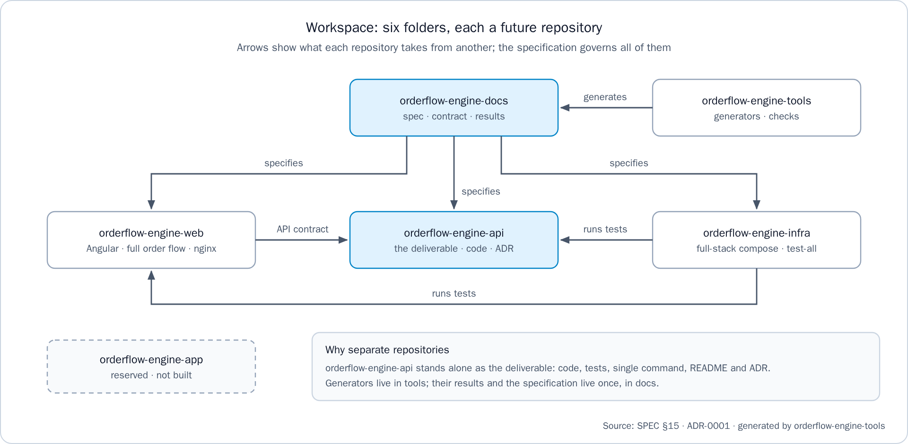

> **Notes:** The arrows show what each repository takes from another: the specification in `orderflow-engine-docs` governs all of them, the generators of `orderflow-engine-tools` produce what the documentation publishes, the web client follows the API contract, and `orderflow-engine-infra` runs the tests of both.

## Runtime topology

- One origin: nginx serves the Angular client and forwards `/api/` to the API, so no CORS
- One Spring Boot 4.1.1 service on Java 21: web adapter, use cases, pure engine, persistence
- PostgreSQL 17 is the single source of truth: explicit SQL and row locks
- Push and the ERP are called only by the outbox relay, after the order is committed
- In this delivery, push and the ERP are fakes behind ports that deduplicate by `event_id`

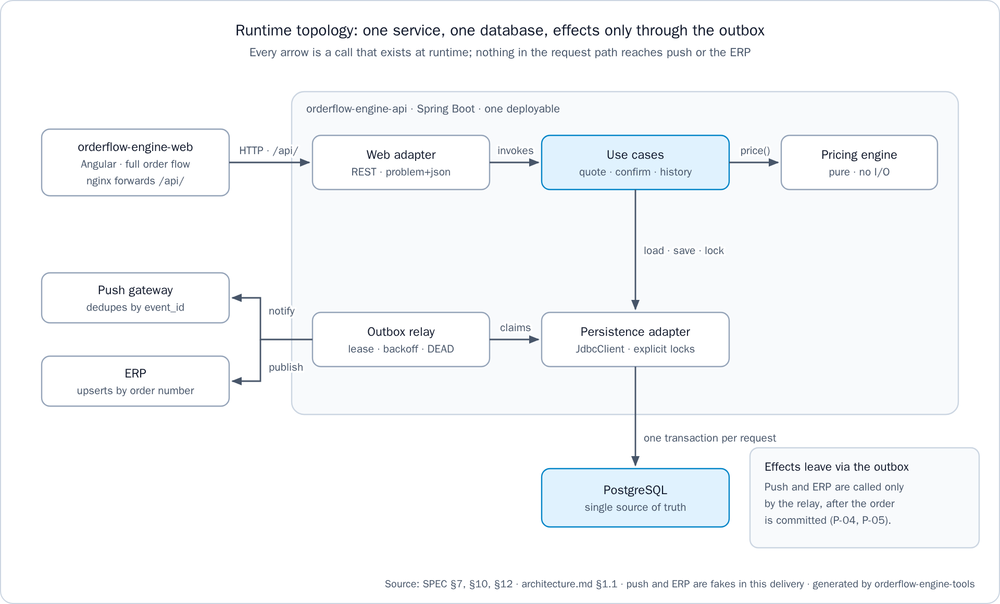

> **Notes:** At run time there is one service and one database. The browser only calls its own origin, and nginx forwards the API paths. Nothing in the request path calls push or the ERP: those effects leave through the outbox relay once the order is committed.

## Step 1: choose a store and fill the cart

- The store picker lists eight seeded stores, two per country, grouped by tenant
- The cart reads the tenant's products from the API on every visit (`GET /api/v1/products`)
- Each product shows its image, name, SKU, list price before taxes and tax rate
- "Prices in COP" names the currency, because COP and USD share the `$` symbol
- Choose cash or credit, then tap "Get quote"
- The cart shows units only: no subtotal and no total until the quote

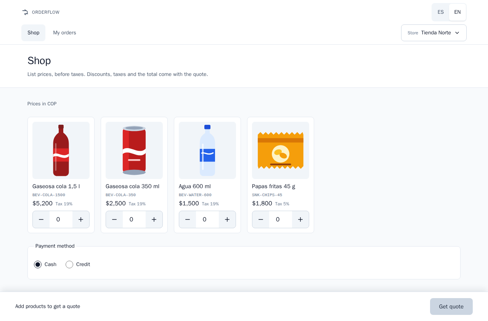

> **Notes:** The store picker stands in for a login, which is out of scope: it sends a seeded tenant and customer as headers. The cart lists exactly what the API can price, and it never computes money, so the total arrives with the quote. The browser keeps one cart per store.

## Step 2: get the quote

- `POST /api/v1/quotes` prices the cart once and seals the quote
- The summary shows each line, the order totals and the time until which the price is held
- The price is held for 15 minutes, a time to live set per country
- On credit, it shows the available credit and whether the order fits; nothing is reserved yet
- If it does not fit, "Confirm order" is disabled and "Pay cash" quotes again in cash

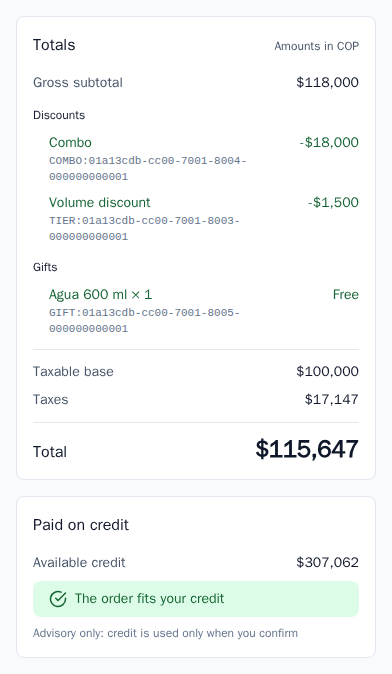

> **Notes:** This is the screen the assignment offered as the optional front. It reads the quote from the API on every visit and shows each amount exactly as the API sent it. The credit check here is advisory: credit is consumed only at confirmation.

## Step 3: read the levers on the quote

- Each discount shows its origin: "Volume discount" for a tier, or "Combo"
- A combo is one discount entry, and its products never show a loose discount
- A line inside a combo shows its "Combo share", used only to derive its taxable base
- A gift is a separate line with its quantity, free, with its reference value
- The taxable base, the taxes and the total close the breakdown

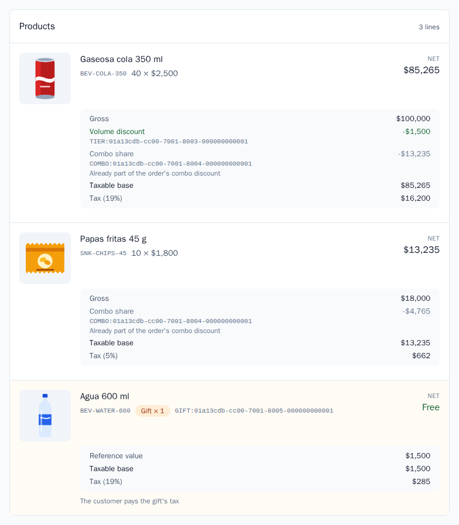

> **Notes:** This is the breakdown the assignment asks for: per line and in totals, the gross subtotal, discounts with their origin, gifts with their quantity, the taxable base, taxes and the total. The combo appears once, as the assignment requires, and its share on each line only explains that line's tax. Where the country taxes gifts, the screen says that the customer pays the gift's tax.

## Step 4: confirm the order

- "Confirm order" creates one idempotency key for the quote and keeps it in the browser
- The button is disabled while the request is in flight, so a double tap sends one request
- A retry after no answer, a 5xx or a reload sends the same key
- A 201 opens the order with its number and the notice "Order confirmed"
- A replayed 201 says "This order was already recorded": no second order, no extra credit used

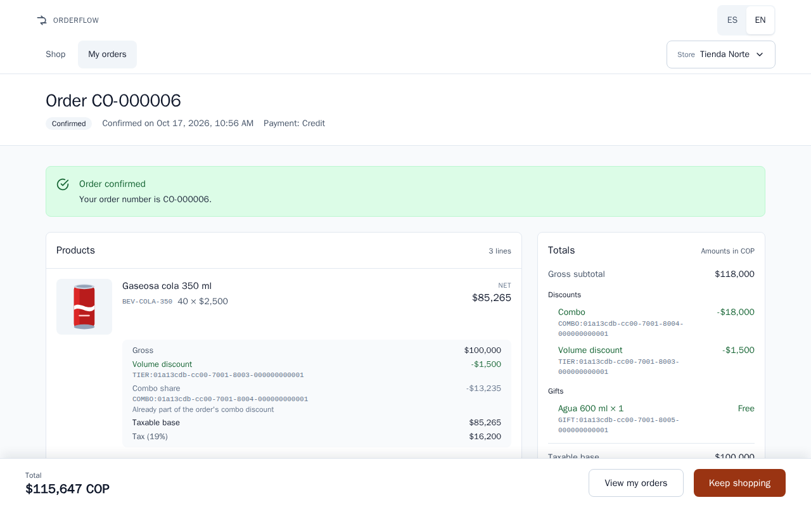

> **Notes:** The client side of idempotency mirrors the server side: one key per quote, created at the first tap and reused on every retry. If the network fails after the order was committed, the retry gets the same order back instead of a duplicate. The store's cart is emptied after the 201.

## Step 5: find it in My orders

- My orders reads the history from the API on every visit (`GET /api/v1/orders?customerId=`)
- Newest first: order number, confirmation time and total with its currency code
- The order just confirmed comes first, with the confirmed total
- The client keeps no copy of an order, so no cache can hide a committed one
- Each row opens its order, rendered from its sealed quote

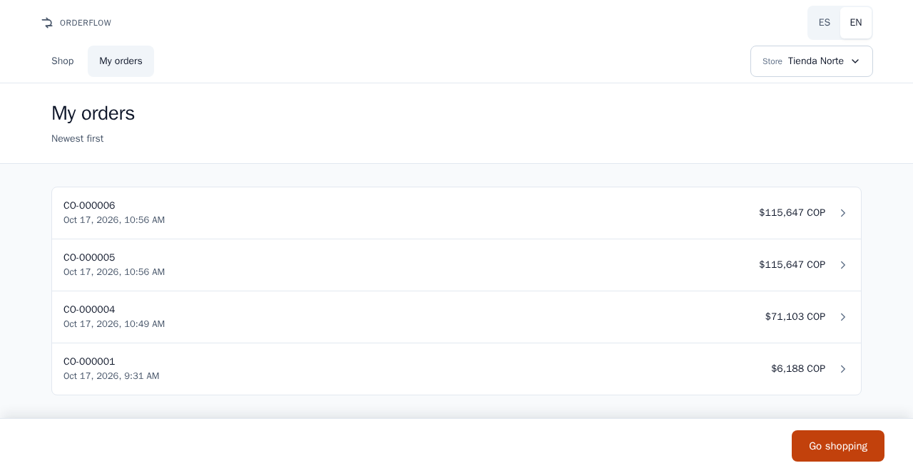

> **Notes:** This closes the loop on the reported defect: the number the shopkeeper just received is in the history right away. The history reads the same primary tables the confirmation wrote, and the end-to-end flow checks it in Spanish and in English.

## The pricing pipeline and the lever order

1. Gift eligibility, on paid quantities or the gross subtotal before discounts
2. Combos consume their units first: one `COMBO` entry, never a second discount on those units
3. Tier discounts in marginal brackets, on the units no combo consumed
4. Line net = gross − discounts, then the taxable base
5. Tax per line at each SKU's rate, then total = Σ net + taxes
6. Credit check on the final total, in the application layer, outside the pure engine

> **Notes:** The engine is a pure function: the cart is normalized first, and the same cart and snapshot always give the same breakdown. Combos go before tiers so the same units are never discounted twice, and tax is computed after the commercial discounts, as the assignment requires. Golden test 1 shows the marginal brackets: 25 colas at 2,500 give 1,250 plus 1,500, a 2,750 discount and a 71,103 total.

## The pricing pipeline at a glance

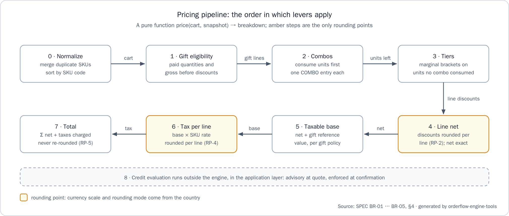

> **Notes:** The amber steps are the only rounding points: the discounts and the tax of each line, at the scale and rounding mode of the country. The total is the sum of the rounded lines and is never rounded again, and the credit evaluation runs outside the engine.

## Money and rounding

- `Money` wraps `BigDecimal`; an architecture test bans `float` and `double` from the domain
- Scale and rounding mode come from the country data: COP scale 0, USD scale 2, `HALF_UP`
- Never from `java.util.Currency`, which reports COP with two decimals
- Rounding happens per line only: each discount component and each tax
- Totals are sums of rounded lines and are never rounded again
- In the API, money is a JSON string at the currency's scale, never a number

> **Notes:** Per-line rounding matches the way an electronic invoice carries tax, so the order and its invoice always agree. Golden test 4 shows it: a 3,600 combo discount is split into 2,647 and 953 by largest remainder, the taxes are 1,397 and 132, and the total is 11,529. The web client never does arithmetic on money either: it formats the API's strings.

## Quote equals confirmation

- The quote is sealed: its lines and discount components are insert-only
- Each line keeps the price and the tax rate in force when it was quoted
- The order stores no amount: it references the quote, so every figure exists once
- Confirmation never runs the engine again, so later price or lever changes cannot reach the order
- Trade-off: an open quote keeps its price until it expires, at most 15 minutes
- Golden test 6 changes a price and deactivates a lever in between: same total, and a fresh quote differs

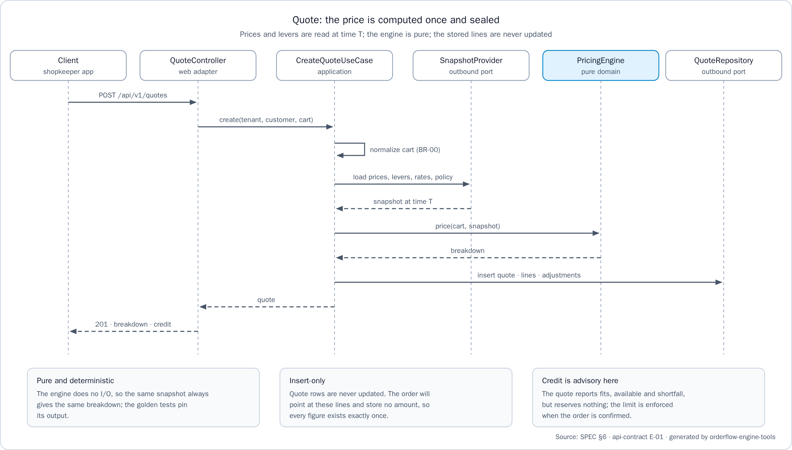

> **Notes:** The quoted total equals the confirmed total by construction, not by comparing two computations: there is one copy of each figure, and the order points at it. The ADR records the trade-off: a wrong price is honored for at most one time to live, and quote revocation is the next step of its mitigation.

## The idempotent confirmation in one transaction

1. Insert the idempotency key; a concurrent request with the same key waits on it
2. Lock the quote, then check its owner, that it has no order yet and that it has not expired
3. On credit, a conditional update that never exceeds the limit
4. Insert the order (no amounts), its ledger row on credit, and the push and ERP outbox events
5. Store the 201 body on the key, then commit
6. Only after the commit is the 201 sent

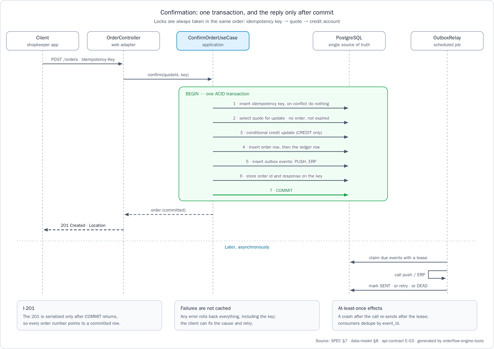

> **Notes:** Every write of the confirmation happens in one PostgreSQL transaction, and the response is sent only after the commit, so a returned order number always points to a committed, readable row. The same key with the same body returns the stored response byte for byte, with `Idempotent-Replayed: true`, while a failed request is not cached, so the client can fix the cause and retry. Locks are always taken key, then quote, then credit, so concurrent confirmations cannot deadlock.

## The outbox: effects never lost, never applied twice

- The order transaction writes one outbox event for push and one for the ERP
- Every second, the relay claims due events with `FOR UPDATE SKIP LOCKED` under a 30-second lease
- It calls push or the ERP outside any transaction, passing the `event_id`
- A failure is retried with exponential backoff and full jitter, its ceiling from 2 seconds up to 5 minutes
- After 8 attempts, or a non-retryable error, the event becomes `DEAD` and is counted in `outbox_dead`
- Consumers deduplicate by `event_id`, so sending again has no second effect

> **Notes:** If push or the ERP is down, the order stays confirmed and the effect waits in the outbox, the `outbox_pending` gauge shows the backlog, and delivery resumes on recovery. If the service stops between sending and marking, the lease expires and the event is sent again, which is safe because consumers deduplicate. An operator requeues a `DEAD` event with one SQL update, documented in the API README.

## The outbox lifecycle at a glance

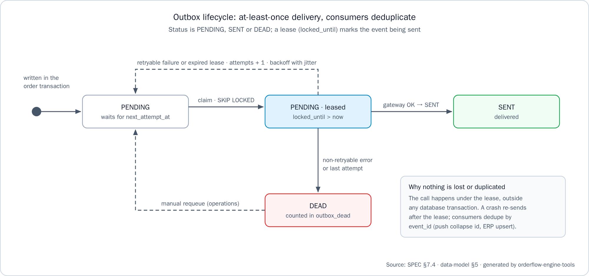

> **Notes:** An event is written as `PENDING` in the order transaction, leased with `SKIP LOCKED` while it is sent, and becomes `SENT` when the call succeeds. A retryable failure or an expired lease returns it to `PENDING` with backoff; a non-retryable error or the last attempt makes it `DEAD`, and an operator can requeue it.

## Four countries, two languages

- `co-alpha`, Colombia: COP at scale 0, 19% and 5% tax, gifts taxed
- `ec-alpha`, Ecuador: USD at scale 2, 15% tax, gifts exempt
- `gt-alpha`, Guatemala: GTQ at scale 2, 12% tax, gifts exempt
- `pe-alpha`, Peru: PEN at scale 2, 18% tax, gifts taxed
- Guatemala and Peru arrived as one Liquibase changelog of data, with no change to the engine or the API code
- Spanish by default and English complete: the API follows `Accept-Language`, the web client switches at run time

> **Notes:** Currency, scale, rounding mode, tax rates, gift tax policy and quote lifetime are country data, and none of them is hard-coded; Guatemala and Peru were the proof, since they arrived as data only. Adding a language is one file per side. The ES/EN switch translates the interface, while product and store names stay in the tenant's language.

## Quality and evidence

- API: 333 unit and 308 integration tests green, the six golden tests among them
- JaCoCo: 100% lines and branches on `pricing.domain` and `pricing.domain.lever` (gate 90%); 99.2% lines / 98.0% branches on the whole service
- PIT: 185 of 185 mutations detected (100%, threshold 80%)
- Web: 209 specs in 15 files, in headless Chromium
- End to end: 2 of 2 flows pass, in Spanish and in English, against the full stack
- `test-all`: OK on fresh clones, on 2026-10-17

> **Notes:** These numbers come from the handoff, each with the command that produced it. The integration tests run against a real PostgreSQL 17 with Testcontainers, and ArchUnit keeps the domain pure and the transaction boundary in the use cases. Mutation testing proves that the pricing tests detect wrong code, not just execute it.

## How to run it

1. Clone the six repositories side by side; Docker must be running, with JDK 21 and Node 18 or later for `test-all`
2. `docker compose up --build` in `orderflow-engine-infra`: the database, the API and the web client
3. Open `http://localhost:8081`; the API health is at `http://localhost:8080/actuator/health`
4. `./mvnw verify` in `orderflow-engine-api`: the single command for the API code and tests
5. `bash scripts/test-all.sh` in `orderflow-engine-infra`: API, web, end to end, documentation and integrity

> **Notes:** Three commands cover it: one starts the stack, one runs the API tests, and one runs every check of the workspace. Compose builds the API and web images from the sibling repositories and starts PostgreSQL first, and every service restarts with Docker unless it was stopped by hand. On Windows, `pwsh -File scripts/test-all.ps1` runs the same steps.

## What was not included, and why

- Authentication: out of scope; tenant and customer come from headers, and a gateway would inject them
- Catalog and lever administration: Liquibase changesets seed the stores, products and levers
- Payment capture, cancellation and credit release: not required
- Real push and ERP clients: fakes behind ports prove the delivery guarantees
- Quote revocation: the next step of the ADR's risk mitigation
- CI pipeline and SonarQube: verification runs locally; CI would run the same `./mvnw verify`

> **Notes:** Each cut is deliberate and recorded, with its reason, in the API README and the ADR. SonarQube would import the JaCoCo report that the build already produces, so CI can add it without project changes. The mobile app repository is reserved and not built.

## Four guarantees, and questions

- The quoted total is the confirmed total: sealed, insert-only quotes
- No floating point for money: `BigDecimal`, scale from country data, rounding per line
- A 201 means the order exists and can be read: one transaction, reply after commit
- Push and ERP effects are never lost and never applied twice: outbox and `event_id`
- Each guarantee has its tests: golden, integration, mutation and end to end
- Questions?

> **Notes:** These are the four guarantees of the specification, each with the mechanism that holds it. The defect the assignment reported, an order number returned and then missing, cannot happen by construction, and the tests prove it. Thank you; I am glad to walk through any part of it in the code.
