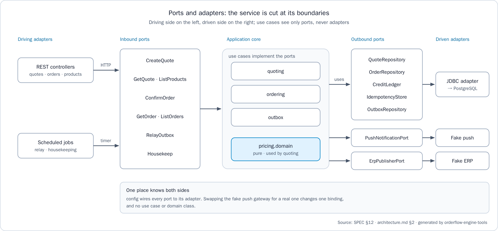

# Orderflow Engine — Manual técnico

> **Pregunta que responde este documento:** ¿cómo instalo, configuro, ejecuto, opero, pruebo y mantengo Orderflow Engine?

## Acerca de este manual

### Audiencia

Este manual es para el ingeniero que despliega, opera y mantiene Orderflow Engine: el motor de precios y la confirmación idempotente de pedidos de un marketplace B2B de bebidas en varios países, su cliente web en Angular y el stack de Docker Compose que los ejecuta. Supone conocimiento práctico de Docker Compose, PostgreSQL, una shell Unix y HTTP. Cómo usa el cliente un tendero está en el manual de usuario (`user-manual.es.md`), y por qué el sistema tiene esta forma está en el informe de arquitectura (`architecture-report.es.md`).

### Convenciones

| Convención | Significado |
|------------|-------------|
| Bloques `bash` | Comandos para bash en Linux, macOS o Git Bash en Windows. Cuando la carpeta importa, un comentario en la primera línea la nombra. El código y sus comentarios están en inglés |
| Bloques `text` | Salidas, SQL para escribir en `psql`, YAML o JSON |
| Rutas | Relativas a la raíz del espacio de trabajo, la carpeta que contiene los repositorios `orderflow-engine-*` uno al lado del otro |
| `<value>` | Un valor a reemplazar, por ejemplo `<correlationId>` |
| Valores | Cada puerto, clave y valor por defecto que se muestra es el de `.env.example`. Un `.env` puede cambiarlo |
| Dinero | Los montos viajan como cadenas JSON a la escala de la moneda: `"71103"` en COP, `"77.11"` en USD |
| Avisos | **Nota:** agrega contexto. **Advertencia:** marca una acción que borra datos o expone el sistema |
| Fuentes | Cada dato nombra el archivo del que sale, para poder comprobarlo en los repositorios |

## El sistema de un vistazo

### Componentes y puertos

| Componente | Se construye desde | Puerto del host | Dirección en la red | Función |
|------------|--------------------|-----------------|---------------------|---------|
| `db` | `postgres:17` | No se publica | `db:5432` | Única fuente de verdad: catálogo, palancas, crédito, cotizaciones, pedidos, claves de idempotencia y outbox |
| `api` | `orderflow-engine-api`: Java 21, Spring Boot 4.1.1, ejecutado como usuario sin privilegios sobre `eclipse-temurin:21-jre` | `8080` (`API_PORT`) | `api:8080` | Cotiza carritos, sella cotizaciones, confirma pedidos, sirve el historial de pedidos, entrega los eventos del outbox y purga los datos vencidos |
| `web` | `orderflow-engine-web`: Angular 22, servido por `nginxinc/nginx-unprivileged:1.30.6-alpine` | `8081` (`WEB_PORT`) | `web:8080` | El cliente. Su nginx reenvía `/api/` a la API |
| Gateway de push y ERP | Simulaciones dentro de la API (`adapters.out.push`, `adapters.out.erp`) | — | — | Reciben cada pedido confirmado solo a través del relay del outbox, y deduplican por `event_id` |

Fuente: `orderflow-engine-infra/compose.yaml`, los dos archivos `Dockerfile` y `orderflow-engine-docs/spec/architecture.md` §1.

### Recorrido de una petición

1. El navegador carga el cliente desde `http://localhost:8081`. El cliente solo llama rutas relativas bajo `/api/v1/`.
2. nginx, en el contenedor `web`, reenvía `/api/` sin cambios a `API_UPSTREAM`, que en el stack completo es `http://api:8080`. El navegador ve un solo origen, así que la API no necesita CORS. Los encabezados de la petición (`X-Tenant-Id`, `X-Customer-Id`, `Idempotency-Key`, `Accept-Language`, `X-Correlation-Id`) y los de la respuesta (`Location`, `Idempotent-Replayed`) pasan sin cambios. Cualquier otra ruta cae en `index.html`, así que recargar una ruta del cliente funciona. `/actuator` no se reenvía.
3. La API valida encabezados y cuerpo, ejecuta el caso de uso y lee o escribe en PostgreSQL mediante repositorios `JdbcClient` con SQL y bloqueos explícitos. Una confirmación es una sola transacción ACID: clave de idempotencia, bloqueo de la cotización, crédito, pedido, dos eventos del outbox y la respuesta guardada. El 201 se envía solo después del commit.
4. El relay del outbox, un job programado dentro del mismo proceso de la API, reclama los eventos que ya tocan, llama a las simulaciones de push y ERP fuera de toda transacción de base de datos, y marca cada evento como `SENT`, programa un reintento o lo marca como `DEAD`.


### Repositorios

| Repositorio | Contenido | Se necesita para |
|-------------|-----------|------------------|
| `orderflow-engine-api` | El entregable: código, pruebas, README, ADR-0001 y los changelogs de Liquibase | El stack y `test-all` |
| `orderflow-engine-web` | Cliente Angular, plantilla de nginx, lista de tiendas `public/config/stores.json`, imágenes de productos y specs | El stack y `test-all` |
| `orderflow-engine-infra` | `compose.yaml` del stack completo, `scripts/test-all.sh`, `scripts/test-all.ps1`, `scripts/e2e.sh`, `scripts/e2e.ps1` y la suite de Playwright en `e2e/` | El stack (Compose se ejecuta aquí) y `test-all` |
| `orderflow-engine-docs` | Especificación, contrato de la API, modelo de datos, arquitectura, diagramas, gobierno, handoff y documentos de entrega | `test-all` |
| `orderflow-engine-tools` | Verificaciones de documentación e integridad, generadores de figuras y documentos | `test-all` |
| `orderflow-engine-app` | Reservado para una futura app móvil, no construido | `test-all`, cuyas verificaciones leen todos los repositorios |


### Datos sembrados

Liquibase siembra cuatro tenants, uno por cada país del enunciado. Todos los países redondean `HALF_UP` y una cotización se mantiene 15 minutos. Ambos valores son datos del país en la tabla `countries`.

| Tenant | País | Moneda y escala | Tasas de impuesto | Impuesto del obsequio | Palancas |
|--------|------|-----------------|-------------------|-----------------------|----------|
| `co-alpha` | Colombia (`CO`) | COP, 0 | 19%, papas 5% | `TAXED` | Tramos sobre `BEV-COLA-350` (10+ 5%, 20+ 10%). Combo 2 `BEV-COLA-350` + 1 `SNK-CHIPS-45` por 5000. 1 `BEV-WATER-600` por cada 10 snacks, repetible |
| `ec-alpha` | Ecuador (`EC`) | USD, 2 | 15% | `EXEMPT` | Tramos sobre la familia de colas (12+ 4%, 24+ 8%). Combo 6 `BEV-COLA-350` + 2 `SNK-PLANTAIN-45` por 3.99. 2 `BEV-WATER-600` desde un subtotal bruto de 50.00, una vez |
| `gt-alpha` | Guatemala (`GT`) | GTQ, 2 | 12% | `EXEMPT` | Tramos sobre `BEV-COLA-350` (12+ 5%, 24+ 10%). 1 `BEV-WATER-600` por cada 12 `BEV-COLA-350`, repetible |
| `pe-alpha` | Perú (`PE`) | PEN, 2 | 18% | `TAXED` | Combo 2 `BEV-COLA-350` + 1 `SNK-CHIPS-45` por 6.00. 1 `BEV-WATER-600` desde un subtotal bruto de 100.00, una vez |

| Tienda | Tenant | Id del cliente | Paga con |
|--------|--------|----------------|----------|
| Tienda Norte | `co-alpha` | `01a13cdb-cc00-7001-8001-000000000001` | Crédito hasta 500,000, o contado |
| Tienda Sur | `co-alpha` | `01a13cdb-cc00-7001-8001-000000000002` | Solo contado |
| Tienda Quito | `ec-alpha` | `01a13cdb-cc00-7002-8001-000000000001` | Crédito hasta 1,500.00, o contado |
| Tienda Guayaquil | `ec-alpha` | `01a13cdb-cc00-7002-8001-000000000002` | Solo contado |
| Tienda Ciudad de Guatemala | `gt-alpha` | `01a13cdb-cc00-7003-8001-000000000001` | Crédito hasta 5,000.00, o contado |
| Tienda Quetzaltenango | `gt-alpha` | `01a13cdb-cc00-7003-8001-000000000002` | Solo contado |
| Tienda Lima | `pe-alpha` | `01a13cdb-cc00-7004-8001-000000000001` | Crédito hasta 2,000.00, o contado |
| Tienda Arequipa | `pe-alpha` | `01a13cdb-cc00-7004-8001-000000000002` | Solo contado |

Fuente: los changelogs de siembra en `orderflow-engine-api/src/main/resources/db/changelog/2026/` y `orderflow-engine-web/public/config/stores.json`.

## Requisitos previos

| Requisito | Versión | Se usa para |
|-----------|---------|-------------|
| Docker con Compose v2 (`docker compose`) | Un daemon en ejecución | El stack, las pruebas de integración de la API (Testcontainers), las pruebas web y el flujo de extremo a extremo |
| Git | Cualquier versión reciente | Clonar los repositorios |
| JDK | 21 | `./mvnw verify` y `test-all`. El Maven Wrapper descarga Maven, así que no hace falta un Maven global |
| Node | 18 o posterior | Solo las verificaciones de documentación e integridad de `test-all` y la verificación de versión del flujo de extremo a extremo. Las pruebas web y el flujo de extremo a extremo traen su propio Node en sus contenedores |
| Node, para el cliente en el host | 22.22.3 o posterior en la línea 22, o 24.15 o posterior | Solo `npm test` o `npm start` fuera de un contenedor (Angular 22 lo exige) |
| PowerShell | 7 (`pwsh`) | Solo `scripts/test-all.ps1` en Windows |
| Python 3.11 y LibreOffice | Con los paquetes de `orderflow-engine-tools/requirements.txt` | Solo para regenerar las figuras, los documentos Word y PDF y las presentaciones PowerPoint |

**Entorno verificado.** La máquina de construcción registrada en `orderflow-engine-docs/handoff/HANDOFF.md` §5 tiene Java 21, Node 24 (24.20), Docker Desktop, Python 3.11 con `python-docx`, `pypdf` y `python-pptx`, y LibreOffice. El 2026-10-17 `test-all` terminó con `test-all: OK (API verify, web tests, end-to-end, documentation check, integrity check)` sobre clones nuevos de todos los repositorios.

## Instalación y primer arranque

### Clonar los repositorios

Clona los seis repositorios uno al lado del otro en una carpeta vacía, que pasa a ser la raíz del espacio de trabajo:

```bash
# From the folder that becomes the workspace root
for r in api web infra docs tools app; do
  git clone https://github.com/ariel5253/orderflow-engine-$r.git
done
```

```text
workspace/
├── orderflow-engine-api/
├── orderflow-engine-web/
├── orderflow-engine-infra/   <- ejecuta docker compose aquí
├── orderflow-engine-docs/
├── orderflow-engine-tools/
└── orderflow-engine-app/
```

> **Nota:** `docker compose` solo necesita `orderflow-engine-api` y `orderflow-engine-web` junto a `orderflow-engine-infra`. `test-all` necesita los seis, porque la verificación de la documentación lee todos los repositorios.

### Configurar el entorno

`orderflow-engine-infra/.env.example` lista cada clave con un comentario. Sus valores son los valores por defecto escritos después de `:-` en `compose.yaml`, así que el stack arranca sin un `.env`. Crea uno solo para cambiar un valor:

```bash
# From orderflow-engine-infra
cp .env.example .env
# Edit .env, for example DB_PASSWORD, API_PORT or WEB_PORT
```

> **Advertencia:** `.env` nunca se versiona (está en `.gitignore`). Define un `DB_PASSWORD` real antes del primer arranque: la imagen de PostgreSQL guarda la contraseña cuando crea el volumen `db-data`, así que un cambio posterior en `.env` no llega a una base de datos que ya existe.

### Levantar el stack

```bash
# From orderflow-engine-infra
docker compose up --build -d
docker compose ps
```

`--build` construye la imagen de la API desde `../orderflow-engine-api` y la imagen web desde `../orderflow-engine-web`. La imagen de la API empaqueta el servicio sin ejecutar las pruebas, porque el comando de pruebas es `./mvnw verify`. La imagen web ejecuta `npm run build` y nunca construye la etapa de pruebas. Sin `-d`, los logs de los tres servicios se quedan en la terminal.

### Qué pasa al arrancar

1. `db` arranca PostgreSQL 17 sobre el volumen `db-data`. Su health check ejecuta `pg_isready` cada 5 segundos, con 12 reintentos después de un periodo de arranque de 10 segundos.
2. `api` arranca solo cuando `db` está sano. Liquibase aplica `db/changelog/db.changelog-master.yaml`: sobre una base vacía, 33 changesets en 8 changelogs crean el esquema y siembran los cuatro tenants (líneas de log `Running Changeset: ...`). En arranques posteriores aplica solo los changesets que no tiene registrados en `databasechangelog`. Luego el servicio escucha en `API_PORT` (línea de log `Started Application in ... seconds`, unos 10 segundos en la máquina de construcción).
3. `web` arranca después de `api`. La imagen de nginx escribe `API_UPSTREAM` en su configuración y sirve el cliente en el puerto 8080 del contenedor, publicado en `WEB_PORT`.
4. El relay del outbox consulta cada `API_OUTBOX_POLL_INTERVAL`. El job de limpieza corre una hora después del arranque y luego cada hora.

Comprueba la API y luego abre el cliente:

```bash
curl http://localhost:8080/actuator/health
```

```text
{"groups":["liveness","readiness"],"status":"UP"}
```

Abre `http://localhost:8081`. El cliente arranca en español con la primera tienda de `stores.json` (Tienda Norte, `co-alpha`). Agrega `?lang=en`, o usa el selector ES/EN, para inglés.

> **Nota:** la API sola (`docker compose up --build` en `orderflow-engine-api`) y el cliente solo (el mismo comando en `orderflow-engine-web`) publican los mismos puertos que el stack completo. Ejecuta un stack a la vez, o dale a uno de ellos otro `API_PORT` u otro `WEB_PORT`.

## Configuración

### Claves del stack completo

Cada clave de `orderflow-engine-infra/.env.example`, la propiedad de Spring o el ajuste del contenedor que alimenta, y su efecto:

| Clave | Por defecto | Fija | Efecto |
|-------|-------------|------|--------|
| `DB_NAME` | `orderflow` | `POSTGRES_DB` y la base de `SPRING_DATASOURCE_URL` (`jdbc:postgresql://db:5432/<DB_NAME>`) | Nombre de la base de datos |
| `DB_USER` | `orderflow` | `POSTGRES_USER` y `SPRING_DATASOURCE_USERNAME` | Rol con el que se conecta la API. Liquibase también migra con él |
| `DB_PASSWORD` | `change-me` | `POSTGRES_PASSWORD` y `SPRING_DATASOURCE_PASSWORD` | Contraseña de ese rol. Define un valor real en `.env` |
| `API_PORT` | `8080` | `SERVER_PORT` (`server.port`), el puerto publicado y `API_UPSTREAM` de `web` (`http://api:<API_PORT>`) | Puerto HTTP de la API, dentro del contenedor y en el host |
| `API_DEFAULT_LOCALE` | `es` | `APP_I18N_DEFAULT_LOCALE` (`app.i18n.default-locale`) | Idioma de los textos de error cuando falta `Accept-Language` o nombra un idioma no soportado |
| `API_OUTBOX_POLL_INTERVAL` | `1s` | `app.outbox.poll-interval` | Espera entre dos consultas de eventos pendientes |
| `API_OUTBOX_LEASE` | `30s` | `app.outbox.lease` | Cuánto tiempo queda arrendado un evento reclamado. Después, otra consulta puede reclamarlo y enviarlo de nuevo |
| `API_OUTBOX_MAX_ATTEMPTS` | `8` | `app.outbox.max-attempts` | Intentos de entrega antes de que un evento pase a `DEAD` |
| `API_OUTBOX_BACKOFF_BASE` | `2s` | `app.outbox.backoff.base` | Primer techo de la espera entre reintentos. El techo se duplica tras cada intento fallido, y la espera se sortea por debajo de él |
| `API_OUTBOX_BACKOFF_MAX` | `5m` | `app.outbox.backoff.max` | Techo más alto de la espera entre reintentos |
| `API_IDEMPOTENCY_RETENTION` | `24h` | `app.idempotency.retention` | Cuánto tiempo una clave de idempotencia repite su primera respuesta |
| `API_HOUSEKEEPING_RETENTION` | `7d` | `app.housekeeping.retention` | Cuánto tiempo se guardan las cotizaciones vencidas sin confirmar y los eventos `SENT` del outbox |
| `WEB_PORT` | `8081` | El puerto publicado de `web`, mapeado al puerto 8080 del contenedor | Puerto del cliente en el host |

Las duraciones usan la notación de Spring (`1s`, `30s`, `5m`, `24h`, `7d`). Después de cambiar `.env`, ejecuta `docker compose up -d`: Compose recrea los servicios cuya configuración cambió.

Algunos valores no son configuración, a propósito:

| Valor | Dónde vive |
|-------|------------|
| `lock_timeout` de una confirmación: 2 segundos | `ConfirmOrderUseCase.LOCK_TIMEOUT` en el código |
| Frecuencia de la limpieza: cada hora | `HousekeepingJob` en el código |
| Escala de la moneda, modo de redondeo, política de impuesto del obsequio y vigencia de la cotización | Datos del país en las tablas `currencies` y `countries`, que se cambian con un changeset |
| URL, usuario y contraseña de la base de datos | Solo el entorno (`SPRING_DATASOURCE_*`). `application.yml` no fija ningún valor por defecto |

### Claves de los stacks independientes y del script de extremo a extremo

| Dónde | Clave | Por defecto | Efecto |
|-------|-------|-------------|--------|
| `orderflow-engine-api/.env.example` | Las mismas claves `DB_*` y `API_*` | Los mismos valores | La API y su PostgreSQL solos, levantados desde `orderflow-engine-api` |
| `orderflow-engine-web/.env.example` | `WEB_PORT` | `8081` | Puerto del cliente solo en el host |
| `orderflow-engine-web/.env.example` | `API_UPSTREAM` | `http://host.docker.internal:8080` | Adónde reenvía nginx `/api/`, leído cuando arranca el contenedor: un valor nuevo necesita un reinicio, no un rebuild. `extra_hosts` mapea `host.docker.internal` al gateway del host en Linux |
| Entorno de `scripts/e2e.sh` y `scripts/e2e.ps1` | `E2E_PROJECT` | `ofe-e2e` | Nombre del proyecto Compose del stack de extremo a extremo |
| Entorno de `scripts/e2e.sh` y `scripts/e2e.ps1` | `E2E_API_PORT` | `18080` | Puerto de su API en el host |
| Entorno de `scripts/e2e.sh` y `scripts/e2e.ps1` | `E2E_WEB_PORT` | `18081` | Puerto de su cliente en el host |
| Entorno de `npm start` (`proxy.conf.mjs`) | `API_UPSTREAM` | `http://localhost:8080` | Adónde reenvía `/api/` el servidor de desarrollo de Angular |

## Operación

### Levantar, detener y reiniciar

```bash
# From orderflow-engine-infra
docker compose up --build -d     # build and start, or apply new code or a changed .env
docker compose ps                # state of db (with its health), api and web
docker compose stop              # stop the three services; the data stays
docker compose start             # start them again
docker compose restart api       # restart one service
docker compose down              # remove containers and network; the db-data volume stays
```

Cada servicio tiene `restart: unless-stopped`: Docker vuelve a arrancar un servicio cuando termina, y vuelve a arrancar el stack cuando arranca el daemon de Docker, por ejemplo después de reiniciar la máquina. Un servicio detenido a mano con `docker compose stop` o `docker compose down` se queda detenido.

> **Advertencia:** `docker compose down -v` también borra el volumen `db-data`. Se pierden todos los pedidos, cotizaciones, movimientos de crédito y eventos del outbox, y el siguiente arranque siembra una base vacía. Saca un respaldo antes.

### Salud y métricas

| Endpoint | Respuesta | Uso |
|----------|-----------|-----|
| `GET http://localhost:8080/actuator/health` | `200` `{"groups":["liveness","readiness"],"status":"UP"}` | Salud general, `UP` cuando la base de datos responde. Sin encabezados de tenant |
| `GET http://localhost:8080/actuator/health/liveness` | `200` `{"status":"UP"}` | Sonda de liveness |
| `GET http://localhost:8080/actuator/health/readiness` | `200` `{"status":"UP"}` | Sonda de readiness |

Solo la salud se expone por HTTP: `GET /actuator` lista únicamente los enlaces de salud, y `/actuator/metrics` responde 404. La API registra dos gauges en Micrometer (`OutboxConfig`): `outbox_pending`, la cola de entregas pendientes, que crece mientras push o el ERP están caídos, y `outbox_dead`, los eventos que necesitan un operador. Ningún endpoint HTTP los expone en esta entrega, así que lee los mismos números en la base de datos:

```text
SELECT status, destination, count(*) FROM outbox_events GROUP BY status, destination ORDER BY 1, 2;
```

La salud responde solo en el puerto de la API. El origen del cliente reenvía `/api/` y nada más, así que `http://localhost:8081/actuator/health` devuelve la página del cliente, no el cuerpo de salud.

### Logs e id de correlación

```bash
# From orderflow-engine-infra
docker compose logs -f api                      # follow the API
docker compose logs --tail 100 web              # last nginx lines
docker compose logs api | grep <correlationId>  # every line of one request
```

Cada línea de log de la API lleva el id de correlación entre corchetes después del nombre del hilo: `[<correlationId>]` en una línea escrita mientras se atiende una petición, y `[]` en una línea de un job programado. Por ejemplo:

```text
2026-10-17T14:31:12.114Z  INFO 1 --- [orderflow-engine-api] [   scheduling-1] [] c.o.e.adapters.out.erp.FakeErpGateway    : ERP order CO-000001 upserted from event 01a14a46-1ede-7b0b-9b91-bb601a4a11bd
```

`CorrelationIdFilter` reutiliza el `X-Correlation-Id` de la petición cuando cumple `[A-Za-z0-9._-]{1,128}`, y si no genera un UUID. Devuelve el id en el encabezado de respuesta `X-Correlation-Id` y en el campo `correlationId` de todo cuerpo de error. El cliente web muestra sus primeros 8 caracteres en cada aviso de problema, para que soporte encuentre la petición en los logs. Un 500 `INTERNAL_ERROR` se registra en nivel ERROR con su stack trace, y su cuerpo nunca expone detalles internos.

| Logger | Nivel | Mensaje | Qué hacer |
|--------|-------|---------|-----------|
| `OutboxRelay` | WARN | `Outbox event ... failed attempt N of M, retrying at ...` | Nada todavía: el relay reintenta con backoff |
| `OutboxRelay` | ERROR | `Outbox event ... is DEAD for order ... after N attempts, needs an operator` | Corregir la causa y reencolar el evento |
| `OutboxRelay` | WARN | `Outbox event ... was taken over after its lease expired, outcome not recorded` | Nada: otra consulta es dueña del evento, y los consumidores deduplican por `event_id`. Si la línea es frecuente, conviene subir `API_OUTBOX_LEASE` |
| `HousekeepingJob` | INFO | `Housekeeping purged N idempotency keys, N unconfirmed quotes and N sent outbox events` | Nada: corrió la purga de cada hora |
| `FakeErpGateway`, `FakePushGateway` | INFO | `ERP order CO-000001 upserted from event ...`, `Push notification ... shown to customer ... for order ...` | Nada: la entrega llegó a la simulación |
| `ProblemDetailsAdvice` | ERROR | `Unexpected error, answered as INTERNAL_ERROR with status 500` | Un defecto: busca las líneas de su id de correlación |

### Entrega del outbox

Cada pedido confirmado escribe un evento para push y otro para el ERP, en la misma transacción del pedido. El relay los entrega después:

| Estado | Significado | Qué sigue |
|--------|-------------|-----------|
| `PENDING` | Toca enviarlo en `next_attempt_at`, o está arrendado hasta `locked_until` mientras una consulta lo envía | El relay reclama los eventos que ya tocan con `FOR UPDATE SKIP LOCKED`, así que pueden correr varias instancias de la API a la vez |
| `SENT` | El gateway lo aceptó | La limpieza lo purga después de `API_HOUSEKEEPING_RETENTION` |
| `DEAD` | `API_OUTBOX_MAX_ATTEMPTS` intentos fallidos, o de inmediato ante un error que reintentar no corrige, como un 4xx del ERP | Nunca se purga. Espera a un operador |

- **Nunca se pierde:** si la API se detiene entre el envío y la marca, el arriendo vence y el evento se envía de nuevo.
- **Nunca se aplica dos veces:** los consumidores deduplican por `event_id`. Las simulaciones lo hacen, un push real lo usaría como collapse id y el ERP haría un upsert por número de pedido.
- **Sistema externo caído:** el pedido sigue confirmado y el efecto espera en el outbox. La entrega se reanuda cuando el sistema se recupera.


Para ver lo que todavía no se entregó, en `psql`:

```text
SELECT tenant_id, id, order_id, destination, status, attempts, next_attempt_at, last_error
FROM outbox_events
WHERE status <> 'SENT'
ORDER BY created_at DESC;
```

### Reencolar un evento DEAD

Primero corrige la causa, que `last_error` registra. Luego lista los eventos `DEAD` y reencola uno por su `tenant_id` e `id`, reemplazando `co-alpha` y `<id>` por los valores que devolvió la primera consulta:

```text
SELECT tenant_id, id, order_id, destination, attempts, last_error, created_at
FROM outbox_events
WHERE status = 'DEAD'
ORDER BY created_at DESC;

UPDATE outbox_events
SET status = 'PENDING', attempts = 0, next_attempt_at = now(), locked_until = NULL
WHERE tenant_id = 'co-alpha' AND id = '<id>' AND status = 'DEAD';
```

Por qué es seguro, según la sección de operación de `orderflow-engine-api/README.es.md`:

- El relay reclama los eventos `PENDING` cuyo `next_attempt_at` ya pasó, así que la siguiente consulta lo envía.
- `attempts = 0` le devuelve al evento todos sus reintentos, y `last_error` queda como evidencia del último fallo.
- La condición `status = 'DEAD'` hace repetible la sentencia: sobre un evento ya reencolado no cambia nada.
- Los consumidores deduplican por `event_id`, así que reencolar un evento que en realidad sí se entregó no tiene un segundo efecto.

### Limpieza por retención

Un job de limpieza corre cada hora, para todos los tenants, y registra en el log lo que purgó.

| Dato | Se guarda | Clave |
|------|-----------|-------|
| Claves de idempotencia | 24 horas. Un reintento posterior de una cotización confirmada igual recibe `QUOTE_ALREADY_CONFIRMED` con el número de pedido | `API_IDEMPOTENCY_RETENTION` |
| Cotizaciones no confirmadas | 7 días después de vencer | `API_HOUSEKEEPING_RETENTION` |
| Eventos `SENT` del outbox | 7 días después de escritos | `API_HOUSEKEEPING_RETENTION` |
| Pedidos, sus cotizaciones, movimientos de crédito y eventos `DEAD` | Nunca se borran | — |

### Inspeccionar la base de datos

El puerto de la base de datos no se publica en el host. Abre `psql` dentro del contenedor `db`, con `DB_USER` y `DB_NAME` si `.env` los cambió:

```bash
# From orderflow-engine-infra
docker compose exec db psql -U orderflow -d orderflow
```

```text
\dt
SELECT id, filename, orderexecuted FROM databasechangelog ORDER BY orderexecuted;
SELECT tenant_id, customer_id, credit_limit, consumed FROM credit_accounts ORDER BY 1, 2;
SELECT tenant_id, order_number, customer_id, confirmed_at FROM orders ORDER BY confirmed_at DESC LIMIT 10;
```

> **Advertencia:** las cotizaciones, sus líneas y sus componentes de descuento solo admiten inserciones, y un pedido no guarda montos: sus cifras se leen de su cotización. Nunca los actualices a mano. Los cambios de catálogo y de palancas se hacen con un changeset (ver Mantenimiento).

### Respaldo y restauración

Un respaldo es un `pg_dump` en el formato custom de PostgreSQL, que sale en streaming del contenedor `db`:

```bash
# From orderflow-engine-infra, in bash
docker compose exec -T db pg_dump -U orderflow -d orderflow --format=custom > orderflow-backup.dump
```

Para restaurarlo, detén la API para que nada escriba durante la restauración, restaura sobre los objetos existentes y vuelve a arrancar la API:

```bash
# From orderflow-engine-infra, in bash
docker compose stop api
docker compose exec -T db pg_restore -U orderflow -d orderflow --clean --if-exists < orderflow-backup.dump
docker compose start api
```

`-T` desactiva la pseudoterminal, así que el volcado binario pasa intacto por la redirección. El volcado incluye `databasechangelog`, así que después de restaurar Liquibase aplica solo los changesets más nuevos que el respaldo. Restaura en PostgreSQL 17, la versión del stack. El 2026-10-17 un volcado del stack en ejecución se restauró en un PostgreSQL 17 vacío y otra vez sobre sí mismo con `--clean --if-exists`, y sus pedidos y sus 33 changesets quedaron intactos.

## La API

El contrato completo, con cada petición, respuesta y error, es `orderflow-engine-docs/spec/api-contract.md`.

### Endpoints

| Id | Operación | Éxito | Notas |
|----|-----------|-------|-------|
| E-01 | `POST /api/v1/quotes` | 201 con `Location: /api/v1/quotes/{quoteId}` | Cotiza el carrito y sella la cotización. Cuerpo: `paymentMethod` (`CASH` o `CREDIT`) y `lines` de `{sku, qty}` |
| E-02 | `GET /api/v1/quotes/{quoteId}` | 200 | La cotización con su estado derivado: `OPEN`, `CONFIRMED` o `EXPIRED`. `credit` se recalcula mientras está `OPEN` |
| E-03 | `POST /api/v1/orders` | 201 con `Location: /api/v1/orders/{orderId}` | Confirma una cotización. Exige `Idempotency-Key`. Cuerpo: `{"quoteId": "..."}` |
| E-04 | `GET /api/v1/orders/{orderId}` | 200 | El pedido, presentado desde su cotización |
| E-05 | `GET /api/v1/orders?customerId={id}&size=20` | 200 | Los pedidos del cliente, del más nuevo al más antiguo. `size` vale 20 por defecto, y un valor mayor que 100 se lee como 100 |
| E-06 | `GET /actuator/health` | 200 | Salud. Sin encabezados de tenant |
| E-07 | `GET /api/v1/products` | 200 | Los productos del tenant en orden de SKU, con precios de lista antes de palancas e impuestos. Solo lee |

Los números de pedido son `<COUNTRY>-NNNNNN`, por ejemplo `CO-000001`, tomados de una secuencia por país.

### Encabezados

| Encabezado | Dirección | Regla |
|------------|-----------|-------|
| `X-Tenant-Id` | Petición | Obligatorio en toda operación de negocio. Un tenant desconocido responde 400 `TENANT_NOT_FOUND` |
| `X-Customer-Id` | Petición | Obligatorio en toda operación de negocio, un UUID |
| `Idempotency-Key` | Petición, solo E-03 | Obligatorio, debe cumplir `^[A-Za-z0-9_-]{8,64}$`. Se recomienda un UUID, uno por cotización |
| `Accept-Language` | Petición | Opcional: `es` (por defecto) o `en`. Elige el idioma de `title` y `detail` en los errores |
| `X-Correlation-Id` | Petición y respuesta | Opcional en la petición. Se devuelve igual cuando cumple `[A-Za-z0-9._-]{1,128}`; si no, se reemplaza por un UUID nuevo |
| `Location` | Respuesta | En el 201 de E-01 y E-03 |
| `Idempotent-Replayed` | Respuesta | `true` cuando E-03 devuelve una respuesta guardada |

> **Advertencia:** la API no tiene autenticación, por el alcance del enunciado: tenant y cliente llegan en encabezados, y en producción un gateway autenticaría a quien llama y los inyectaría (brecha GAP-01 del contrato). No publiques los puertos 8080 ni 8081 en una red no confiable.

### Confirmación idempotente

| Situación | Respuesta |
|-----------|-----------|
| Misma clave, mismo cuerpo, ya completada | La respuesta guardada, byte a byte, con `Idempotent-Replayed: true`. Ni un segundo pedido ni un segundo consumo de crédito |
| Misma clave, otro cuerpo | 422 `IDEMPOTENCY_KEY_REUSED` |
| Misma clave mientras la primera petición sigue en curso | Espera y luego repite la respuesta. 409 `IDEMPOTENCY_KEY_IN_PROGRESS` cuando antes se cumple el `lock_timeout` de 2 segundos |
| Una petición fallida: validación, cotización vencida, crédito excedido | No se guarda. La transacción se revierte y libera la clave, así que el cliente puede corregir la causa y reintentar |
| Una clave nueva sobre una cotización ya confirmada | 409 `QUOTE_ALREADY_CONFIRMED`, con `orderNumber` y `orderId` en el cuerpo |

### Códigos de error

Los errores son `application/problem+json` (RFC 9457) con `type`, `title`, `status`, `detail`, `instance`, un `code` estable y el `correlationId`:

```text
{"detail":"One of the products does not exist or is not sold by this tenant.","instance":"/api/v1/quotes","status":422,"title":"Unknown product","type":"https://orderflow-engine.example/problems/unknown-sku","code":"UNKNOWN_SKU","correlationId":"manual-check-001"}
```

| Código | Estado | Significado |
|--------|--------|-------------|
| `VALIDATION_FAILED` | 400 | Petición mal formada: falta un encabezado, un valor no es un UUID, el cuerpo no es un objeto JSON, falta el valor de un campo o no es válido |
| `INVALID_QUANTITY` | 400 | Una cantidad menor o igual a 0, no entera o mayor que 1,000,000, también después de unir los SKU repetidos |
| `CART_EMPTY` | 400 | `lines` está vacío |
| `TENANT_NOT_FOUND` | 400 | `X-Tenant-Id` desconocido |
| `IDEMPOTENCY_KEY_MISSING` | 400 | E-03 sin `Idempotency-Key` |
| `IDEMPOTENCY_KEY_INVALID` | 400 | `Idempotency-Key` no cumple su patrón |
| `QUOTE_NOT_FOUND` | 404 | Cotización desconocida, o de otro tenant u otro cliente |
| `ORDER_NOT_FOUND` | 404 | Pedido desconocido, o de otro tenant u otro cliente |
| `CUSTOMER_NOT_FOUND` | 404 | Cliente desconocido para el tenant, o un historial pedido para otro `customerId` |
| `REQUEST_NOT_SUPPORTED` | 404, 405, 406 o 415 | Ruta, método, tipo de contenido o tipo aceptado desconocido, con el estado que eligió el framework |
| `QUOTE_EXPIRED` | 409 | La cotización pasó su `expiresAt` |
| `QUOTE_ALREADY_CONFIRMED` | 409 | La cotización se confirmó con otra clave. El cuerpo trae `orderNumber` y `orderId` |
| `CREDIT_LIMIT_EXCEEDED` | 409 | El total no cabe en el crédito disponible al confirmar. No se escribe nada |
| `IDEMPOTENCY_KEY_IN_PROGRESS` | 409 | La misma clave sigue en proceso cuando se cumple el `lock_timeout` |
| `UNKNOWN_SKU` | 422 | Un SKU desconocido, o que este tenant no vende |
| `CREDIT_NOT_ENABLED` | 422 | `CREDIT` pedido por un cliente sin cuenta de crédito |
| `IDEMPOTENCY_KEY_REUSED` | 422 | Misma clave, otra petición |
| `INTERNAL_ERROR` | 500 | Una falla inesperada, registrada en el log con el id de correlación |

Las cotizaciones, pedidos e historiales ajenos responden 404, nunca 403, así que la API nunca revela que existen. Fuente: `ErrorCode.java` y las decisiones de comportamiento BD-01 a BD-04 del contrato.

### Recorrido con curl

Esta sesión cotiza 25 colas a crédito para Tienda Norte, confirma la cotización, repite la confirmación y lee el pedido y el historial. Se ejecutó contra un stack en marcha el 2026-10-17.

1. Fija los valores de la sesión y lee el catálogo:

```bash
API=http://localhost:8080
TENANT='X-Tenant-Id: co-alpha'
CUSTOMER='X-Customer-Id: 01a13cdb-cc00-7001-8001-000000000001'
curl -s "$API/api/v1/products" -H "$TENANT" -H "$CUSTOMER"
```

```text
{"currency":"COP","items":[{"sku":"BEV-COLA-1500","description":"Gaseosa cola 1,5 l","listPrice":"5200","taxRate":"0.190000"},{"sku":"BEV-COLA-350","description":"Gaseosa cola 350 ml","listPrice":"2500","taxRate":"0.190000"}, ...]}
```

2. Crea la cotización, guarda su id y vuelve a leerla:

```bash
quote_id=$(curl -s "$API/api/v1/quotes" -H 'Content-Type: application/json' -H "$TENANT" -H "$CUSTOMER" \
  -d '{"paymentMethod":"CREDIT","lines":[{"sku":"BEV-COLA-350","qty":25}]}' \
  | sed -E 's/.*"quoteId":"([^"]+)".*/\1/')
curl -s "$API/api/v1/quotes/$quote_id" -H "$TENANT" -H "$CUSTOMER"
```

El desglose es el golden test 1: un bruto de 62500, un descuento por tramos de 2750 (`TIER:01a13cdb-cc00-7001-8003-000000000001`), un impuesto de 11353 y `"total":"71103"`, con `"status":"OPEN"`, un `expiresAt` 15 minutos adelante y `credit.fits` en true. `credit.available` vale `500000` en un stack nuevo y baja con cada pedido a crédito.

3. Confírmala con una clave de idempotencia nueva:

```bash
key=5d1f3a2b-8c4e-4f6a-9b7d-0e1f2a3b4c5d
curl -i "$API/api/v1/orders" -H 'Content-Type: application/json' -H "$TENANT" -H "$CUSTOMER" \
  -H "Idempotency-Key: $key" -d "{\"quoteId\":\"$quote_id\"}"
```

```text
HTTP/1.1 201
X-Correlation-Id: <uuid>
Location: /api/v1/orders/<orderId>
Content-Type: application/json

{"orderId":"<orderId>","orderNumber":"CO-000001","status":"CONFIRMED","quoteId":"<quoteId>","confirmedAt":"...","currency":"COP","lines":[...],"totals":{...,"total":"71103"},"paymentMethod":"CREDIT"}
```

`CO-000001` es el primer pedido de Colombia en un stack nuevo. Los totales son los de la cotización.

4. Envía el mismo comando otra vez. La respuesta es el mismo cuerpo, byte a byte, con `Idempotent-Replayed: true`, y no se crea un segundo pedido. Toma de ella el id del pedido:

```bash
curl -i "$API/api/v1/orders" -H 'Content-Type: application/json' -H "$TENANT" -H "$CUSTOMER" \
  -H "Idempotency-Key: $key" -d "{\"quoteId\":\"$quote_id\"}"
order_id=$(curl -s "$API/api/v1/orders" -H 'Content-Type: application/json' -H "$TENANT" -H "$CUSTOMER" \
  -H "Idempotency-Key: $key" -d "{\"quoteId\":\"$quote_id\"}" | sed -E 's/.*"orderId":"([^"]+)".*/\1/')
```

5. Lee el pedido y el historial. El pedido sale primero en cuanto llega el 201:

```bash
curl -s "$API/api/v1/orders/$order_id" -H "$TENANT" -H "$CUSTOMER"
curl -s "$API/api/v1/orders?customerId=01a13cdb-cc00-7001-8001-000000000001" -H "$TENANT" -H "$CUSTOMER"
```

```text
{"currency":"COP","items":[{"orderId":"<orderId>","orderNumber":"CO-000001","confirmedAt":"...","total":"71103"}]}
```

6. Mira un error en inglés, con un id de correlación propio:

```bash
curl -i "$API/api/v1/quotes" -H 'Content-Type: application/json' -H "$TENANT" -H "$CUSTOMER" \
  -H 'Accept-Language: en' -H 'X-Correlation-Id: manual-check-001' \
  -d '{"paymentMethod":"CASH","lines":[{"sku":"NOPE-1","qty":1}]}'
```

Responde 422 `UNKNOWN_SKU` con `"correlationId":"manual-check-001"`, el cuerpo que se muestra en Códigos de error.

> **Nota:** para repetir el recorrido, usa una `key` nueva. La misma clave con una cotización nueva es otra petición y responde 422 `IDEMPOTENCY_KEY_REUSED` durante 24 horas. Una clave nueva sobre la cotización ya confirmada responde 409 `QUOTE_ALREADY_CONFIRMED` con su número de pedido.

## Pruebas y compuertas de calidad

### El comando del espacio de trabajo

```bash
# From orderflow-engine-infra
bash scripts/test-all.sh
```

```bash
# From orderflow-engine-infra, on Windows with PowerShell 7
pwsh -File scripts/test-all.ps1
```

`test-all` encuentra la raíz del espacio de trabajo dos niveles arriba del script y ejecuta, en orden:

| Paso | Comando | Carpeta |
|------|---------|---------|
| 1. Verificación de la API | `./mvnw verify` (`mvnw.cmd verify` en PowerShell) | `orderflow-engine-api` |
| 2. Pruebas web | `docker build --target test .` | `orderflow-engine-web` |
| 3. Extremo a extremo | `bash scripts/e2e.sh` (`scripts/e2e.ps1` en PowerShell) | `orderflow-engine-infra` |
| 4. Verificación de la documentación | `node orderflow-engine-tools/docs-check/check-docs.mjs` | Raíz del espacio de trabajo |
| 5. Verificación de integridad | `node orderflow-engine-tools/integrity/check-integrity.mjs` | Raíz del espacio de trabajo |

Se detiene en la primera falla con `test-all: FAIL (<step>, exit code <n>)` y ese código de salida. Cuando todos los pasos pasan, termina con `test-all: OK (API verify, web tests, end-to-end, documentation check, integrity check)`.

### Build y pruebas de la API

```bash
# From orderflow-engine-api
./mvnw verify
```

Este único comando construye el servicio y ejecuta todas las pruebas: unitarias, golden tests (marcadas con `@Tag("golden")`, con sus fixtures en `src/test/resources/golden/`), de contrato (`*ContractIT`), de arquitectura (ArchUnit) y de integración contra un PostgreSQL 17 real que levanta Testcontainers, incluida la prueba de rollback de Liquibase. Aplica la compuerta de JaCoCo: al menos 90% de las líneas y ramas de `com.orderflow.engine.pricing` y sus subpaquetes. El reporte de cobertura es `target/site/jacoco/index.html`.

### Pruebas de mutación

```bash
# From orderflow-engine-api
./mvnw -Pmutation verify
```

El perfil opcional `mutation` ejecuta PIT sobre `com.orderflow.engine.pricing.domain` y su subpaquete `lever`, y falla por debajo del 80% de mutaciones detectadas. Es más lento, así que corre antes de una entrega y no en cada build.

### Pruebas web

```bash
# From orderflow-engine-web
docker build --target test .
```

La etapa `test` del `Dockerfile` web parte de la imagen de Playwright de la versión fijada (`mcr.microsoft.com/playwright:v1.64.1-noble`), ejecuta `npm ci` y luego `npm test`: la verificación de texto literal (`scripts/no-literal-text.mjs`, ninguna plantilla contiene texto de usuario fuera de los diccionarios) y después cada spec en Chromium headless, con el layout medido a 768 × 1024 y a 375 × 812. Un spec que falla hace fallar el build. El host solo necesita Docker.

Para ejecutar los specs en el host, con un Node soportado: `npm ci`, `npx playwright install chromium` una vez, y luego `npm test`.

### Flujo de extremo a extremo

```bash
# From orderflow-engine-infra
bash scripts/e2e.sh
```

1. `e2e/check-playwright-version.mjs` comprueba que la suite usa la versión de Playwright que fija `orderflow-engine-web`.
2. `docker build` crea la imagen del ejecutor desde `e2e/Dockerfile`.
3. `docker compose --project-name ofe-e2e up --build --detach --wait` levanta un stack completo propio, con la API en 18080 y el cliente en 18081.
4. El ejecutor se une a la red de ese stack y recorre en un navegador carrito, cotización, confirmación, pedido y Mis pedidos, una vez en español y otra en inglés, y falla ante cualquier error en la consola del navegador.
5. `docker compose --project-name ofe-e2e down --volumes --remove-orphans` siempre elimina ese stack y su base de datos, también cuando falla un paso, así que cada ejecución parte de las semillas. Después de una falla, primero imprime el final de los logs del stack.

> **Nota:** el stack de extremo a extremo tiene su propio nombre de proyecto y sus propios puertos, así que nunca toca un stack levantado a mano en 8080 y 8081. Para ejecutar la suite desde el host contra un stack en marcha, desde `orderflow-engine-infra/e2e`: `npm ci`, `npx playwright install chromium` y luego `npx playwright test` con `E2E_BASE_URL=http://localhost:8081`.

### Verificaciones de documentación e integridad

```bash
# From the workspace root
node orderflow-engine-tools/docs-check/check-docs.mjs
node orderflow-engine-tools/integrity/check-integrity.mjs
```

| Verificación | Qué comprueba |
|--------------|---------------|
| `check-docs` | Ubicación e índice de los Markdown, pares de idioma con el mismo número de títulos, enlaces que nunca salen de su repositorio, front matter, títulos obligatorios, extensión del ADR, claves i18n idénticas en todos los idiomas, el gráfico de avance y las fuentes de los entregables Word y PDF |
| `check-integrity` | Entradas obligatorias de `.gitignore`, `.dockerignore` y `.gitattributes`, `.env.example` donde un repositorio corre con Docker, archivos Docker que no salen de su repositorio, y ningún secreto |

### Evidencia verificada

Según `orderflow-engine-docs/handoff/HANDOFF.md` §3:

| Compuerta | Resultado | Umbral |
|-----------|-----------|--------|
| Pruebas de la API | 333 pruebas unitarias + 308 de integración en verde, con los seis golden tests entre ellas | Todas en verde |
| JaCoCo sobre `pricing.domain` y `pricing.domain.lever` | 100% de líneas y ramas | 90% |
| JaCoCo sobre todo el servicio | 99.2% de líneas / 98.0% de ramas | — |
| PIT | 185/185 mutaciones detectadas (100%) | 80% |
| Specs web | 209 specs en 15 archivos en Chromium headless | Todos en verde |
| Flujo de extremo a extremo | 2/2 (es y en) | Todos en verde |
| `test-all` | OK sobre clones nuevos el 2026-10-17 | — |

Fases: preparación T-00, scaffold T-01, núcleo T-02..T-16 + T-18, web T-17, T-19, T-20, todas cerradas en main.

## Mantenimiento

### Dónde va el código

La API es un monolito hexagonal. Todos los paquetes viven bajo `com.orderflow.engine`:

| Paquete | Tipo | Qué va aquí |
|---------|------|-------------|
| `pricing.domain`, `pricing.domain.lever` | Dominio, puro | `Money`, la política de moneda, el motor de precios, los pasos de las palancas y el desglose. Solo importa el JDK |
| `quoting` | Aplicación | Casos de uso de cotización y de lista de productos, y sus puertos (`SnapshotProvider`, `QuoteRepository`, `CreditAdvisor`, `ProductCatalog`) |
| `ordering` | Aplicación | Casos de uso de confirmación, pedido e historial, y sus puertos (`OrderRepository`, `CreditLedger`, `IdempotencyStore`, `OutboxWriter`) |
| `outbox` | Aplicación | `OutboxRelay`, `HousekeepingJob` y sus puertos (`PushNotificationPort`, `ErpPublisherPort`, `OutboxRepository`) |
| `adapters.in.web` | Adaptador de entrada | Controladores, DTOs, `ProblemDetailsAdvice`, `ErrorCode`, filtros de idioma y de correlación |
| `adapters.out.persistence` | Adaptador de salida | Repositorios `JdbcClient` con SQL y bloqueos explícitos |
| `adapters.out.push`, `adapters.out.erp` | Adaptadores de salida | Las simulaciones de los gateways. Un cliente real cambia un solo enlace en `config` |
| `config` | Raíz de composición | Conexión de puertos con adaptadores y propiedades tipadas |



Las dependencias apuntan hacia adentro: adaptadores, luego aplicación, luego dominio. Dos pruebas de ArchUnit hacen fallar el build cuando se rompe la regla:

- `DomainPurityArchTest`: el dominio de precios depende solo de `java..` y de sí mismo, nunca de `java.sql`, nunca de `float` ni `double`, y nunca de `java.util.Currency`.
- `TransactionBoundaryArchTest`: una transacción empieza solo en un caso de uso de la aplicación; un caso de uso transaccional nunca llega a push, al ERP ni a un cliente HTTP; los casos de uso dependen de puertos, nunca de adaptadores ni del cableado; y la confirmación nunca vuelve a cotizar un carrito.

El texto para el usuario nunca vive en el código. Un error nuevo de la API necesita un valor en `ErrorCode` y las claves `error.<CODE>.title` y `error.<CODE>.detail` en cada bundle de `src/main/resources/i18n/` (`messages.properties`, `messages_es.properties`, `messages_en.properties`). El texto del cliente va en `orderflow-engine-web/public/i18n/es.json` y `en.json`, con las mismas claves en ambos.

### Changesets de Liquibase

Liquibase es dueño del esquema y de los datos que no tienen pantalla: tiendas, productos, precios y palancas. Cada cambio es un archivo de changelog nuevo:

1. Crea `orderflow-engine-api/src/main/resources/db/changelog/<year>/<date>-<nnn>-<what>.yaml`, por ejemplo `2026/2026-10-17-001-seed-mx.yaml`.
2. Fija `logicalFilePath` con su ruta bajo `src/main/resources`, para que el archivo pueda moverse sin volver a aplicarse.
3. Dale a cada `changeSet` un `id` único, `author: orderflow-engine` y un `rollback` que quite exactamente lo que agrega.
4. Incluye el archivo al final de `db/changelog/db.changelog-master.yaml`, que lista todos los changelogs en el orden en que se aplican.
5. Nunca edites un changeset ya aplicado. Corrígelo con uno nuevo, como `2026-10-16-001-seed-names-in-spanish.yaml` renombró las filas sembradas.
6. Escribe cada monto a la escala de la moneda del tenant (0 decimales para COP, 2 para USD, GTQ y PEN). Ningún check de la base puede exigirlo, así que lo hace `PriceScaleValidationIT`.
7. Ejecuta `./mvnw verify`. `LiquibaseRollbackIT` revierte todos los changesets hasta un esquema vacío y los vuelve a aplicar.
8. Reconstruye y reinicia la API: `docker compose up --build -d` en `orderflow-engine-infra`. Liquibase aplica los changesets nuevos al arrancar.

> **Nota:** Las pruebas de integración fijan los datos sembrados de demostración. Un cambio cuyo changeset modifica un tenant sembrado actualiza, en el mismo cambio, `ProductContractIT` (el cuerpo exacto de E-07 de cada tenant), `LiquibaseRollbackIT` (los tenants, países y monedas, todos los nombres de productos y clientes, y las secuencias de números de pedido), `PriceScaleValidationIT` (los tenants con precios sembrados) y las pruebas que verifican montos cotizados con las semillas, como los casos de palancas de `QuoteLeversIT` y `QuoteContractIT`. Si no, `./mvnw verify` falla. `LiquibaseRollbackIT` revierte primero todos los changesets desde el changelog de Guatemala y Perú en adelante, así que una fila que agrega un changelog posterior va solo en los nombres que espera después de una actualización (`assertFourCountries`), en su orden, y no en los nombres que espera después de ese rollback.

```text
databaseChangeLog:
  - logicalFilePath: db/changelog/2026/2026-10-17-001-<what>.yaml

  - changeSet:
      id: <unique-id>
      author: orderflow-engine
      changes:
        - sql:
            sql: |
              <sql>
      rollback:
        - sql:
            sql: |
              <rollback sql>
```

```text
  - include:
      file: 2026/2026-10-17-001-<what>.yaml
      relativeToChangelogFile: true
```

Las semillas usan ids UUIDv7 fijos con un patrón legible, `01a13cdb-cc00-70TT-80KK-NNNNNNNNNNNN`: `TT` es el tenant (`01` co-alpha, `02` ec-alpha, `03` gt-alpha, `04` pe-alpha), `KK` es el tipo (`01` cliente, `02` producto, `03` regla de tramos, `04` combo, `05` obsequio) y `NNNNNNNNNNNN` es la secuencia. Las filas sembradas nuevas siguen ese patrón.

### Cambiar un precio o desactivar una palanca

Un cambio de precio aplica solo a las cotizaciones nuevas. Una cotización abierta conserva el precio con el que se cotizó hasta que vence, y un pedido confirmado nunca cambia, como lo prueba `QuoteConfirmRegressionIT`. Una palanca se desactiva, nunca se borra, porque las líneas de las cotizaciones siguen apuntando a la regla que las produjo.

```text
  - changeSet:
      id: co-alpha-cola-350-price-2600
      author: orderflow-engine
      changes:
        - sql:
            sql: UPDATE products SET list_price = 2600 WHERE tenant_id = 'co-alpha' AND sku = 'BEV-COLA-350'
      rollback:
        - sql:
            sql: UPDATE products SET list_price = 2500 WHERE tenant_id = 'co-alpha' AND sku = 'BEV-COLA-350'

  - changeSet:
      id: co-alpha-deactivate-snacks-gift
      author: orderflow-engine
      changes:
        - sql:
            sql: UPDATE gift_rules SET active = false WHERE tenant_id = 'co-alpha' AND id = '01a13cdb-cc00-7001-8005-000000000001'
      rollback:
        - sql:
            sql: UPDATE gift_rules SET active = true WHERE tenant_id = 'co-alpha' AND id = '01a13cdb-cc00-7001-8005-000000000001'
```

Los dos ejemplos cambian datos sembrados de `co-alpha` que las pruebas fijan: `ProductContractIT` espera el precio de lista `2500`, y `QuoteLeversIT`, `QuoteContractIT` y `QuoteConfirmRegressionIT` verifican cotizaciones calculadas con él, con el obsequio `GIFT:01a13cdb-cc00-7001-8005-000000000001` y totales como `71103`. Actualiza esas expectativas en el mismo cambio.

### Agregar un producto

1. En un changeset, inserta el producto. Su familia debe existir para el tenant (insértala antes si es nueva), su SKU es único por tenant, su tasa de impuesto está entre 0 y 1, y su precio no incluye impuestos y va a la escala de la moneda.
2. Si quieres, agrega su imagen como `orderflow-engine-web/public/products/<SKU>.svg`. Un producto sin imagen muestra la imagen de reemplazo.
3. Agrega el producto, en orden de SKU, al cuerpo de E-07 que fija `ProductContractIT` para su tenant (`CO_PRODUCTS` para `co-alpha`) y a los nombres de productos que `LiquibaseRollbackIT` espera después de una actualización, y luego ejecuta `./mvnw verify`.
4. Reconstruye la API, y la imagen web si agregaste una imagen. E-07 y el carrito muestran el producto de inmediato, y E-01 lo cotiza con las palancas del tenant.

```text
  - changeSet:
      id: seed-co-alpha-juice
      author: orderflow-engine
      changes:
        - sql:
            sql: |
              INSERT INTO families (tenant_id, code) VALUES ('co-alpha', 'juices');
              INSERT INTO products (tenant_id, id, sku, name, family_code, tax_rate, list_price) VALUES
                ('co-alpha', '01a13cdb-cc00-7001-8002-000000000005', 'BEV-JUICE-300', 'Jugo de naranja 300 ml', 'juices', 0.190000, 3200)
      rollback:
        - sql:
            sql: |
              DELETE FROM products WHERE tenant_id = 'co-alpha' AND sku = 'BEV-JUICE-300';
              DELETE FROM families WHERE tenant_id = 'co-alpha' AND code = 'juices'
```

Los nombres de producto son datos del tenant en su idioma, y se muestran tal como están guardados. El selector ES/EN traduce la interfaz, no el catálogo.

### Agregar una palanca

| Palanca | Tablas | Reglas que impone el esquema |
|---------|--------|------------------------------|
| Descuento por tramos | `tier_rules` (`product_id` o `family_code`, `active`) y `tier_brackets` (`from_qty`, `percent`) | Exactamente un objetivo. A lo sumo una regla activa por SKU y por familia, así que reemplazar una regla desactiva la anterior en el mismo changeset. `from_qty` de 1 o más, `percent` entre 0 y 1. Los tramos son marginales, y una regla por SKU tiene prioridad sobre una regla por familia |
| Combo | `combo_rules` (`combo_price`, `active`) y `combo_items` (`product_id`, `min_qty`) | `min_qty` de 1 o más. Los combos se evalúan en orden de id, y un combo que no bajaría el precio no consume nada |
| Obsequio | `gift_rules` (disparador, `gift_product_id`, `gift_qty`, `repeatable`, `active`) | Exactamente un disparador: `trigger_product_id` con `min_qty`, `trigger_family_code` con `min_qty`, o `min_gross` solo. `gift_qty` de 1 o más |

Una regla de tramos sobre una familia, con sus tramos, como changeset:

```text
  - changeSet:
      id: seed-co-alpha-waters-tier
      author: orderflow-engine
      changes:
        - sql:
            sql: |
              INSERT INTO tier_rules (tenant_id, id, product_id, family_code, active) VALUES
                ('co-alpha', '01a13cdb-cc00-7001-8003-000000000002', NULL, 'waters', true);
              INSERT INTO tier_brackets (tenant_id, tier_rule_id, from_qty, percent) VALUES
                ('co-alpha', '01a13cdb-cc00-7001-8003-000000000002',  1, 0.000000),
                ('co-alpha', '01a13cdb-cc00-7001-8003-000000000002', 24, 0.050000)
      rollback:
        - sql:
            sql: |
              DELETE FROM tier_brackets WHERE tenant_id = 'co-alpha' AND tier_rule_id = '01a13cdb-cc00-7001-8003-000000000002';
              DELETE FROM tier_rules WHERE tenant_id = 'co-alpha' AND id = '01a13cdb-cc00-7001-8003-000000000002'
```

Las formas de combo y de obsequio están en el ejemplo de país más abajo. El orden en que se aplican las palancas lo fija el motor, no los datos: obsequios, combos, tramos, neto, base gravable, impuesto, total y crédito (`orderflow-engine-api/README.es.md`, "Orden de las palancas").

### Agregar una tienda

Una tienda del cliente web es un cliente de un tenant.

1. En un changeset, inserta el cliente y, si compra a crédito, su cuenta de crédito (`consumed` empieza en 0 y nunca puede superar `credit_limit`).
2. Agrega la tienda a `orderflow-engine-web/public/config/stores.json`, junto a las tiendas de su tenant. `name` es lo que muestra el selector de tiendas.
3. Actualiza la lista que fija `src/app/core/api-headers.interceptor.spec.ts` en `orderflow-engine-web`, y luego ejecuta ahí `docker build --target test .`.
4. Agrega el cliente, en orden de tenant e id, a los nombres de clientes que `LiquibaseRollbackIT` espera después de una actualización, y luego ejecuta `./mvnw verify` en `orderflow-engine-api`.
5. Reconstruye ambas imágenes: `docker compose up --build -d` en `orderflow-engine-infra`.

```text
  - changeSet:
      id: seed-co-alpha-tienda-centro
      author: orderflow-engine
      changes:
        - sql:
            sql: |
              INSERT INTO customers (tenant_id, id, name) VALUES
                ('co-alpha', '01a13cdb-cc00-7001-8001-000000000003', 'Tienda Centro');
              INSERT INTO credit_accounts (tenant_id, customer_id, credit_limit, consumed) VALUES
                ('co-alpha', '01a13cdb-cc00-7001-8001-000000000003', 300000, 0)
      rollback:
        - sql:
            sql: |
              DELETE FROM credit_accounts WHERE tenant_id = 'co-alpha' AND customer_id = '01a13cdb-cc00-7001-8001-000000000003';
              DELETE FROM customers WHERE tenant_id = 'co-alpha' AND id = '01a13cdb-cc00-7001-8001-000000000003'
```

```text
  {
    "tenantId": "co-alpha",
    "customerId": "01a13cdb-cc00-7001-8001-000000000003",
    "name": "Tienda Centro"
  }
```

> **Nota:** `stores.json` forma parte de la imagen web, así que un cambio necesita reconstruir `web`. Una tienda cuyo tenant o cliente no conoce la base de datos responde 400 `TENANT_NOT_FOUND` o 404 `CUSTOMER_NOT_FOUND` en el cliente.

### Agregar un país

Un país nuevo es solo datos. Guatemala y Perú se agregaron así (tarea T-20, `2026-10-16-002-seed-gt-and-pe.yaml`) sin ningún cambio en el motor ni en el código de la API, lo que en sí mismo prueba que ninguna moneda, escala, tasa o regla está escrita en el código. Sigue el mismo orden de changesets:

1. La moneda, si es nueva, con su escala (`currencies`).
2. El país: moneda, modo de redondeo, política de impuesto del obsequio (`EXEMPT` o `TAXED`) y vigencia de la cotización (`countries`).
3. La secuencia de números de pedido del país, llamada `order_number_seq_` seguido del código del país en minúsculas. El repositorio de pedidos toma de ella el siguiente número y lo formatea como `<COUNTRY>-NNNNNN`, así que el primer pedido de México es `MX-000001`.
4. El tenant: su id, país y marca (`tenants`; un tenant por país y marca).
5. Los datos del tenant: familias, productos, palancas, clientes y cuentas de crédito.

El ejemplo de abajo agrega un tenant `mx-alpha` para México. Es un ejemplo para adaptar, no un archivo del repositorio: la moneda, las tasas, los precios y la política de impuesto del obsequio deben salir de las reglas fiscales reales del país. Su SQL, con el rollback incluido, se ejecutó el 2026-10-17 sobre una copia de la base de datos del stack, y la secuencia nueva le dio a `MX` su número 1.

```text
databaseChangeLog:
  - logicalFilePath: db/changelog/2026/2026-10-17-001-seed-mx.yaml

  - changeSet:
      id: seed-mx-currency
      author: orderflow-engine
      changes:
        - sql:
            sql: INSERT INTO currencies (code, scale) VALUES ('MXN', 2)
      rollback:
        - sql:
            sql: DELETE FROM currencies WHERE code = 'MXN'

  - changeSet:
      id: seed-mx-country
      author: orderflow-engine
      changes:
        - sql:
            sql: |
              INSERT INTO countries (code, currency_code, rounding_mode, gift_tax_policy, quote_ttl) VALUES
                ('MX', 'MXN', 'HALF_UP', 'EXEMPT', '15 minutes')
      rollback:
        - sql:
            sql: DELETE FROM countries WHERE code = 'MX'

  - changeSet:
      id: create-mx-order-number-sequence
      author: orderflow-engine
      changes:
        - createSequence: {sequenceName: order_number_seq_mx, startValue: 1, incrementBy: 1}
      rollback:
        - dropSequence: {sequenceName: order_number_seq_mx}

  - changeSet:
      id: seed-mx-tenant
      author: orderflow-engine
      changes:
        - sql:
            sql: INSERT INTO tenants (id, country_code, brand) VALUES ('mx-alpha', 'MX', 'alpha')
      rollback:
        - sql:
            sql: DELETE FROM tenants WHERE id = 'mx-alpha'

  - changeSet:
      id: seed-mx-alpha
      author: orderflow-engine
      changes:
        - sql:
            sql: |
              INSERT INTO families (tenant_id, code) VALUES
                ('mx-alpha', 'colas'),
                ('mx-alpha', 'waters');

              INSERT INTO products (tenant_id, id, sku, name, family_code, tax_rate, list_price) VALUES
                ('mx-alpha', '01a13cdb-cc00-7005-8002-000000000001', 'BEV-COLA-350',  'Refresco de cola 350 ml', 'colas',  0.160000, 12.50),
                ('mx-alpha', '01a13cdb-cc00-7005-8002-000000000002', 'BEV-WATER-600', 'Agua 600 ml',             'waters', 0.160000,  9.00);

              INSERT INTO tier_rules (tenant_id, id, product_id, family_code, active) VALUES
                ('mx-alpha', '01a13cdb-cc00-7005-8003-000000000001', '01a13cdb-cc00-7005-8002-000000000001', NULL, true);

              INSERT INTO tier_brackets (tenant_id, tier_rule_id, from_qty, percent) VALUES
                ('mx-alpha', '01a13cdb-cc00-7005-8003-000000000001',  1, 0.000000),
                ('mx-alpha', '01a13cdb-cc00-7005-8003-000000000001', 12, 0.050000);

              INSERT INTO gift_rules
                (tenant_id, id, trigger_product_id, trigger_family_code, min_qty, min_gross,
                 gift_product_id, gift_qty, repeatable, active) VALUES
                ('mx-alpha', '01a13cdb-cc00-7005-8005-000000000001', '01a13cdb-cc00-7005-8002-000000000001', NULL, 24, NULL,
                 '01a13cdb-cc00-7005-8002-000000000002', 1, true, true);

              INSERT INTO customers (tenant_id, id, name) VALUES
                ('mx-alpha', '01a13cdb-cc00-7005-8001-000000000001', 'Tienda Monterrey'),
                ('mx-alpha', '01a13cdb-cc00-7005-8001-000000000002', 'Tienda Puebla');

              INSERT INTO credit_accounts (tenant_id, customer_id, credit_limit, consumed) VALUES
                ('mx-alpha', '01a13cdb-cc00-7005-8001-000000000001', 10000.00, 0)
      rollback:
        - sql:
            sql: |
              DELETE FROM credit_accounts WHERE tenant_id = 'mx-alpha';
              DELETE FROM customers WHERE tenant_id = 'mx-alpha';
              DELETE FROM gift_rules WHERE tenant_id = 'mx-alpha';
              DELETE FROM tier_brackets WHERE tenant_id = 'mx-alpha';
              DELETE FROM tier_rules WHERE tenant_id = 'mx-alpha';
              DELETE FROM products WHERE tenant_id = 'mx-alpha';
              DELETE FROM families WHERE tenant_id = 'mx-alpha'
```

Después completa el cambio:

1. Incluye el archivo al final de `db.changelog-master.yaml`.
2. Agrega las tiendas nuevas a `stores.json` y al spec web que fija esa lista (ver Agregar una tienda).
3. Extiende las pruebas que fijan los datos sembrados: `PriceScaleValidationIT` (los tenants con precios sembrados) y, en `LiquibaseRollbackIT`, `ALL_TENANTS`, los países y monedas de `assertFourCountries`, los nombres de productos y clientes que espera después de una actualización, y las secuencias de números de pedido que quita su primer rollback (agrega `S order_number_seq_mx` junto a `GT_AND_PE_SEQUENCES`).
4. Ejecuta `./mvnw verify` y `docker build --target test .` en `orderflow-engine-web`, y luego reconstruye el stack con `docker compose up --build -d`.
5. Cotiza y confirma una vez con `X-Tenant-Id: mx-alpha`: el número de pedido es `MX-000001`.

### Por qué no hay pantalla de catálogo

La administración del catálogo y de las palancas queda fuera del alcance por diseño (`orderflow-engine-docs/spec/SPEC.md` §1), en la API y en el cliente. El enunciado pide un motor de precios y una confirmación idempotente de pedidos, no administración del catálogo, así que las migraciones siembran los datos (`orderflow-engine-api/README.es.md`, "No incluido"). Una pantalla también necesitaría la autenticación que el alcance deja fuera. Los changesets ya dan lo que esa pantalla tendría que reconstruir: cada cambio queda versionado y revisado en un pull request, tiene un rollback que prueba `LiquibaseRollbackIT`, y sus montos se comparan con la escala de la moneda en `PriceScaleValidationIT`. La única operación de catálogo es la lista de productos de solo lectura E-07, que alimenta el carrito. El selector de tiendas del cliente reemplaza a la autenticación con los ids sembrados de `stores.json`; en producción la identidad vendría de la autenticación, no de una lista (brecha GAP-04 del contrato).

## Solución de problemas

| Síntoma | Causa | Solución |
|---------|-------|----------|
| `docker compose up` falla con "port is already allocated" en 8080 o 8081 | El stack de la API o el web levantado solo, u otro programa, publica el mismo puerto | Detén el otro stack, o define otro `API_PORT` u otro `WEB_PORT` en `.env` |
| El contenedor `web` termina al arrancar o se reinicia en bucle, y su log dice que no encuentra el host upstream | nginx resuelve el host de `proxy_pass` al arrancar y termina si el nombre no resuelve (HANDOFF TR-12) | En el stack completo, levanta primero `api` y luego `docker compose up -d web`. Para el cliente solo, levanta antes la API en el host. En Linux, `extra_hosts` mapea `host.docker.internal` al gateway del host |
| `/api/` responde 502 Bad Gateway después de reconstruir la API | nginx conservó la dirección que resolvió al arrancar | `docker compose restart web` |
| `http://localhost:8081/actuator/health` devuelve la página del cliente | El origen del cliente reenvía solo `/api/` | Usa `http://localhost:8080/actuator/health` |
| La API se reinicia en bucle con un error de autenticación por contraseña | `DB_PASSWORD` cambió después de crear el volumen `db-data` | Vuelve al valor anterior, o cambia la contraseña del rol en `psql` con `ALTER ROLE`. Borrar el volumen también funciona, y borra todos los datos |
| La API no arranca y Liquibase reporta un error de validación o de checksum | Se editó un changeset que ya estaba aplicado | Revierte la edición y haz el cambio en un changeset nuevo |
| `./mvnw verify` falla con `ContainerLaunchException`, no con una aserción | Con mucha carga en paralelo, Testcontainers agotó el tiempo esperando a PostgreSQL (HANDOFF TR-14) | Vuelve a ejecutarlo en un host más tranquilo antes de leerlo como un defecto |
| `./mvnw` o `scripts/test-all.sh` responde "Permission denied" en Linux o macOS | Un clon hecho en Windows con `core.filemode=false` lo versionó sin el bit de ejecución (HANDOFF TR-07) | Ejecútalo como `bash scripts/test-all.sh` o `sh mvnw verify`. Al versionarlo, agrégalo con `git add --chmod=+x` y comprueba que `git ls-files -s` muestre `100755` |
| `test-all` dice OK, pero los specs web no volvieron a ejecutarse | La caché de build de Docker sirvió la etapa de pruebas de un build anterior (HANDOFF TR-15) | `docker build --no-cache-filter test --target test .` en `orderflow-engine-web` |
| `npm test` o `npm start` en el host fallan por la versión de Node | Angular 22 necesita Node 22.22.3 o posterior en la línea 22, o 24.15 o posterior (HANDOFF TR-13) | Ejecuta los specs en su contenedor con `docker build --target test .`, o actualiza Node |
| El cliente muestra `TENANT_NOT_FOUND` o `CUSTOMER_NOT_FOUND` para una tienda | `stores.json` nombra un tenant o un cliente que la base de datos no tiene | Alinea `stores.json` con las semillas y reconstruye `web` |
| Un producto, una tienda o un precio nuevo no aparece | El changelog no está incluido en el changelog maestro, o la imagen de la API no se reconstruyó | Inclúyelo y luego `docker compose up --build -d` |
| E-03 responde 409 `IDEMPOTENCY_KEY_IN_PROGRESS` | La primera petición con esa clave seguía en curso cuando se cumplió el `lock_timeout` de 2 segundos | Reintenta con la misma clave y el mismo cuerpo: repite la respuesta guardada cuando termina la primera petición |
| `outbox_events` tiene filas `DEAD`, o las filas `PENDING` no paran de crecer | Push o el ERP fallan o están caídos | Lee `last_error` y las líneas WARN y ERROR del relay, corrige la causa y reencola los eventos `DEAD` |

## Referencia rápida de comandos

```bash
# Stack, from orderflow-engine-infra
docker compose up --build -d
docker compose ps
docker compose logs -f api
docker compose restart web
docker compose stop
docker compose down                      # keeps the data; down -v deletes it
curl http://localhost:8080/actuator/health

# Database, from orderflow-engine-infra
docker compose exec db psql -U orderflow -d orderflow
docker compose exec -T db pg_dump -U orderflow -d orderflow --format=custom > orderflow-backup.dump
docker compose exec -T db pg_restore -U orderflow -d orderflow --clean --if-exists < orderflow-backup.dump

# Tests, from the workspace root
bash orderflow-engine-infra/scripts/test-all.sh                     # every check, in order
(cd orderflow-engine-api && ./mvnw verify)                          # API, with the coverage gate
(cd orderflow-engine-api && ./mvnw -Pmutation verify)               # PIT mutation testing
(cd orderflow-engine-web && docker build --target test .)           # web specs in a container
(cd orderflow-engine-infra && bash scripts/e2e.sh)                  # end-to-end flow
node orderflow-engine-tools/docs-check/check-docs.mjs               # documentation check
node orderflow-engine-tools/integrity/check-integrity.mjs           # integrity check

# Standalone stacks, from the workspace root
(cd orderflow-engine-api && docker compose up --build)              # API and its PostgreSQL
(cd orderflow-engine-web && docker compose up --build)              # client, /api/ to an API on the host
```
