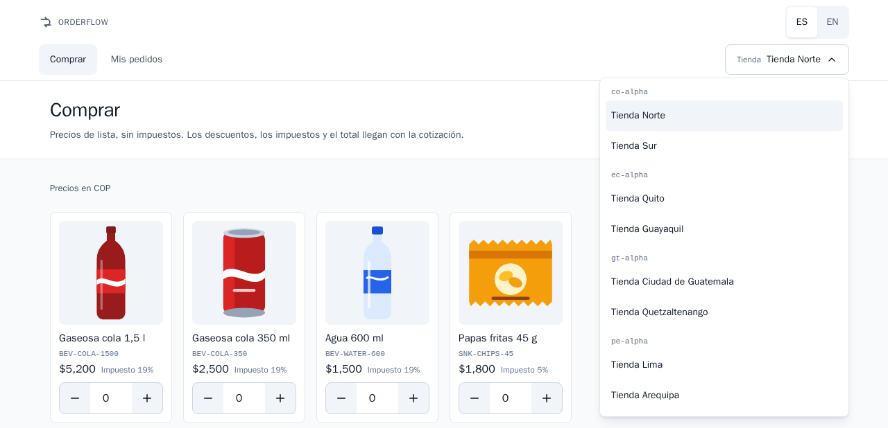
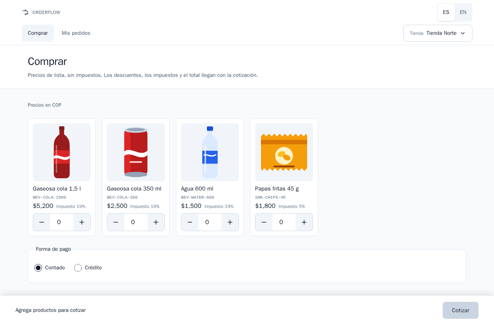
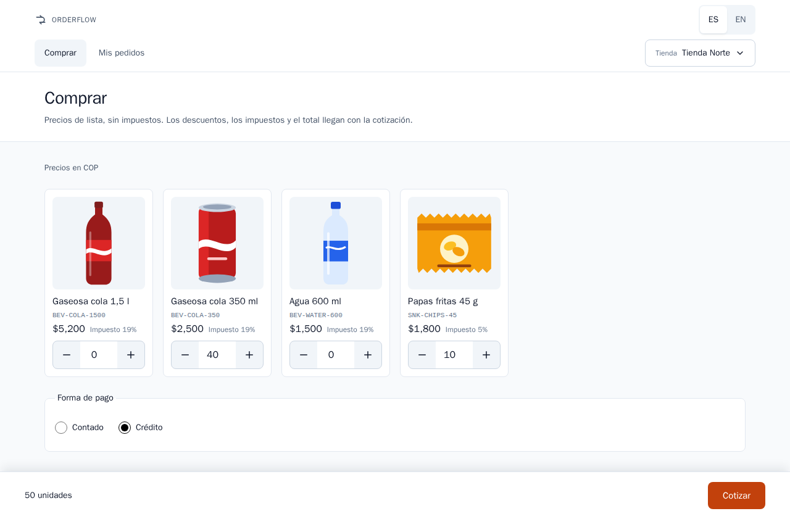
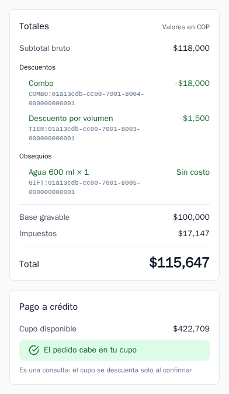
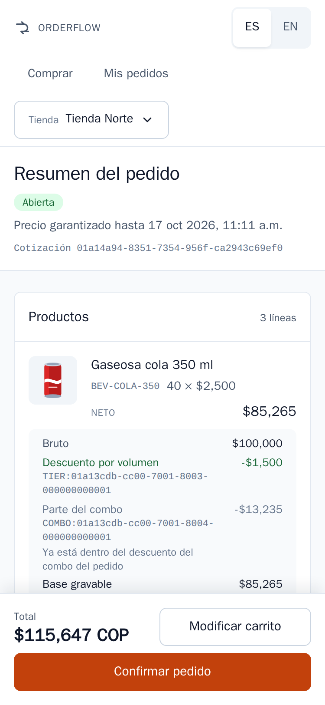
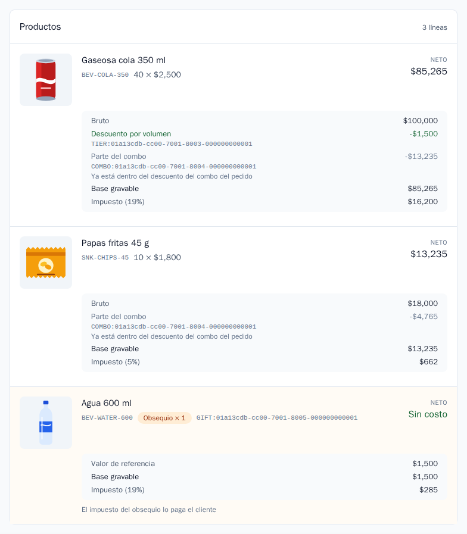
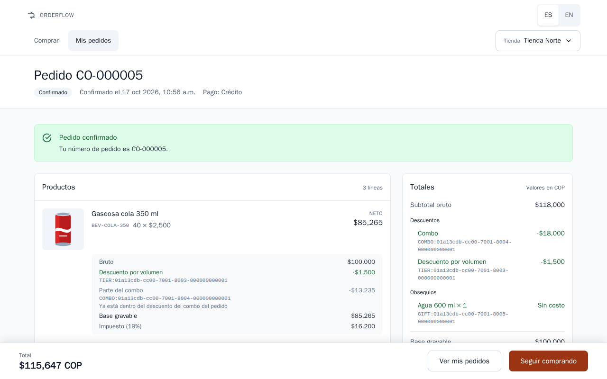
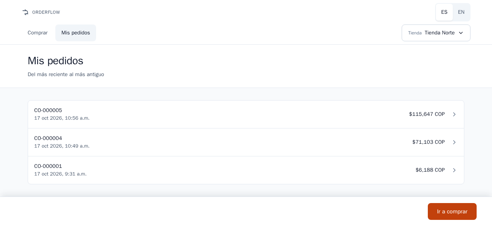
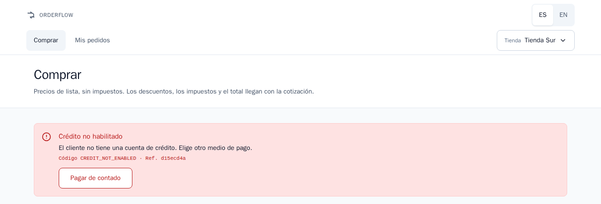

# Orderflow Engine — Manual de usuario

> **Pregunta que responde este documento:** ¿Cómo hace un tendero un pedido en el cliente web de Orderflow Engine, desde que elige la tienda hasta que encuentra el pedido en su historial?

## Antes de empezar

### Qué es Orderflow Engine

Orderflow Engine es el sistema de pedidos de tu distribuidor de bebidas. En una sola página web eliges productos, ves el precio exacto de tu pedido con cada descuento, obsequio e impuesto, y lo confirmas. El precio que ves en la cotización es el precio del pedido que confirmas.

El sistema atiende tiendas de cuatro países: Colombia, Ecuador, Guatemala y Perú. Cada país tiene su moneda, sus impuestos y sus promociones.

### Qué puedes hacer

| Quieres | Pantalla | Qué tocas |
|---------|----------|-----------|
| Elegir la tienda para la que pides | Parte superior de cada pantalla | **Tienda** |
| Ver las pantallas en español o en inglés | Parte superior de cada pantalla | **ES** o **EN** |
| Agregar productos y fijar cantidades | **Comprar** | **+** y **−**, o escribes la cantidad |
| Pagar de contado o a crédito | **Comprar** | **Forma de pago** |
| Ver el precio exacto de tu pedido | **Comprar** | **Cotizar** |
| Convertir la cotización en pedido | **Resumen del pedido** | **Confirmar pedido** |
| Ver los pedidos que hiciste | **Mis pedidos** | La fila del pedido |

### Cómo leer este manual

- Las secciones siguen el orden en que usas las pantallas: tienda, carrito, cotización, confirmación e historial.
- Las palabras en **negrita** son exactamente lo que muestra la pantalla en español. El manual en inglés cita las pantallas en inglés.
- Los ejemplos usan Tienda Norte, la primera tienda de la lista, que compra en pesos colombianos.
- Los valores se escriben como los muestra la pantalla, por ejemplo $115,647: la coma separa los miles y el punto, los decimales.
- Los avisos que empiezan con **Nota** o **Importante** señalan lo que debes recordar.
- Para abrir el sistema, abre en tu navegador la dirección web que te dio tu distribuidor. En un computador donde el sistema está instalado es `http://localhost:8081`.

> **Nota:** No hay usuario ni contraseña. Al elegir una tienda le dices al sistema quién está pidiendo.

## Elige tu tienda y tu idioma

### Elige tu tienda

1. En la parte superior de la pantalla, toca **Tienda**. Muestra el nombre de la tienda actual.
2. Se abre la lista. Las tiendas están agrupadas por un código corto de su país: `co-alpha` (Colombia), `ec-alpha` (Ecuador), `gt-alpha` (Guatemala) y `pe-alpha` (Perú).
3. Toca tu tienda. La lista se cierra y se abre la pantalla **Comprar** de esa tienda.

- En tu primera visita el sistema elige la primera tienda de la lista, Tienda Norte. Después, este navegador recuerda la tienda que elegiste.
- Cada tienda tiene su propio carrito. Cambiar de tienda no mezcla los productos de dos tiendas.
- Los precios, las cotizaciones, el cupo y los pedidos siempre son de la tienda que elegiste.
- Con teclado, la tecla Esc cierra la lista sin cambiar de tienda.

### Cambia el idioma

- Toca **ES** para español o **EN** para inglés, en la parte superior de la pantalla. La pantalla cambia de inmediato y no se pierde nada de tu carrito.
- El español es el idioma de la primera visita. Este navegador recuerda tu elección para la próxima visita.
- Un enlace que termina en `?lang=en` abre el sistema en inglés, y `?lang=es`, en español.
- Los valores, los números y las fechas siguen el idioma que elegiste.
- Los mensajes del sistema, como los errores, también llegan en el idioma que elegiste.

> **Nota:** Los nombres de los productos y de las tiendas los escribe el distribuidor, en español para los cuatro países. El cambio de idioma traduce las pantallas y los mensajes, no los nombres de los productos.

## El catálogo y el carrito

La pantalla **Comprar** es tu catálogo y tu carrito en una sola página. Debajo del título te recuerda: "Precios de lista, sin impuestos. Los descuentos, los impuestos y el total llegan con la cotización." Encima de los productos indica la moneda de tu tienda, por ejemplo **Precios en COP**.

Cada tarjeta de producto muestra:

- la imagen y el nombre del producto, como Gaseosa cola 350 ml;
- el código del producto, como `BEV-COLA-350`;
- el precio de lista sin impuestos;
- el impuesto del producto, como **Impuesto 19%**;
- la casilla de cantidad, con **−** a la izquierda y **+** a la derecha.

### Agrega productos

1. Toca **+** debajo de un producto para agregar una unidad.
2. O toca la casilla de cantidad y escribe el número de unidades.
3. La barra de la parte inferior de la pantalla cuenta las unidades de tu carrito, por ejemplo **50 unidades**.

### Cambia las cantidades

- Toca **+** o **−**, o escribe un número nuevo en la casilla.
- Las cantidades son unidades enteras. Si sales de la casilla con algo que no es un número entero, cuenta como 0.
- Cada producto admite de 1 a un millón de unidades. Una cantidad mayor devuelve el mensaje **Cantidad no válida**.
- El carrito muestra solo unidades, nunca un subtotal ni un total. El precio, con sus descuentos e impuestos, llega con la cotización.

### Quita un producto

- Toca **−** hasta que la cantidad sea 0, o escribe 0. Un producto con 0 unidades no hace parte del pedido.
- Cuando el carrito no tiene unidades, la barra inferior dice **Agrega productos para cotizar**.
- Después de confirmar un pedido, el carrito de esa tienda se vacía solo.

> **Nota:** El carrito se guarda en este navegador, en este dispositivo. Otro dispositivo u otro navegador tiene su propio carrito, y borrar los datos del navegador lo vacía.

### Elige cómo pagar

Debajo de los productos, **Forma de pago** ofrece **Contado** y **Crédito**. Contado está elegido hasta que lo cambies.

- **Contado**: el pedido no usa cupo de crédito.
- **Crédito**: el pedido se carga al cupo de crédito de tu tienda. Solo lo pueden usar las tiendas con cuenta de crédito. En los datos entregados son Tienda Norte, Tienda Quito, Tienda Ciudad de Guatemala y Tienda Lima.

Cuando tu carrito esté listo, toca **Cotizar**. El botón dice **Cotizando…** mientras se calcula el precio, y está desactivado mientras el carrito esté vacío.

> **Importante:** Si tu tienda no tiene cuenta de crédito y eliges **Crédito**, aparece el mensaje **Crédito no habilitado** con el botón **Pagar de contado**. Tócalo para obtener la misma cotización pagada de contado.

## Cotiza

La cotización abre el **Resumen del pedido**. En la parte superior ves:

- el estado de la cotización: **Abierta**, **Confirmada** o **Vencida**;
- **Precio garantizado hasta** seguido de la fecha y la hora: hasta entonces el precio de esta cotización no cambia;
- **Cotización** seguida de un código largo que la identifica.

### Qué muestra el resumen

La tarjeta **Productos** tiene una línea por cada producto que pagas y una línea por cada obsequio. Una línea de producto muestra la cantidad por el precio de lista, por ejemplo "40 × $2,500", su valor **Neto** y cómo se llegó a él:

| Etiqueta | Qué significa |
|----------|---------------|
| **Bruto** | La cantidad por el precio de lista |
| **Descuento por volumen** | Descuento por comprar muchas unidades, con el código de la regla que lo dio |
| **Parte del combo** | La porción de un descuento de combo que le toca a este producto. La nota "Ya está dentro del descuento del combo del pedido" te recuerda que no es un segundo descuento |
| **Base gravable** | El valor sobre el que se calcula el impuesto de esta línea |
| **Impuesto (19%)** | El impuesto de la línea, con su tarifa |

Una línea de obsequio muestra la etiqueta **Obsequio × 1** (con su cantidad), **Sin costo** como valor neto, su **Valor de referencia** (lo que costaría a precio de lista), su **Base gravable** y su **Impuesto**. Cuando tu país grava los obsequios, la línea agrega: "El impuesto del obsequio lo paga el cliente".

La tarjeta **Totales** suma el pedido. Indica la moneda, por ejemplo **Valores en COP**:

| Etiqueta | Qué significa |
|----------|---------------|
| **Subtotal bruto** | Los productos que pagas, a precio de lista |
| **Descuentos** | Cada descuento del pedido, **Combo** o **Descuento por volumen**, con el código de su regla y signo menos |
| **Obsequios** | Cada obsequio con su cantidad, marcado **Sin costo** |
| **Base gravable** | Sobre qué se calculan los impuestos: los productos después de descuentos, más el valor de referencia de los obsequios cuando tu país los grava |
| **Impuestos** | La suma de los impuestos de todas las líneas |
| **Total** | Lo que pagas: los productos después de descuentos, más los impuestos |

La barra inferior siempre muestra el **Total** seguido del código de la moneda, por ejemplo "$115,647 COP", y dos botones:

- **Modificar carrito** abre el carrito con los productos y las cantidades de esta cotización, para que los cambies y vuelvas a tocar **Cotizar**. Cada cotización nueva tiene su propio precio y su propio plazo.
- **Confirmar pedido** convierte esta cotización en un pedido (ver "Confirma el pedido").

> **Nota:** El código de la moneda acompaña cada total porque el peso colombiano y el dólar estadounidense usan el mismo signo $.

### Tu cupo de crédito

Cuando pagas a crédito, la tarjeta **Pago a crédito** muestra:

- **Cupo disponible**: tu límite de crédito menos lo que usaron los pedidos a crédito anteriores;
- "El pedido cabe en tu cupo" cuando el total es igual o menor que el cupo disponible;
- si no, "Te faltan $… de cupo" y el valor **Faltante**;
- siempre la nota "Es una consulta: el cupo se descuenta solo al confirmar".

Cotizar nunca reserva cupo. El cupo se usa solo cuando confirmas el pedido, y una sola vez. El resumen revisa tu cupo cada vez que lo abres.

Cuando el pedido no cabe, aparece una advertencia: **El pedido no cabe en tu cupo** — "Supera tu cupo disponible en $…. Puedes pagarlo de contado." **Confirmar pedido** queda desactivado. Toca **Pagar de contado** para obtener una cotización nueva de los mismos productos pagados de contado, o **Modificar carrito** para pedir menos.

### En el celular

El sistema funciona igual en el celular. La barra con el total y los botones se queda en la parte inferior de la pantalla, también cuando el teclado está abierto. Los nombres largos de productos pasan a varias líneas; nunca se cortan.

## Cómo se calculan los precios

El sistema calcula cada valor; la pantalla los muestra tal como el sistema los envía. Los precios de lista no incluyen impuestos. Las promociones de tu país están en "Países y monedas".

### El orden de los pasos

| Paso | Qué pasa | Por qué te importa |
|------|----------|--------------------|
| 1. Obsequios | El sistema revisa si tu pedido gana un obsequio. Mira lo que compras: las unidades que pagas, o el subtotal bruto antes de descuentos | Un obsequio nunca cambia lo que pagas por tus productos |
| 2. Combos | Un combo es un grupo de productos que se vende junto a un precio fijo. Toma sus unidades primero | Las unidades de un combo no reciben además descuento por volumen: nunca hay doble descuento |
| 3. Descuentos por volumen | Las unidades que quedan fuera de los combos se cuentan por tramos. Cada porcentaje se aplica solo a las unidades de su tramo | La unidad 25 recibe el porcentaje de su tramo, nunca dos porcentajes sumados |
| 4. Neto por línea | Bruto menos los descuentos de la línea | — |
| 5. Base gravable | Los impuestos se calculan después de los descuentos. El valor de referencia de un obsequio se suma solo donde el país grava los obsequios | Nunca pagas impuesto sobre un descuento |
| 6. Impuestos | Cada línea tiene la tarifa de su producto. El impuesto de cada línea se redondea por separado a la moneda: pesos enteros en COP, centavos en USD, GTQ y PEN; la mitad se redondea hacia arriba | El total siempre es igual a la suma de sus líneas |
| 7. Total | Neto de los productos que pagas, más todos los impuestos | Es el valor que confirmas |
| 8. Cupo | Solo cuando pagas a crédito: el total se compara con tu cupo disponible | Es una consulta, no un cobro |

> **Nota:** Las unidades de un obsequio nunca cuentan para un descuento por volumen ni para un combo.

### Ejemplo paso a paso

Este ejemplo usa los datos entregados de Tienda Norte (`co-alpha`, Colombia, pesos sin centavos), pagando a crédito. El carrito tiene 40 unidades de Gaseosa cola 350 ml a $2,500 cada una (impuesto 19%) y 10 unidades de Papas fritas 45 g a $1,800 cada una (impuesto 5%). Tienda Norte tiene tres promociones: el combo "2 Gaseosa cola 350 ml + 1 Papas fritas 45 g por $5,000", un descuento por volumen en Gaseosa cola 350 ml (5% de la unidad 10 a la 19, 10% desde la unidad 20) y el obsequio "1 Agua 600 ml por cada 10 pasabocas".

| Paso | Cálculo | Resultado |
|------|---------|-----------|
| Subtotal bruto | 40 × $2,500 = $100,000, más 10 × $1,800 = $18,000 | $118,000 |
| 1. Obsequio | 10 bolsas de papas alcanzan "1 agua por cada 10 pasabocas" | 1 Agua 600 ml, **Sin costo** |
| 2. Combo | El combo cabe 10 veces, porque hay 10 bolsas. Toma 20 gaseosas y 10 bolsas, que a precio de lista valen $68,000, y cobra 10 × $5,000 = $50,000 | **Combo** −$18,000 |
| Partes del combo | Los $18,000 se reparten según el valor de cada producto en el combo: $13,235 en las gaseosas y $4,765 en las papas | **Parte del combo** en cada línea |
| 3. Descuento por volumen | Quedan 20 gaseosas fuera del combo. De la unidad 1 a la 9 no hay descuento; de la 10 a la 19 hay 5%: 10 × $2,500 × 5% = $1,250; la unidad 20 tiene 10%: 1 × $2,500 × 10% = $250 | **Descuento por volumen** −$1,500 |
| 4. Neto | Gaseosas: $100,000 − $1,500 − $13,235 = $85,265. Papas: $18,000 − $4,765 = $13,235 | $98,500 |
| 5. Base gravable | $85,265 + $13,235 + el valor de referencia del obsequio, $1,500, porque Colombia grava los obsequios | $100,000 |
| 6. Impuestos | Gaseosas: 19% de $85,265 = $16,200.35, redondeado a $16,200. Papas: 5% de $13,235 = $661.75, redondeado a $662. Obsequio: 19% de $1,500 = $285 | $17,147 |
| 7. Total | $98,500 + $17,147 | **$115,647 COP** |
| 8. Cupo | Tienda Norte empieza con un límite de crédito de $500,000. El pedido cabe mientras el cupo disponible sea de $115,647 o más | "El pedido cabe en tu cupo" |

La tarjeta **Totales** de esta cotización muestra: **Subtotal bruto** $118,000; **Descuentos**: **Combo** −$18,000 y **Descuento por volumen** −$1,500; **Obsequios**: Agua 600 ml × 1, **Sin costo**; **Base gravable** $100,000; **Impuestos** $17,147; **Total** $115,647.

> **Importante:** Cuando un obsequio está gravado, el total no es la base gravable más los impuestos. El valor de referencia del obsequio entra en la base gravable solo para calcular su impuesto: pagas el impuesto del obsequio ($285 aquí), nunca el obsequio.

## Confirma el pedido

1. Revisa los productos, los descuentos y el **Total** del **Resumen del pedido**.
2. Toca **Confirmar pedido**. El botón dice **Confirmando…** y queda desactivado hasta que el sistema responda.
3. Se abre la pantalla del pedido con el aviso **Pedido confirmado** — "Tu número de pedido es CO-000042." (con tu propio número).

**Confirmar pedido** está desactivado cuando la cotización está vencida, ya confirmada, o es a crédito sin cupo suficiente. El aviso encima del resumen te dice cuál es el caso y te ofrece el botón que lo resuelve.

### Un toque basta

- Desde el primer toque hasta la respuesta, el botón está desactivado: más toques no envían nada.
- Si falla la conexión, el mensaje ofrece **Reintentar**. Reintentar, o volver más tarde a la cotización y tocar otra vez **Confirmar pedido**, envía la misma confirmación, nunca una nueva. El sistema la reconoce y responde con el pedido que ya creó.
- En ese caso la pantalla del pedido muestra **Este pedido ya estaba registrado** — "Recibimos la misma confirmación otra vez: no se creó otro pedido ni se usó más cupo."
- Una cotización se convierte como máximo en un pedido. Si ya se confirmó, por ejemplo desde otro navegador, el resumen dice **Esta cotización ya es un pedido** y ofrece **Ver pedido** seguido de su número, o **Ver mis pedidos**.
- El total confirmado siempre es el total cotizado: el pedido conserva las cifras de la cotización y nunca las vuelve a calcular, aunque un precio haya cambiado después de cotizar.

> **Importante:** Un doble toque, una conexión lenta o recargar la página nunca crean dos pedidos ni usan tu cupo dos veces.

### Tu número de pedido

- Un número de pedido tiene las letras de su país y seis dígitos, por ejemplo `CO-000042`. Cada país numera sus propios pedidos.
- La pantalla del pedido muestra **Pedido** seguido del número, el estado **Confirmado**, "Confirmado el" con la fecha y la hora, y **Pago:** **Contado** o **Crédito**. Abajo repite las mismas líneas y los mismos totales del resumen.
- La barra inferior muestra el **Total** y dos botones: **Ver mis pedidos** y **Seguir comprando**, que abre el carrito.
- Guarda el número de pedido: es como tú y tu distribuidor identifican el pedido.

## Mis pedidos

Toca **Mis pedidos** en la parte superior de cualquier pantalla para ver los pedidos de la tienda elegida, **Del más reciente al más antiguo**.

- Cada fila muestra el número del pedido, la fecha y la hora en que se confirmó, y su total con el código de la moneda. Toca una fila para abrir el pedido.
- La lista muestra los 20 pedidos más recientes de la tienda.
- Un pedido que acabas de confirmar aparece arriba de inmediato.
- Si todavía no hay pedidos, la pantalla dice **Aún no tienes pedidos** — "Cuando confirmes un pedido, aparecerá aquí."
- **Ir a comprar**, en la parte inferior, abre el carrito.
- Para ver los pedidos de otra tienda, primero elige esa tienda.

## Mensajes y qué hacer

Un mensaje de error siempre muestra un título, una explicación, la línea "Código" con un código en mayúsculas y "Ref." con una referencia corta, y un botón: la acción que te saca del problema. Si pides ayuda, da el código y la referencia.

### Avisos sobre tu cotización o tu pedido

Estos avisos no son errores. Te dicen en qué estado está tu cotización o tu pedido.

| Aviso como se muestra | Qué significa | Qué hacer |
|-----------------------|---------------|-----------|
| **El pedido no cabe en tu cupo** — "Supera tu cupo disponible en $…. Puedes pagarlo de contado." | Pagas a crédito y el total es mayor que tu cupo disponible | Toca **Pagar de contado**, o **Modificar carrito** para pedir menos |
| **La cotización venció** — "El precio se garantizaba hasta …. Vuelve a cotizar para ver los precios vigentes." | Pasó el plazo en que se garantizaba el precio | Toca **Volver a cotizar**: mismos productos, misma forma de pago, precios vigentes |
| **Esta cotización ya es un pedido** — "Una cotización se confirma una sola vez." | Esta cotización ya se confirmó antes | Toca **Ver pedido** y su número, o **Ver mis pedidos** |
| **Pedido confirmado** — "Tu número de pedido es …." | Se creó tu pedido | Nada. Guarda el número |
| **Este pedido ya estaba registrado** — "Recibimos la misma confirmación otra vez: no se creó otro pedido ni se usó más cupo." | Tu confirmación llegó dos veces al sistema y existe un solo pedido | Nada |

### Mensajes de error

El título y la explicación son los de la pantalla en español; el código nunca cambia.

| Mensaje como se muestra (código) | Qué significa | Qué hacer |
|----------------------------------|---------------|-----------|
| **No pudimos comunicarnos con el servidor** — "Revisa tu conexión e inténtalo de nuevo." (sin código) | El sistema no respondió | Revisa tu conexión y toca **Reintentar**. Si el botón es otro, tócalo y avísale a tu operador |
| **Crédito no habilitado** (`CREDIT_NOT_ENABLED`) | Tu tienda no tiene cuenta de crédito | Toca **Pagar de contado**: los mismos productos se cotizan de contado y se abre la cotización nueva |
| **Cupo de crédito insuficiente** (`CREDIT_LIMIT_EXCEEDED`) | Al confirmar, el total ya no cabía en tu cupo, por ejemplo porque se confirmó otro pedido a crédito después de esta cotización | Toca **Pagar de contado** |
| **Cotización vencida** (`QUOTE_EXPIRED`) | La cotización venció antes de que confirmaras | Toca **Volver a cotizar** |
| **Cotización ya confirmada** (`QUOTE_ALREADY_CONFIRMED`) | La cotización ya es un pedido | Toca **Ver pedido** y su número. No se creó un segundo pedido |
| **Solicitud en proceso** (`IDEMPOTENCY_KEY_IN_PROGRESS`) | Tu confirmación todavía se está procesando | Espera unos segundos y toca **Reintentar**. No crea un segundo pedido |
| **Error interno** (`INTERNAL_ERROR`) | Un problema inesperado en el sistema | Toca **Reintentar**. Si se repite, dale a tu operador el código y la referencia |
| **Cantidad no válida** (`INVALID_QUANTITY`) | Una cantidad no es un número entero de 1 a un millón | Toca **Revisar carrito** y corrige la cantidad |
| **Carrito vacío** (`CART_EMPTY`) | La cotización no tenía productos. **Cotizar** está desactivado mientras el carrito esté vacío, así que es raro | Toca **Revisar carrito** y agrega productos |
| **Producto desconocido** (`UNKNOWN_SKU`) | Un producto del carrito ya no se vende a tu tienda | Toca **Revisar carrito**, recarga la página para que la lista de productos esté al día y vuelve a tocar **Cotizar** |
| **Cotización no encontrada** (`QUOTE_NOT_FOUND`) | La cotización no existe o es de otra tienda, por ejemplo un enlace guardado que abriste con otra tienda elegida | Toca **Modificar carrito**. Elige la tienda que hizo la cotización, o vuelve a cotizar |
| **Pedido no encontrado** (`ORDER_NOT_FOUND`) | El pedido no existe o es de otra tienda | Toca **Ver mis pedidos**, o elige la tienda que hizo el pedido |
| **Cliente no encontrado** (`CUSTOMER_NOT_FOUND`) | La tienda que elegiste no está registrada en el sistema | Toca el botón que aparece y avísale a tu operador |
| **Tenant desconocido** (`TENANT_NOT_FOUND`) | El grupo de país de tu tienda no está registrado en el sistema | Avísale a tu operador |
| **Solicitud no válida** (`VALIDATION_FAILED`) | El sistema no pudo leer la solicitud | Toca el botón que aparece. Si se repite, avísale a tu operador |
| **Solicitud no admitida** (`REQUEST_NOT_SUPPORTED`) | La solicitud no llegó a una parte del sistema que pueda responderla | Avísale a tu operador |
| **Falta la clave de idempotencia** (`IDEMPOTENCY_KEY_MISSING`) o **Clave de idempotencia no válida** (`IDEMPOTENCY_KEY_INVALID`) | Faltaba el código de confirmación del pedido o estaba mal formado. La página web siempre envía uno válido, así que no debería aparecer | Toca **Modificar carrito**, pide una cotización nueva y avísale a tu operador |
| **Clave de idempotencia reutilizada** (`IDEMPOTENCY_KEY_REUSED`) | El código de confirmación ya se había usado para otra solicitud | Toca **Modificar carrito**, pide una cotización nueva y confírmala. Si se repite, avísale a tu operador |

Para cualquier mensaje sin una acción propia, el botón depende de la pantalla:

| Pantalla | Botón | Qué hace |
|----------|-------|----------|
| **Comprar** | **Revisar carrito** | Cierra el mensaje y deja tu carrito como estaba |
| **Resumen del pedido** | **Modificar carrito** | Abre el carrito con los productos de la cotización |
| **Pedido** | **Ver mis pedidos** | Abre tu historial de pedidos |
| **Mis pedidos** | **Ir a comprar** | Abre el carrito |

> **Nota:** Si una cotización nueva falla después de **Pagar de contado** o **Volver a cotizar**, su mensaje aparece en la pantalla **Comprar**.

## Preguntas frecuentes

### El precio cambió después de cotizar. ¿Cuál pago?

Pagas el precio de tu cotización. Se garantiza hasta la hora que muestra **Precio garantizado hasta**: 15 minutos después de cotizar en los cuatro países. Los cambios de precios o de promociones en ese tiempo no tocan tu cotización, y el total confirmado siempre es el total cotizado. Pasado ese tiempo la cotización vence, y **Volver a cotizar** muestra los precios vigentes.

### Mi cotización venció. ¿Qué hago?

Toca **Volver a cotizar**. Obtienes una cotización nueva con los mismos productos y la misma forma de pago, a precios vigentes. Para cambiar productos antes, toca **Modificar carrito**.

### Mi cupo no alcanza. ¿Qué puedo hacer?

Toca **Pagar de contado** para cotizar el mismo pedido de contado, o **Modificar carrito** para pedir menos. Cotizar nunca usa cupo: se usa solo cuando confirmas, exactamente por el total del pedido. Esta versión no incluye pagos ni liberación del cupo usado; pregúntale a tu distribuidor por ellos.

### ¿Por qué veo una línea de obsequio?

Tu pedido alcanzó una promoción de obsequio de tu país, por ejemplo 1 Agua 600 ml por cada 10 pasabocas en Colombia. El obsequio tiene su propia línea, marcada **Obsequio** y **Sin costo**, aunque también compres el mismo producto. Su **Valor de referencia** es lo que costaría a precio de lista. En Colombia y Perú pagas el impuesto del obsequio; en Ecuador y Guatemala el obsequio no tiene impuesto.

### ¿Puedo cancelar un pedido?

No. La cancelación de pedidos no está incluida en esta versión. Un pedido confirmado sigue confirmado. Habla con tu distribuidor y ten a mano el número del pedido.

### ¿Puedo agregar productos o tiendas?

No desde estas pantallas. Los productos, las tiendas, los precios y las promociones los carga en el sistema un operador. El Manual técnico explica cómo.

### ¿Por qué los productos están en español si elegí inglés?

Los nombres de los productos y de las tiendas los escribe el distribuidor, en español para los cuatro países. El cambio **ES**/**EN** traduce las pantallas y los mensajes, no los nombres.

### ¿Por qué mi carrito está vacío en otro dispositivo?

El carrito se guarda en el navegador donde lo armaste. Otro dispositivo, otro navegador, o borrar los datos del navegador empiezan con el carrito vacío. Los pedidos confirmados son distintos: los guarda el sistema, así que aparecen en **Mis pedidos** en cualquier dispositivo.

### ¿Qué son los códigos largos junto a los descuentos y los obsequios?

Identifican la promoción que dio el descuento o el obsequio, como `TIER:…` para un descuento por volumen, `COMBO:…` para un combo y `GIFT:…` para un obsequio. No los necesitas, pero le sirven a tu operador para responder preguntas sobre un precio.

## Países y monedas

| Grupo en la lista de tiendas | País | Moneda | Decimales | Impuesto de los productos | Impuesto del obsequio | Tiendas |
|------------------------------|------|--------|-----------|---------------------------|-----------------------|---------|
| `co-alpha` | Colombia | Peso colombiano (COP) | Ninguno | 19% en gaseosas y agua, 5% en papas fritas | Lo paga el cliente | Tienda Norte (crédito), Tienda Sur (solo contado) |
| `ec-alpha` | Ecuador | Dólar estadounidense (USD) | 2 | 15% en todos los productos | No tiene | Tienda Quito (crédito), Tienda Guayaquil (solo contado) |
| `gt-alpha` | Guatemala | Quetzal (GTQ) | 2 | 12% en todos los productos | No tiene | Tienda Ciudad de Guatemala (crédito), Tienda Quetzaltenango (solo contado) |
| `pe-alpha` | Perú | Sol (PEN) | 2 | 18% en todos los productos | Lo paga el cliente | Tienda Lima (crédito), Tienda Arequipa (solo contado) |

| Grupo | Descuento por volumen | Combo | Obsequio | Límite de crédito inicial |
|-------|-----------------------|-------|----------|---------------------------|
| `co-alpha` | Gaseosa cola 350 ml: 5% de la unidad 10 a la 19, 10% desde la unidad 20 | 2 Gaseosa cola 350 ml + 1 Papas fritas 45 g por $5,000 | 1 Agua 600 ml por cada 10 pasabocas, se repite por cada 10 | $500,000 COP (Tienda Norte) |
| `ec-alpha` | Las dos gaseosas cola se cuentan juntas: 4% de la unidad 12 a la 23, 8% desde la unidad 24 | 6 Gaseosa cola 350 ml + 2 Chifles 45 g por $3.99 | 2 Agua 600 ml cuando el subtotal bruto es de $50.00 o más, una vez por pedido | $1,500.00 USD (Tienda Quito) |
| `gt-alpha` | Gaseosa cola 350 ml: 5% de la unidad 12 a la 23, 10% desde la unidad 24 | Ninguno | 1 Agua 600 ml por cada 12 Gaseosa cola 350 ml, se repite por cada 12 | 5,000.00 GTQ (Tienda Ciudad de Guatemala) |
| `pe-alpha` | Ninguno | 2 Gaseosa cola 350 ml + 1 Papas fritas 45 g por 6.00 PEN | 1 Agua 600 ml cuando el subtotal bruto es de 100.00 PEN o más, una vez por pedido | 2,000.00 PEN (Tienda Lima) |

- En los cuatro países una cotización garantiza su precio durante 15 minutos.
- Los totales siempre muestran el código de la moneda, porque el peso colombiano y el dólar estadounidense comparten el signo $.
- El límite de crédito inicial es el límite antes de cualquier pedido: cada pedido a crédito confirmado baja el cupo disponible en su total.

> **Nota:** Estos son los valores con los que se entrega el sistema. Tu distribuidor puede cambiarlos; la pantalla **Comprar** y la cotización siempre muestran los vigentes.
