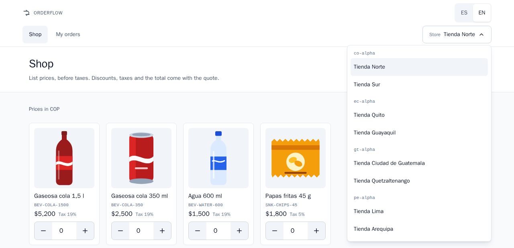
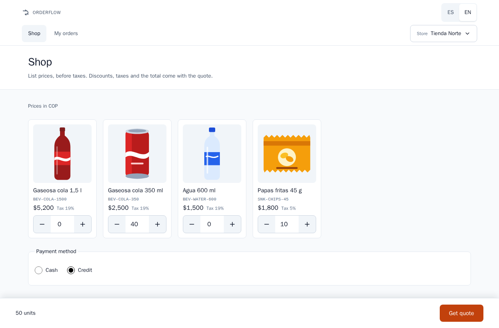
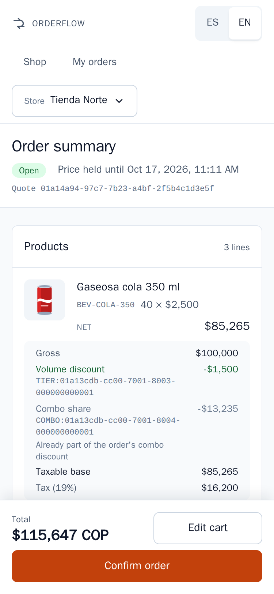
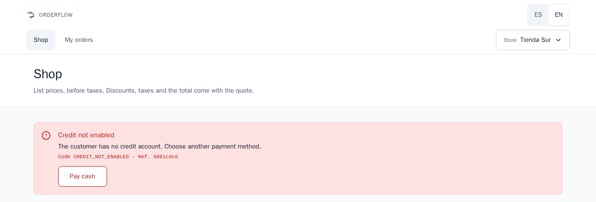

# Orderflow Engine — User manual

> **Question this document answers:** How does a shopkeeper place an order in the Orderflow Engine web client, from choosing the store to finding the order in the history?

## Before you start

### What Orderflow Engine is

Orderflow Engine is the ordering system of your beverage distributor. On one web page you choose products, see the exact price of your order with every discount, gift and tax, and confirm it. The price you see on the quote is the price of the order you confirm.

The system serves stores in four countries: Colombia, Ecuador, Guatemala and Peru. Each country has its own currency, its own taxes and its own promotions.

### What you can do

| You want to | Screen | What you tap |
|-------------|--------|--------------|
| Choose the store you order for | Top of every screen | **Store** |
| Read the screens in Spanish or English | Top of every screen | **ES** or **EN** |
| Add products and set quantities | **Shop** | **+** and **−**, or type the quantity |
| Pay cash or on credit | **Shop** | **Payment method** |
| See the exact price of your order | **Shop** | **Get quote** |
| Turn the quote into an order | **Order summary** | **Confirm order** |
| See the orders you placed | **My orders** | The row of the order |

### How to read this manual

- The sections follow the order in which you use the screens: store, cart, quote, confirmation, history.
- Words in **bold** are exactly what the screen shows in English. The Spanish manual quotes the Spanish screens.
- The examples use Tienda Norte, the first store in the list, which buys in Colombian pesos.
- Amounts are written as the screen shows them, for example $115,647: the comma separates thousands and the point, decimals.
- Notices that start with **Note** or **Important** point out what you should remember.
- To open the system, open the web address your distributor gave you in your browser. On a computer where the system is installed it is `http://localhost:8081`.

> **Note:** There is no user name or password. Choosing a store tells the system who is ordering.

## Choose your store and language

### Choose your store

1. At the top of the screen, tap **Store**. It shows the name of the current store.
2. The list opens. Stores are grouped by a short code of their country: `co-alpha` (Colombia), `ec-alpha` (Ecuador), `gt-alpha` (Guatemala) and `pe-alpha` (Peru).
3. Tap your store. The list closes and the **Shop** screen of that store opens.

- On your first visit the system selects the first store of the list, Tienda Norte. After that, this browser remembers the store you chose.
- Each store has its own cart. Changing the store does not mix the products of two stores.
- Prices, quotes, credit and orders always belong to the store you chose.
- With a keyboard, the Esc key closes the list without changing the store.

### Change the language

- Tap **ES** for Spanish or **EN** for English, at the top of the screen. The screen changes at once and nothing in your cart is lost.
- Spanish is the language of the first visit. This browser remembers your choice for the next visit.
- A link that ends in `?lang=en` opens the system in English, and `?lang=es` in Spanish.
- Money, numbers and dates follow the language you chose.
- Messages from the system, such as errors, also arrive in the language you chose.

> **Note:** Product names and store names are written by the distributor, in Spanish for the four countries. The language switch translates the screens and the messages, not the names of the products.

## The catalog and the cart

The **Shop** screen is your catalog and your cart in one page. Under the title it reminds you: "List prices, before taxes. Discounts, taxes and the total come with the quote." Above the products it names the currency of your store, for example **Prices in COP**.

Each product card shows:

- the picture and the name of the product, such as Gaseosa cola 350 ml;
- the product code, such as `BEV-COLA-350`;
- the list price before taxes;
- the tax of the product, such as **Tax 19%**;
- the quantity box, with **−** on the left and **+** on the right.

### Add products

1. Tap **+** under a product to add one unit.
2. Or tap the quantity box and type the number of units.
3. The bar at the bottom of the screen counts the units in your cart, for example **50 units**.

### Change quantities

- Tap **+** or **−**, or type a new number in the box.
- Quantities are whole units. If you leave the box with something that is not a whole number, it counts as 0.
- Each product takes from 1 to 1,000,000 units. A larger quantity returns the message **Invalid quantity**.
- The cart shows units only, never a subtotal or a total. The price, with its discounts and taxes, comes with the quote.

### Remove a product

- Tap **−** until the quantity is 0, or type 0. A product with 0 units is not part of the order.
- When the cart has no units, the bottom bar says **Add products to get a quote**.
- After you confirm an order, the cart of that store empties by itself.

> **Note:** The cart is kept in this browser, on this device. Another device or another browser has its own cart, and clearing the browser data empties it.

### Choose how to pay

Under the products, **Payment method** offers **Cash** and **Credit**. Cash is selected until you change it.

- **Cash**: the order does not use credit.
- **Credit**: the order is charged to your store's credit. Only stores with a credit account can use it. In the delivered data these are Tienda Norte, Tienda Quito, Tienda Ciudad de Guatemala and Tienda Lima.

When your cart is ready, tap **Get quote**. The button reads **Getting quote…** while the price is calculated, and it is disabled while the cart is empty.

> **Important:** If your store has no credit account and you choose **Credit**, the message **Credit not enabled** appears with the button **Pay cash**. Tap it to get the same quote paid in cash.

## Get a quote

The quote opens the **Order summary**. At the top you see:

- the state of the quote: **Open**, **Confirmed** or **Expired**;
- **Price held until** followed by the date and time: until then the price of this quote does not change;
- **Quote** followed by a long code that identifies it.

### What the summary shows

The **Products** card has one line for each product you pay for, and one line for each gift. A product line shows the quantity times the list price, for example "40 × $2,500", its **Net** amount, and how it was reached:

| Label | What it means |
|-------|---------------|
| **Gross** | Quantity times the list price |
| **Volume discount** | Discount for buying many units, with the code of the rule that gave it |
| **Combo share** | The part of a combo discount that falls on this product. The note "Already part of the order's combo discount" reminds you that it is not a second discount |
| **Taxable base** | The amount the tax of this line is calculated on |
| **Tax (19%)** | The tax of the line, with its rate |

A gift line shows the badge **Gift × 1** (with its quantity), **Free** as its net amount, its **Reference value** (what it would cost at list price), its **Taxable base** and its **Tax**. When your country taxes gifts, the line adds: "The customer pays the gift's tax".

The **Totals** card adds up the order. It names the currency, for example **Amounts in COP**:

| Label | What it means |
|-------|---------------|
| **Gross subtotal** | The products you pay for, at list price |
| **Discounts** | Each discount of the order, **Combo** or **Volume discount**, with its rule code and a minus sign |
| **Gifts** | Each gift with its quantity, marked **Free** |
| **Taxable base** | What taxes are calculated on: products after discounts, plus the reference value of the gifts when your country taxes them |
| **Taxes** | The sum of the taxes of every line |
| **Total** | What you pay: the products after discounts, plus taxes |

The bar at the bottom always shows the **Total** followed by the currency code, for example "$115,647 COP", and two buttons:

- **Edit cart** opens the cart with the products and quantities of this quote, so you can change them and tap **Get quote** again. Each new quote has its own price and its own time limit.
- **Confirm order** turns this quote into an order (see "Confirm the order").

> **Note:** The currency code follows every total because the Colombian peso and the US dollar both use the $ sign.

### Your credit

When you pay on credit, the **Paid on credit** card shows:

- **Available credit**: your credit limit minus what earlier credit orders used;
- "The order fits your credit" when the total is equal to or lower than the available credit;
- otherwise "You are $… short" and the **Shortfall** amount;
- always the note "Advisory only: credit is used only when you confirm".

Quoting never reserves credit. Credit is used only when you confirm the order, and only once. The summary checks your credit each time you open it.

When the order does not fit, a warning appears: **The order does not fit your credit** — "It exceeds your available credit by $…. You can pay cash instead." **Confirm order** stays disabled. Tap **Pay cash** to get a new quote of the same products paid in cash, or **Edit cart** to order less.

### On a phone

The system works the same way on a phone. The bar with the total and the buttons stays at the bottom of the screen, also when the keyboard is open. Long product names wrap onto more lines; they are never cut.

## How prices are calculated

The system calculates every amount; the screen shows them exactly as the system sends them. List prices do not include taxes. The promotions of your country are listed in "Countries and currencies".

### The order of the steps

| Step | What happens | Why it matters to you |
|------|--------------|-----------------------|
| 1. Gifts | The system checks whether your order earns a gift. It looks at what you buy: the units you pay for, or the gross subtotal before discounts | A gift never changes what you pay for your products |
| 2. Combos | A combo is a set of products sold together at a fixed price. It takes its units first | The units of a combo get no volume discount on top: there is never a double discount |
| 3. Volume discounts | Units left outside combos are counted in steps. Each percentage applies only to the units inside its step | The 25th unit gets the percentage of its step, never two percentages added together |
| 4. Net per line | Gross minus the discounts of the line | — |
| 5. Taxable base | Taxes are calculated after discounts. A gift's reference value is added only where the country taxes gifts | You never pay tax on a discount |
| 6. Taxes | Each line has the tax rate of its product. Each line's tax is rounded on its own to the currency: whole pesos for COP, cents for USD, GTQ and PEN; a half rounds up | The total always equals the sum of its lines |
| 7. Total | Net of the products you pay for, plus all taxes | This is the amount you confirm |
| 8. Credit | Only when you pay on credit: the total is compared with your available credit | It is a check, not a charge |

> **Note:** Gift units never count toward a volume discount or a combo.

### Worked example

This example uses the delivered data of Tienda Norte (`co-alpha`, Colombia, pesos without cents), paying on credit. The cart has 40 units of Gaseosa cola 350 ml at $2,500 each (tax 19%) and 10 units of Papas fritas 45 g at $1,800 each (tax 5%). Tienda Norte has three promotions: the combo "2 Gaseosa cola 350 ml + 1 Papas fritas 45 g for $5,000", a volume discount on Gaseosa cola 350 ml (5% for units 10 to 19, 10% from unit 20), and the gift "1 Agua 600 ml for every 10 snacks".

| Step | Calculation | Result |
|------|-------------|--------|
| Gross subtotal | 40 × $2,500 = $100,000, plus 10 × $1,800 = $18,000 | $118,000 |
| 1. Gift | 10 bags of chips reach "1 water for every 10 snacks" | 1 Agua 600 ml, **Free** |
| 2. Combo | The combo fits 10 times, because there are 10 bags. It takes 20 colas and 10 bags, worth $68,000 at list price, and charges 10 × $5,000 = $50,000 | **Combo** −$18,000 |
| Combo shares | The $18,000 is shared by the value of each product in the combo: $13,235 on the colas and $4,765 on the chips | **Combo share** on each line |
| 3. Volume discount | 20 colas are left outside the combo. Units 1 to 9 have no discount; units 10 to 19 get 5%: 10 × $2,500 × 5% = $1,250; unit 20 gets 10%: 1 × $2,500 × 10% = $250 | **Volume discount** −$1,500 |
| 4. Net | Colas: $100,000 − $1,500 − $13,235 = $85,265. Chips: $18,000 − $4,765 = $13,235 | $98,500 |
| 5. Taxable base | $85,265 + $13,235 + the gift's reference value of $1,500, because Colombia taxes gifts | $100,000 |
| 6. Taxes | Colas: 19% of $85,265 = $16,200.35, rounded to $16,200. Chips: 5% of $13,235 = $661.75, rounded to $662. Gift: 19% of $1,500 = $285 | $17,147 |
| 7. Total | $98,500 + $17,147 | **$115,647 COP** |
| 8. Credit | Tienda Norte starts with a credit limit of $500,000. The order fits while the available credit is $115,647 or more | "The order fits your credit" |

The **Totals** card of this quote shows: **Gross subtotal** $118,000; **Discounts**: **Combo** −$18,000 and **Volume discount** −$1,500; **Gifts**: Agua 600 ml × 1, **Free**; **Taxable base** $100,000; **Taxes** $17,147; **Total** $115,647.

> **Important:** When a gift is taxed, the total is not the taxable base plus taxes. The gift's reference value enters the taxable base only so that its tax can be calculated: you pay the gift's tax ($285 here), never the gift itself.

## Confirm the order

1. Check the products, the discounts and the **Total** of the **Order summary**.
2. Tap **Confirm order**. The button reads **Confirming…** and stays disabled until the system answers.
3. The **Order** screen opens with the notice **Order confirmed** — "Your order number is CO-000042." (with your own number).

**Confirm order** is disabled when the quote is expired, already confirmed, or paid on credit without enough credit. The notice above the summary tells you which, and offers the button that solves it.

### One tap is enough

- From the first tap until the answer, the button is disabled: more taps send nothing.
- If the connection fails, the message offers **Retry**. Retrying, or coming back to the quote later and tapping **Confirm order** again, sends the same confirmation, never a new one. The system recognizes it and answers with the order it already created.
- In that case the **Order** screen shows **This order was already recorded** — "We received the same confirmation again: no second order was created and no more credit was used."
- A quote becomes one order at most. If it was already confirmed, for example from another browser, the summary says **This quote is already an order** and offers **View order** followed by its number, or **View my orders**.
- The confirmed total is always the quoted total: the order keeps the figures of the quote and never recalculates them, even if a price changed after you quoted.

> **Important:** A double tap, a slow connection or a page reload never creates two orders and never uses your credit twice.

### Your order number

- An order number has the letters of its country and six digits, for example `CO-000042`. Each country counts its own orders.
- The **Order** screen shows **Order** followed by the number, the state **Confirmed**, "Confirmed on" with the date and time, and **Payment:** **Cash** or **Credit**. Below, it repeats the same lines and totals as the summary.
- The bottom bar shows the **Total** and two buttons: **View my orders** and **Keep shopping**, which opens the cart.
- Keep the order number: it is how you and your distributor identify the order.

## My orders

Tap **My orders** at the top of any screen to see the orders of the chosen store, **Newest first**.

- Each row shows the order number, the date and time it was confirmed, and its total with the currency code. Tap a row to open the order.
- The list shows the 20 most recent orders of the store.
- An order you have just confirmed appears at the top at once.
- With no orders yet, the screen says **You have no orders yet** — "Confirmed orders appear here."
- **Go shopping**, at the bottom, opens the cart.
- To see the orders of another store, choose that store first.

## Messages and what to do

An error message always shows a title, an explanation, the line "Code" with a code in capital letters and "Ref." with a short reference, and one button: the action that gets you out of the problem. If you call for help, give the code and the reference.

### Notices about your quote or order

These notices are not errors. They tell you the state of your quote or order.

| Notice as shown | What it means | What to do |
|-----------------|---------------|------------|
| **The order does not fit your credit** — "It exceeds your available credit by $…. You can pay cash instead." | You pay on credit and the total is higher than your available credit | Tap **Pay cash**, or **Edit cart** to order less |
| **The quote expired** — "The price was held until …. Quote again to see current prices." | The time the price was held has passed | Tap **Quote again**: same products, same payment method, current prices |
| **This quote is already an order** — "A quote is confirmed only once." | This quote was confirmed before | Tap **View order** and its number, or **View my orders** |
| **Order confirmed** — "Your order number is …." | Your order was created | Nothing. Keep the number |
| **This order was already recorded** — "We received the same confirmation again: no second order was created and no more credit was used." | Your confirmation reached the system twice, and only one order exists | Nothing |

### Error messages

The title and explanation are those of the English screen; the code never changes.

| Message as shown (code) | What it means | What to do |
|-------------------------|---------------|------------|
| **We could not reach the server** — "Check your connection and try again." (no code) | The system did not answer | Check your connection and tap **Retry**. If the button is another one, tap it and tell your operator |
| **Credit not enabled** (`CREDIT_NOT_ENABLED`) | Your store has no credit account | Tap **Pay cash**: the same products are quoted in cash and the new quote opens |
| **Credit limit exceeded** (`CREDIT_LIMIT_EXCEEDED`) | When you confirmed, the total no longer fit your credit, for example because another credit order was confirmed after this quote | Tap **Pay cash** |
| **Quote expired** (`QUOTE_EXPIRED`) | The quote expired before you confirmed | Tap **Quote again** |
| **Quote already confirmed** (`QUOTE_ALREADY_CONFIRMED`) | The quote is already an order | Tap **View order** and its number. No second order was created |
| **Request in progress** (`IDEMPOTENCY_KEY_IN_PROGRESS`) | Your confirmation is still being processed | Wait a few seconds and tap **Retry**. It does not create a second order |
| **Internal error** (`INTERNAL_ERROR`) | An unexpected problem in the system | Tap **Retry**. If it repeats, tell your operator the code and the reference |
| **Invalid quantity** (`INVALID_QUANTITY`) | A quantity is not a whole number from 1 to 1,000,000 | Tap **Review cart** and correct the quantity |
| **Empty cart** (`CART_EMPTY`) | The quote had no products. **Get quote** is disabled while the cart is empty, so this is rare | Tap **Review cart** and add products |
| **Unknown product** (`UNKNOWN_SKU`) | A product of the cart is no longer sold to your store | Tap **Review cart**, reload the page so the product list is current, and tap **Get quote** again |
| **Quote not found** (`QUOTE_NOT_FOUND`) | The quote does not exist or belongs to another store, for example a saved link opened with another store chosen | Tap **Edit cart**. Choose the store that made the quote, or quote again |
| **Order not found** (`ORDER_NOT_FOUND`) | The order does not exist or belongs to another store | Tap **View my orders**, or choose the store that placed the order |
| **Customer not found** (`CUSTOMER_NOT_FOUND`) | The store you chose is not registered in the system | Tap the button shown and tell your operator |
| **Unknown tenant** (`TENANT_NOT_FOUND`) | The country group of your store is not registered in the system | Tell your operator |
| **Invalid request** (`VALIDATION_FAILED`) | The system could not read the request | Tap the button shown. If it repeats, tell your operator |
| **Request not supported** (`REQUEST_NOT_SUPPORTED`) | The request did not reach a part of the system that can answer it | Tell your operator |
| **Missing idempotency key** (`IDEMPOTENCY_KEY_MISSING`) or **Invalid idempotency key** (`IDEMPOTENCY_KEY_INVALID`) | The confirmation code of the order was missing or malformed. The web page always sends a valid one, so it should not appear | Tap **Edit cart**, get a new quote and tell your operator |
| **Idempotency key reused** (`IDEMPOTENCY_KEY_REUSED`) | The confirmation code was already used for a different request | Tap **Edit cart**, get a new quote and confirm it. If it repeats, tell your operator |

For any message without an action of its own, the button depends on the screen:

| Screen | Button | What it does |
|--------|--------|--------------|
| **Shop** | **Review cart** | Closes the message and keeps your cart as it was |
| **Order summary** | **Edit cart** | Opens the cart with the products of the quote |
| **Order** | **View my orders** | Opens your order history |
| **My orders** | **Go shopping** | Opens the cart |

> **Note:** If a new quote fails after **Pay cash** or **Quote again**, its message appears on the **Shop** screen.

## Frequently asked questions

### The price changed after I quoted. Which one do I pay?

You pay the price of your quote. It is held until the time shown in **Price held until**: 15 minutes after quoting in the four countries. Price or promotion changes made in that time do not touch your quote, and the confirmed total is always the quoted total. After that time the quote expires, and **Quote again** shows the current prices.

### My quote expired. What do I do?

Tap **Quote again**. You get a new quote with the same products and the same payment method, at current prices. To change products first, tap **Edit cart**.

### My credit is not enough. What can I do?

Tap **Pay cash** to quote the same order in cash, or **Edit cart** to order less. Quoting never uses credit: it is used only when you confirm, by exactly the order total. This version does not include payments or freeing used credit; ask your distributor about them.

### Why do I see a gift line?

Your order reached a gift promotion of your country, for example 1 Agua 600 ml for every 10 snacks in Colombia. The gift has its own line, marked **Gift** and **Free**, even if you also buy the same product. Its **Reference value** is what it would cost at list price. In Colombia and Peru you pay the gift's tax; in Ecuador and Guatemala the gift has no tax.

### Can I cancel an order?

No. Cancelling orders is not included in this version. A confirmed order stays confirmed. Talk to your distributor, with the order number at hand.

### Can I add products or stores?

Not from these screens. The products, stores, prices and promotions are loaded into the system by an operator. The Technical manual explains how.

### Why are product names in Spanish when I chose English?

Product names and store names are written by the distributor, in Spanish for the four countries. The **ES**/**EN** switch translates the screens and the messages, not the names.

### Why is my cart empty on another device?

The cart is kept in the browser where you built it. Another device, another browser, or clearing the browser data starts with an empty cart. Confirmed orders are different: the system keeps them, so they appear in **My orders** on any device.

### What are the long codes next to discounts and gifts?

They identify the promotion that gave the discount or the gift, such as `TIER:…` for a volume discount, `COMBO:…` for a combo and `GIFT:…` for a gift. You do not need them, but they help your operator answer questions about a price.

## Countries and currencies

| Group in the store list | Country | Currency | Decimals | Tax on products | Gift tax | Stores |
|-------------------------|---------|----------|----------|-----------------|----------|--------|
| `co-alpha` | Colombia | Colombian peso (COP) | None | 19% on colas and water, 5% on chips | The customer pays it | Tienda Norte (credit), Tienda Sur (cash only) |
| `ec-alpha` | Ecuador | US dollar (USD) | 2 | 15% on every product | None | Tienda Quito (credit), Tienda Guayaquil (cash only) |
| `gt-alpha` | Guatemala | Quetzal (GTQ) | 2 | 12% on every product | None | Tienda Ciudad de Guatemala (credit), Tienda Quetzaltenango (cash only) |
| `pe-alpha` | Peru | Sol (PEN) | 2 | 18% on every product | The customer pays it | Tienda Lima (credit), Tienda Arequipa (cash only) |

| Group | Volume discount | Combo | Gift | Starting credit limit |
|-------|-----------------|-------|------|-----------------------|
| `co-alpha` | Gaseosa cola 350 ml: 5% for units 10 to 19, 10% from unit 20 | 2 Gaseosa cola 350 ml + 1 Papas fritas 45 g for $5,000 | 1 Agua 600 ml for every 10 snacks, repeated for every 10 | $500,000 COP (Tienda Norte) |
| `ec-alpha` | Both colas counted together: 4% for units 12 to 23, 8% from unit 24 | 6 Gaseosa cola 350 ml + 2 Chifles 45 g for $3.99 | 2 Agua 600 ml when the gross subtotal is $50.00 or more, once per order | $1,500.00 USD (Tienda Quito) |
| `gt-alpha` | Gaseosa cola 350 ml: 5% for units 12 to 23, 10% from unit 24 | None | 1 Agua 600 ml for every 12 Gaseosa cola 350 ml, repeated for every 12 | 5,000.00 GTQ (Tienda Ciudad de Guatemala) |
| `pe-alpha` | None | 2 Gaseosa cola 350 ml + 1 Papas fritas 45 g for 6.00 PEN | 1 Agua 600 ml when the gross subtotal is 100.00 PEN or more, once per order | 2,000.00 PEN (Tienda Lima) |

- In the four countries a quote holds its price for 15 minutes.
- Totals always show the currency code, because the Colombian peso and the US dollar share the $ sign.
- The starting credit limit is the limit before any order: each confirmed credit order lowers the available credit by its total.

> **Note:** These are the values the system is delivered with. Your distributor can change them; the **Shop** screen and the quote always show the current ones.
