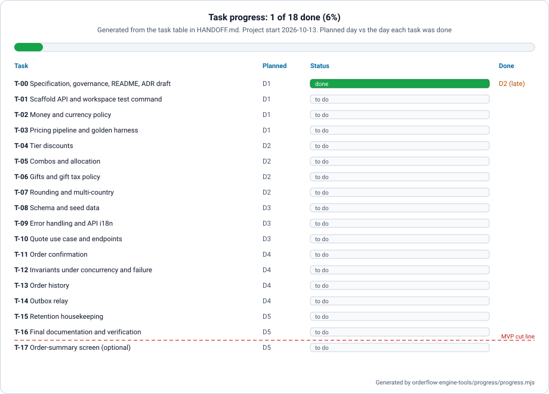

# Orderflow Engine — Handoff

> **Question this document answers:** where does the work stand right now, and how do I pick it up?

**Opening a new session? Start here.** This is the only place where the verified state lives (§3). Other documents link here instead of copying numbers, because a number copied into two places goes stale in one of them.

## 1. What Orderflow Engine is

It is a pricing engine and an idempotent order confirmation for a multi-country B2B beverage marketplace, built as a technical take-home. The assignment is in [assignment/](../assignment/), and the rules are in [SPEC.md](../spec/SPEC.md).

## 2. Workspace

| Folder | State |
|--------|-------|
| `orderflow-engine-docs` | Specification, plan, contract, data model, architecture, 9 diagrams, governance, ADR in Word and PDF, this handoff |
| `orderflow-engine-api` | **The deliverable.** Pricing engine, sealed quotes, idempotent order confirmation, order history, outbox relay and retention housekeeping (T-02 … T-16, T-18). README with the four required topics and an operations section, and ADR-0001 (accepted) |
| `orderflow-engine-web` | README only. T-17 builds the Angular client: the order summary the assignment offers as a plus and, at the product owner's request, the full flow around it (cart → quote → confirmation → order → history). Its nginx forwards `/api/` to the API, so the browser sees one origin |
| `orderflow-engine-infra` | Full-stack compose and `test-all` (T-01). The web client joins both in T-17 |
| `orderflow-engine-tools` | Generators and checks: figures, progress chart, ADR in Word and PDF, documentation, integrity and consistency checks. Own Docker image |
| `orderflow-engine-app` | Reserved. Not built |

Each folder is a private GitHub repository of the account `ariel5253`, initialized on 2026-10-14. The **preparation phase (T-00) is closed**: each code repository received it in `dev` through thematic pull requests and then in `main` through `chore: close preparation phase (T-00)`. This repository has only `main` and received every change through a pull request ([branches-and-environments](../governance/branches-and-environments.md)). The pull requests of each phase are listed in §8, §9 and §10.

Phases close on the owner's order, each with a merge commit on the `main` of the code repositories it changed:

| Phase | Tasks | Closed on | Merge commit |
|-------|-------|-----------|--------------|
| 1. Preparation | T-00 | 2026-10-14 | `chore: close preparation phase (T-00)` in every code repository |
| 2. Scaffold | T-01 | 2026-10-15 | `chore: close scaffold phase (T-01)` in `orderflow-engine-api` and `orderflow-engine-infra` (the other code repositories did not change) |
| 3. Core | T-02 … T-16, T-18 | 2026-10-15 | `chore: close core phase (T-16)` in `orderflow-engine-api`, `orderflow-engine-infra` and `orderflow-engine-web` (`orderflow-engine-app` did not change) |

## 3. State (verified)

| Item | Value | Verified by |
|------|-------|-------------|
| Current task | The core phase is closed: T-02 … T-16 and T-18 are on `dev` and `main` of `orderflow-engine-api` (§10). The assignment's A1, A2 and A3 are delivered. Next: T-17, the optional web client, on the owner's order | `gh pr list --state merged` on each repository on 2026-10-15 |
| Specification | **Pre-release.** SPEC and TASKS are still being improved before the first version. Formal change control starts only after the first version is accepted | Measured review: 21 of 21 assignment bullets specified, the readable history now included; 10 ACs beyond the assignment, each justified in SPEC §14.3 (`cross_reference_check.py` on 2026-10-15) |
| Front scope | On 2026-10-15 the product owner adopted the full web flow (cart → quote → confirmation → order → history, with a store picker) beyond the assignment's one-hour order-summary screen. T-17 is planned as thematic pull requests, estimated at about 13.5 h (11 to 16 h). Pull request 1 (the specification) is delivered: it was merged inside `orderflow-engine-docs` #12, together with the core phase alignment, as GC-9 requires. Pull requests 2 … 8 (about 12.5 h) start on the owner's order. Scope verdict on 2026-10-15: E-07 adopted under T-17 with the shape of SPEC §8; `currency` in E-05 is a contract conformance fix, delivered in T-13 | SPEC §1 (Deviation), §10 and §14.3; TASKS T-17 |
| Tasks done | T-00 (21 task and 5 phase-closing pull requests, §8), T-01 (9 task and 2 phase-closing pull requests, §9), and T-02 … T-16 and T-18 (20 task and 3 phase-closing pull requests, §10) | `gh pr list --state merged` on each repository on 2026-10-15 |
| Branch protections | Rulesets are rejected by GitHub on private repositories of a free plan (HTTP 403). The rules are followed by hand and the rulesets are applied when the repositories become public | `gh api repos/ariel5253/<repository>/rulesets` on 2026-10-14 |
| Documentation check | OK, including the rule that no relative link leaves its repository | `node orderflow-engine-tools/docs-check/check-docs.mjs` on 2026-10-15 |
| Repository integrity | OK in all six repositories: ignore files, `.gitattributes`, Docker files, `.env.example`, no secrets | `node orderflow-engine-tools/integrity/check-integrity.mjs` on 2026-10-15 |
| Tools image | Builds. Inside the container, `check-docs` and `check-integrity` pass, and the figures and progress chart are byte-identical to the host's | `docker build` and `docker run` of `orderflow-engine-tools` on 2026-10-14 |
| Standalone repositories | Each folder copied alone has 0 broken links | Copy of each folder outside the workspace, links resolved, on 2026-10-14 |
| ADR-0001 length | One A4 page at Arial 12 (2 cm margins), in English and in Spanish, as Word and PDF, with the accepted text | `python orderflow-engine-tools/render/build_deliverables.py` fails above one page; page count = 1 on 2026-10-15 |
| Deliverable metadata | Author = license holder, title = document title. The Word files carry no generator or application name; the PDF files keep the converter's `Creator` and `Producer` fields | docx core properties and PDF info dictionary read on 2026-10-15 |
| API tests | 310 unit and 287 integration tests green (Testcontainers PostgreSQL 17), the six golden tests among them. JaCoCo: 100% of lines and branches in `pricing.domain` (222 lines, 56 branches) and `pricing.domain.lever` (215 lines, 83 branches), gate ≥ 90%; 99.1% of lines and 97.9% of branches in the whole service | `./mvnw verify` and `target/site/jacoco/jacoco.xml` on the T-16 commit, and `bash orderflow-engine-infra/scripts/test-all.sh` → `test-all: OK` on `dev`, on 2026-10-15 |
| Web tests | not started (T-17) | — |
| PIT mutation score | 176 of 176 mutations detected (100%; 175 killed by an assertion, 1 by a timeout), threshold 80%, on `pricing.domain` and `pricing.domain.lever`. Test strength 100%; line coverage of the mutated classes 428/438 (98%) | `./mvnw -Pmutation verify` on 2026-10-15 |
| Time spent | Three working days, 2026-10-13 to 2026-10-15, including the specification, as the API README states. For T-17, measured per pull request when it merges, in three parts (the assignment's screen, the container and test wiring, the extension), then recorded in the API README under "Not included" | API README, on 2026-10-15 |

Update this table at the end of every task, using the output of the command in the last column.

## 4. Task progress

Project start: 2026-10-13. Cut line after: T-16. Update this table at the end of every task (GC-8), then regenerate the chart with `node orderflow-engine-tools/progress/progress.mjs`. `check-docs` fails if the chart does not match the table.



| Task | Title | Planned | Status | Done on |
|------|-------|---------|--------|---------|
| T-00 | Specification, governance, README, ADR draft | D1 | done | 2026-10-14 |
| T-01 | Scaffold API and workspace test command | D1 | done | 2026-10-15 |
| T-02 | Money and currency policy | D1 | done | 2026-10-15 |
| T-03 | Pricing pipeline and golden harness | D1 | done | 2026-10-15 |
| T-04 | Tier discounts | D2 | done | 2026-10-15 |
| T-05 | Combos and allocation | D2 | done | 2026-10-15 |
| T-06 | Gifts and gift tax policy | D2 | done | 2026-10-15 |
| T-07 | Rounding and multi-country | D2 | done | 2026-10-15 |
| T-08 | Schema and seed data | D3 | done | 2026-10-15 |
| T-09 | Error handling and API i18n | D3 | done | 2026-10-15 |
| T-10 | Quote use case and endpoints | D3 | done | 2026-10-15 |
| T-11 | Order confirmation | D4 | done | 2026-10-15 |
| T-12 | Invariants under concurrency and failure | D4 | done | 2026-10-15 |
| T-13 | Order history | D4 | done | 2026-10-15 |
| T-14 | Outbox relay | D4 | done | 2026-10-15 |
| T-15 | Retention housekeeping | D5 | done | 2026-10-15 |
| T-18 | Wire the levers into quotes | D5 | done | 2026-10-15 |
| T-16 | Final documentation and verification | D5 | done | 2026-10-15 |
| T-17 | Web client: summary and full flow (optional) | D5 | doing | |
| T-19 | Fixes after the T-17 preview | D5 | doing | |

## 5. Commands to resume

```bash
# Clone the workspace: every repository side by side
for r in api web infra docs tools app; do gh repo clone ariel5253/orderflow-engine-$r; done

# From the workspace root (the folder that contains orderflow-engine-*)
node orderflow-engine-tools/docs-check/check-docs.mjs      # documentation governance
node orderflow-engine-tools/integrity/check-integrity.mjs  # ignore files, line endings, secrets
python orderflow-engine-tools/diagrams/generate_diagrams.py # regenerate and check the figures
python orderflow-engine-tools/render/build_deliverables.py  # ADR in Word and PDF (needs LibreOffice)
# From T-01 on:
orderflow-engine-infra/scripts/test-all.sh                 # API verify + web tests + docs and integrity checks
(cd orderflow-engine-api && ./mvnw verify)                 # API only
(cd orderflow-engine-api && docker compose up --build)     # run the service and its database
# From T-17 on:
(cd orderflow-engine-web && docker build --target test .) # web: no-literal-text check, then the specs in headless Chromium, in a container
(cd orderflow-engine-web && docker compose up --build)     # the web client alone; /api/ goes to an API on the host
(cd orderflow-engine-infra && docker compose up --build)   # database, API and web client on one command
```

Toolchain found on the build machine:
- Java 21
- Node 24 (24.20 since 2026-10-15): the documentation and integrity checks; the web specs only when they run on the host instead of in their container
- Docker Desktop (required by Testcontainers and by every `compose.yaml`)
- Python 3.11 with `python-docx` and `pypdf` (tools; see its `requirements.txt`)
- LibreOffice (tools: PDF conversion)

Maven is not installed globally, so the Maven Wrapper is used. From T-17 on, the web specs run in a container (the `test` stage of the web `Dockerfile`), so they need only Docker. Running them on the host instead needs a Node version the pinned Angular accepts (22.22.3 or later in the 22 line, or 24.15 or later) and Chromium: `npx playwright install chromium`, once, in `orderflow-engine-web`.

## 6. Open decisions

| Code | Decision pending | Owner |
|------|------------------|-------|
| OD-01 | Resolved on 2026-10-14: the repositories are initialized and private. They become public at delivery, after the release pull requests, and the rulesets are applied then | Owner |
| OD-02 | Scope cuts, if any, at the end of day 4 (see the cut line in TASKS) | Owner |
| OD-03 | Resolved on 2026-10-14: the owner is `ariel5253`. Repositories keep citing each other by name, without links, while they are private | Owner |
| OD-04 | Resolved on 2026-10-15: (a) E-07 adopted, read-only, under T-17 and cut with the cart; (b) `currency` in E-05 is a conformance fix in T-13, with no §14.3 row | Owner |
| OD-05 | Resolved on 2026-10-15: SPEC §9 sets a formatting locale in each web dictionary (`app.formatLocale`: `es-419`, `en`). With the bare `es` locale, `Intl.NumberFormat` prints `1500 $`, with no grouping and the symbol after the number; with `es-419` it prints `$1,500`, so a Colombian user reads `$115,647`, not `$ 115.647`. Keeping it in the dictionary preserves "adding a language means adding one file" | Owner |

## 7. Traps already found

| Code | Trap | How to avoid it |
|------|------|-----------------|
| TR-01 | `java.util.Currency` reports COP with 2 decimals | Scale always comes from the `countries` table (SPEC §4) |
| TR-02 | Code prefixes that look alike get confused (e.g. rounding points and requirements) | Every code family has a distinct prefix. See the codes table in the [document map](../README.md) |
| TR-03 | A rule a check cannot enforce decays | Prefer adding a rule to `check-docs` or an ArchUnit test over writing a guideline |
| TR-04 | Scope creep: good ideas the assignment does not ask for | SPEC §1 is the boundary. Anything new updates it first (GC-9) |
| TR-05 | `check-docs` runs in the workspace, where all repositories sit side by side, but the evaluator clones one repository at a time | A relative link may never leave its repository. `check-docs` enforces this |
| TR-06 | GitHub rejects rulesets on private repositories of a free plan | Follow the protection rules by hand while private, and never enable automatic deletion of head branches before the deletion rulesets exist, or a phase-closing merge deletes `dev` |
| TR-07 | Windows clones have `core.filemode=false`, so a plain `git add` records `mvnw` and `scripts/test-all.sh` without the executable bit and they fail on Linux and macOS | Stage them with `git add --chmod=+x`, then check `git ls-files -s` shows `100755` |
| TR-08 | Until T-02 added the first pricing domain class, `./mvnw -Pmutation verify` stopped with "No mutations found" on purpose | Resolved in T-02: the qualifying sentence is gone from both API READMEs, and the profile now reports the score in §3 |
| TR-09 | A page served on one port that calls the API on another makes cross-origin calls, which the API would then have to allow with CORS | The client calls only relative `/api/` paths; nginx (or the `ng serve` proxy) forwards them to `API_UPSTREAM`. The API has no CORS configuration (architecture §1.1) |
| TR-10 | The tools read task ids as `T-NN`. A `T-17a` heading, progress row or commit tag is silently left out of the counts, the chart and the cross-references | Split a large task into thematic pull requests that all end in `(T-NN)`. Slice labels live only inside the task's section of TASKS |
| TR-11 | jsdom has no layout engine: every width is 0, so a 768 px wrapping check passes for any layout | Run the web specs in headless Chromium: the `test` stage of the web `Dockerfile` brings it, on the Playwright image. On the host, install it once with `npx playwright install chromium` |
| TR-12 | nginx resolves the `proxy_pass` host when it starts, and exits if the name does not resolve | In the full stack, the web service depends on `api`. Alone, compose maps `host.docker.internal` to the host gateway (`extra_hosts`), which Linux does not do by default |

## 8. Preparation phase pull requests

| Repository | Task pull requests | Phase closing |
|------------|--------------------|---------------|
| `orderflow-engine-tools` | #1 documentation check · #2 repository integrity check · #3 progress chart generator · #4 diagram generator with checks · #5 ADR rendering to Word and PDF · #6 consistency checks · #7 Docker image and README | #8 |
| `orderflow-engine-docs` | #1 constitution and specification · #2 plan, task plan and contract · #3 data model and architecture · #4 golden rule and git workflow · #5 documentation and integrity rules · #6 architecture diagrams · #7 assignment and document map · #8 ADR in Word and PDF · #9 this handoff | Not applicable: `main` only |
| `orderflow-engine-api` | #1 README with the required topics · #2 ADR-0001 draft | #3 |
| `orderflow-engine-web` | #1 README of the summary screen | #2 |
| `orderflow-engine-infra` | #1 README with the clone layout | #2 |
| `orderflow-engine-app` | #1 README of the reserved app | #2 |

## 9. Scaffold phase pull requests

Each API pull request was verified on a clean export of its own commit (`git archive` of the branch head, then `./mvnw verify`), so every commit on `dev` builds on its own.

| Repository | Task pull requests | Phase closing |
|------------|--------------------|---------------|
| `orderflow-engine-api` | #4 service and test command · #5 domain purity and health tests · #6 container image and compose · #7 run notes and not included | #8 |
| `orderflow-engine-infra` | #3 full-stack compose · #4 workspace test command · #5 stack and test command documentation | #6 |
| `orderflow-engine-docs` | #10 migration decision and environment scope · #11 this handoff | Not applicable: `main` only |

## 10. Core phase pull requests

API pull requests #9 … #23 were verified on a clean export of their own commit (`git archive` of the branch head, then `./mvnw verify`), so every commit on `dev` builds on its own. #24 changes documentation only and was verified with `./mvnw verify` on its commit.

| Repository | Task pull requests | Phase closing |
|------------|--------------------|---------------|
| `orderflow-engine-api` | #9 money value object · #10 pricing pipeline and golden harness · #11 schema and seeds · #12 localized problem details · #13 outbox relay · #14 retention housekeeping · #15 sealed quotes · #16 atomic order confirmation · #17 confirmation invariants · #18 order history · #19 tier discounts · #20 combos before tiers · #21 gifts with tax policy · #22 rounding and countries · #23 levers in quotes · #24 accepted ADR and evidence | #25 |
| `orderflow-engine-infra` | #7 locale, outbox and retention keys | #8 |
| `orderflow-engine-web` | #3 README of the planned web client | #4 |
| `orderflow-engine-docs` | #12 specification aligned with the built API and the web plan · #13 this handoff | Not applicable: `main` only |
