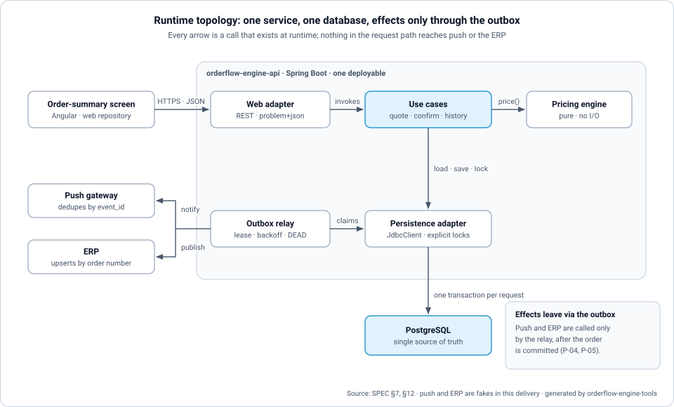
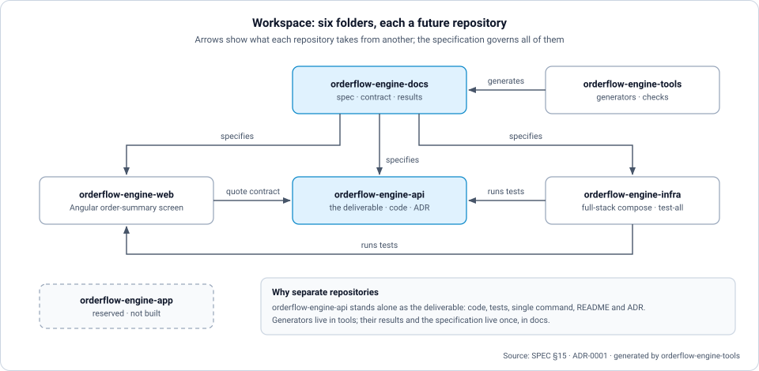
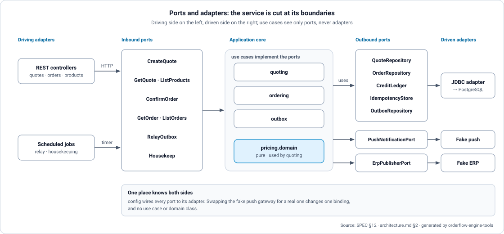
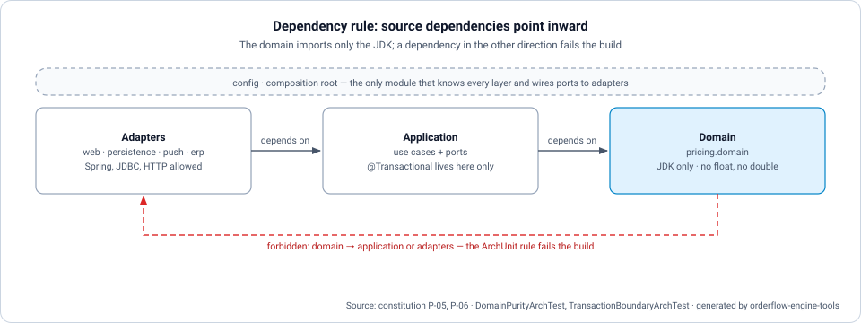
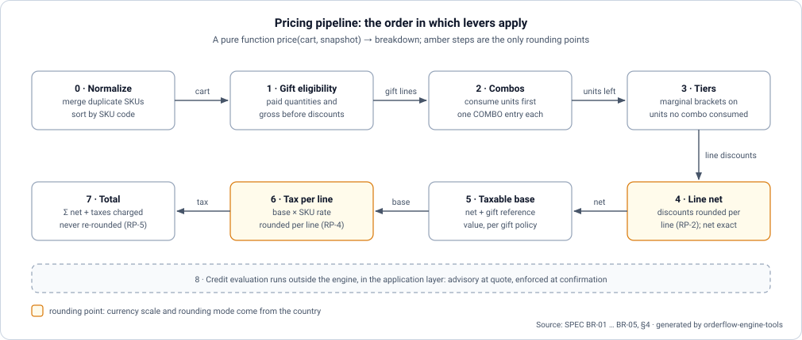
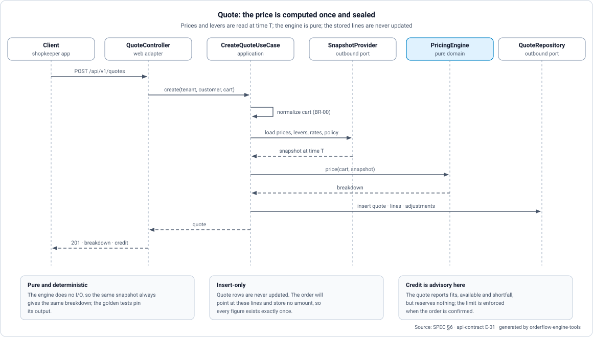
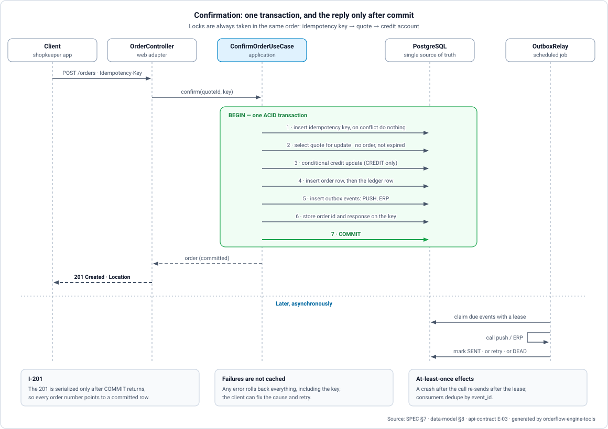
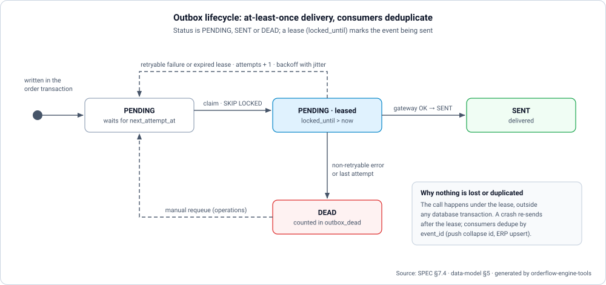

# Orderflow Engine — Architecture

> **Question this document answers:** how is Orderflow Engine shaped (topology, modules, dependency rule, request flows), and where are its risks?

Decisions are in [plan.md](plan.md), and tables are in [data-model.md](data-model.md).

## 1. Topology

| Runtime element | Responsibility | Talks to |
|-----------------|---------------|----------|
| `orderflow-engine-web` | Renders the order summary | `orderflow-engine-api` over HTTP, or a fixture JSON |
| `orderflow-engine-api` | Prices carts, seals quotes, confirms orders, serves history, relays outbox events | PostgreSQL. Push and ERP gateways (fakes in this delivery) |
| PostgreSQL | Single source of truth for catalog, levers, credit, quotes, orders, idempotency keys and outbox | — |
| Push gateway, ERP | External systems that receive `order.confirmed` | Called only by the outbox relay |

The six folders of the workspace and what each one takes from another:

## 2. Hexagon and modules

| Module | Kind | Contains |
|--------|------|----------|
| `pricing.domain` | Domain (pure) | `Money`, `CurrencyPolicy`, `PricingEngine`, lever steps, `Breakdown` |
| `quoting` | Application | `CreateQuoteUseCase`, `GetQuoteUseCase`. Ports: `SnapshotProvider`, `QuoteRepository`, `CreditAdvisor` |
| `ordering` | Application | `ConfirmOrderUseCase`, `GetOrderUseCase`, `ListOrdersUseCase`. Ports: `OrderRepository`, `CreditLedger`, `IdempotencyStore`, `OutboxWriter` |
| `outbox` | Application | `OutboxRelay`, `HousekeepingJob`. Ports: `PushNotificationPort`, `ErpPublisherPort`, `OutboxRepository` |
| `adapters.in.web` | Driving adapter | Controllers, DTOs, `ProblemDetailsAdvice`, locale and correlation filters |
| `adapters.out.persistence` | Driven adapter | `JdbcClient` repositories with explicit SQL and locks |
| `adapters.out.push`, `adapters.out.erp` | Driven adapters | Fake gateways that deduplicate by `event_id` and can be told to fail |
| `config` | Composition root | Wiring of ports to adapters, typed configuration |

### 2.1 Dependency rule

Dependencies point inward: adapters → application → domain. The domain imports only the JDK. Use cases depend on ports, never on adapters. Only `config` knows both sides. `DomainPurityArchTest` and `TransactionBoundaryArchTest` enforce the rule (P-05, P-06).

## 3. Flows

### 3.1 Pricing pipeline

The engine is a pure function `price(cart, snapshot) → breakdown`. It applies the steps of SPEC BR-01 in order. Rounding happens only at RP-2 and RP-4 (SPEC §4).

### 3.2 Quote

1. The controller validates headers and body, then calls `CreateQuoteUseCase`.
2. The use case normalizes the cart and loads the pricing snapshot (prices, active levers, tax rates, country policy) through `SnapshotProvider`. The snapshot is an in-memory input of the engine. It is not stored.
3. The engine prices the cart. `CreditAdvisor` adds the advisory credit result when the payment is `CREDIT`.
4. `QuoteRepository` inserts the quote, its lines and their discount components, which are never updated afterwards. The controller returns 201.

### 3.3 Confirmation

`ConfirmOrderUseCase` runs SPEC §7.1 in **one** transaction, taking locks in the order idempotency → quote → credit. The 201 is written only after the commit returns (I-201). Nothing in this transaction calls a remote system.

### 3.4 Outbox relay

The relay claims due events with a lease in a short transaction, commits, calls the gateway outside any transaction, and then marks the event `SENT`, or schedules a retry, or marks it `DEAD`. A crash between send and mark causes a re-send after the lease expires. Consumers deduplicate by `event_id`.

## 4. Cross-cutting concerns

| Concern | Approach |
|---------|----------|
| Errors | Typed domain and application errors carry a stable code. Only `ProblemDetailsAdvice` maps them to HTTP status and localized `problem+json` |
| i18n | API: `MessageSource` bundles. Web: ngx-translate JSON. Spanish is the default (SPEC §9) |
| Observability | Logs with `correlationId`. Actuator health. `outbox_pending` and `outbox_dead` gauges |
| Configuration | Environment variables. No secret defaults. Country behavior is data (P-07) |
| Time | An injected `Clock`. Tests fix it, which makes goldens and expiry deterministic |

## 5. Risks

The risk register (RISK-01…RISK-07) is in [plan.md](plan.md) §4. The two that shape this architecture most:

| Risk | Where it lives | Containment |
|------|----------------|-------------|
| RISK-01 credit-row contention | Step 3 of the confirmation | Short transaction, `lock_timeout`, explicit 409 |
| RISK-05 consumer without dedupe | Outbox relay | `event_id` contract, push collapse id, ERP upsert |
